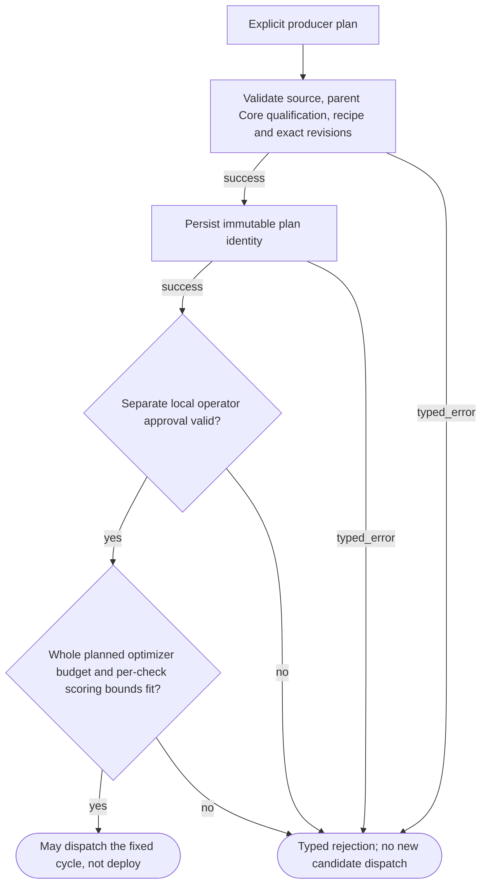
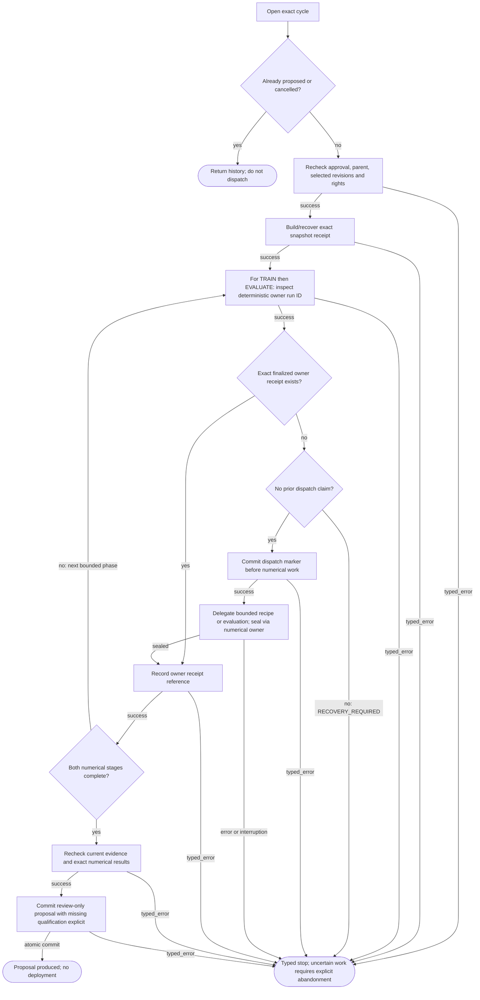
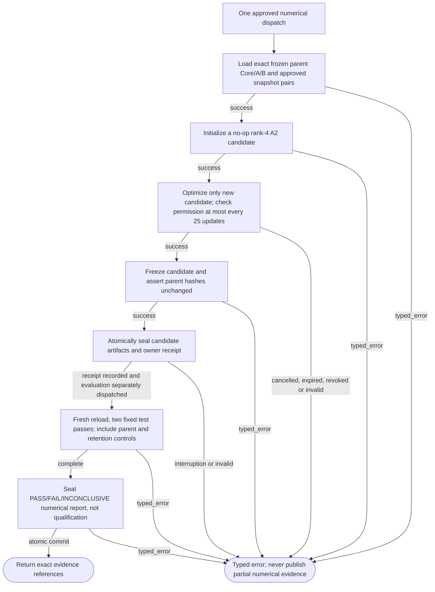

# BoundedLearnerCoordinator001 logic

Fixed local workflow through proposal. Dataset/candidate/evaluation owners stay authoritative; partial or unsupported acceptance fails closed.

## Pin and approve one bounded learning plan

**ID:** `learner_admission`  
**Owner:** LearnerCoordinator via LearningCycles and existing public data/numerical owners  
**Status:** canonical; implementation: `partial-simulator`  
**Purpose:** Pin and approve one bounded learning plan

**Inputs:** Exact LearningPlan, reviewed source revisions and parent Core evidence; Scoped local operator attestation; bounded installed recipe
**Outputs:** Immutable owner receipt references or typed stop; Review-only proposal: unsupported new qualification remains INSUFFICIENT_EVIDENCE
**Structural metrics:** 7 nodes; 9 transitions; normalized complexity 5. Not runtime proof.

### Flowchart



### Pseudocode

```text
PLAN = TRY(VALIDATE_EXACT_PLAN(user_supplied_plan))
TRY(RECHECK_PARENT_CORE_QUALIFICATION_AND_ARCHIVE(PLAN))
TRY(PERSIST_PLAN_WITHOUT_CHANGING_OTHER_OWNERS(PLAN))
approval = AUTHORIZE_LOCAL_TRAINING_ONLY(PLAN.hash, separate_actor, expiry)
REQUIRE(approval is current and one-attempt budget fits, AUTHORIZATION_DENIED or BUDGET_EXHAUSTED)
return RESULT(SUCCESS, permission_to_attempt_fixed_local_recipe) # NOT a Runtime or deployment permit
```

### Invariants

- Exact parent Core/A/B weights remain unchanged.
- Only one explicitly claimed training attempt per approved plan.
- Dataset and report owners remain canonical; coordinator stores references.
- Withdrawal/cancellation/expiry block new work; history is not renewed permission.
- Fixed candidate scoring repeats are separate from parent-evidence/current-use verification; no total-energy claim.
- A2/A2B acceptance and deployment are not implemented.

### Typed failures

- AUTHORIZATION_DENIED
- BUDGET_EXHAUSTED
- CAPABILITY_UNAVAILABLE
- CONFLICT_REQUIRES_REVIEW
- CONSTRAINT_CONFLICT
- INCOMPATIBLE_CONFIGURATION
- INSUFFICIENT_EVIDENCE
- INTERNAL_FAILURE
- RECOVERY_REQUIRED
- RETENTION_RESTRICTED
- TRAINING_RESTRICTED
- VALIDATION_FAILED

### Forbidden edges

- Learner -> qualification decision or release publication
- Context packet -> training permission
- Coordinator -> neighbor private SQL
- Unfinished dispatch -> automatic repeat training

### Optimization notes

- Reuse existing numerical and event journal mechanics.
- No copied dataset bodies or second active-generation pointer.
- Check eligibility before costly work; never cache a permission grant.

## Execute, reconcile, and propose without self-promotion

**ID:** `learner_cycle`  
**Owner:** LearnerCoordinator via LearningCycles and existing public data/numerical owners  
**Status:** canonical; implementation: `partial-simulator`  
**Purpose:** Execute, reconcile, and propose without self-promotion

**Inputs:** Exact LearningPlan, reviewed source revisions and parent Core evidence; Scoped local operator attestation; bounded installed recipe
**Outputs:** Immutable owner receipt references or typed stop; Review-only proposal: unsupported new qualification remains INSUFFICIENT_EVIDENCE
**Structural metrics:** 16 nodes; 25 transitions; normalized complexity 13. Not runtime proof.

### Flowchart



### Pseudocode

```text
if TERMINAL(cycle): return HISTORY(cycle) # no new permission
TRY(APPROVAL_AND_SOURCE_GATES(cycle))
snapshot = TRY(DATASET_OWNER.BUILD_OR_RECOVER_EXACT_RECEIPT())
for phase in [TRAIN, EVALUATE]:
  prior = NUMERICAL_OWNER.INSPECT(exact_operation_id)
  if prior is finalized: REQUIRE(exact_plan_and_receipt_match, VALIDATION_FAILED)
  else:
    REQUIRE(no earlier dispatch marker, RECOVERY_REQUIRED)
    TRY(COMMIT_DISPATCH_MARKER(phase))
    prior = TRY(DELEGATE_INSTALLED_BOUNDED_OPERATION(phase))
  TRY(RECORD_REFERENCE(prior.receipt))
TRY(CURRENT_EVIDENCE_AND_EXACT_NUMERICAL_RECHECK())
return ATOMIC_PROPOSAL(numerical_verdict, qualification=INSUFFICIENT_EVIDENCE, authority=NONE)
# Unfinished dispatch is not automatically re-executed. Operator may abandon and approve a new plan.
```

### Invariants

- Exact parent Core/A/B weights remain unchanged.
- Only one explicitly claimed training attempt per approved plan.
- Dataset and report owners remain canonical; coordinator stores references.
- Withdrawal/cancellation/expiry block new work; history is not renewed permission.
- Fixed candidate scoring repeats are separate from parent-evidence/current-use verification; no total-energy claim.
- A2/A2B acceptance and deployment are not implemented.

### Typed failures

- AUTHORIZATION_DENIED
- BUDGET_EXHAUSTED
- CAPABILITY_UNAVAILABLE
- CONFLICT_REQUIRES_REVIEW
- CONSTRAINT_CONFLICT
- INCOMPATIBLE_CONFIGURATION
- INSUFFICIENT_EVIDENCE
- INTERNAL_FAILURE
- RECOVERY_REQUIRED
- RETENTION_RESTRICTED
- TRAINING_RESTRICTED
- VALIDATION_FAILED

### Forbidden edges

- Learner -> qualification decision or release publication
- Context packet -> training permission
- Coordinator -> neighbor private SQL
- Unfinished dispatch -> automatic repeat training

### Optimization notes

- Reuse existing numerical and event journal mechanics.
- No copied dataset bodies or second active-generation pointer.
- Check eligibility before costly work; never cache a permission grant.

## Train only a new overlay and score its sealed checkpoints

**ID:** `learner_recipe`  
**Owner:** LearnerCoordinator via LearningCycles and existing public data/numerical owners  
**Status:** canonical; implementation: `partial-simulator`  
**Purpose:** Train only a new overlay and score its sealed checkpoints

**Inputs:** Exact LearningPlan, reviewed source revisions and parent Core evidence; Scoped local operator attestation; bounded installed recipe
**Outputs:** Immutable owner receipt references or typed stop; Review-only proposal: unsupported new qualification remains INSUFFICIENT_EVIDENCE
**Structural metrics:** 10 nodes; 15 transitions; normalized complexity 8. Not runtime proof.

### Flowchart



### Pseudocode

```text
core, A, B = TRY(LOAD_EXACT_FROZEN_PARENT_ARTIFACTS())
data = TRY(SNAPSHOT_OWNER.READ_CURRENT_TRAINING_PURPOSE())
candidate = INIT_ZERO_CONTRIBUTION_OVERLAY(rank=4)
REQUIRE(BASE_PLUS_BLANK_EQUALS_BASE, VALIDATION_FAILED)
FIT(candidate.parameters_only, frozen_core, data, approved_steps, live_gates)
REQUIRE(parent_hashes_unchanged, VALIDATION_FAILED)
TRY(NUMERICAL_OWNER.SEAL(candidate, training_report))
for repeat in fixed_two_passes: metrics = SCORE_RELOADED_CHECKPOINTS_ON_DECLARED_TEST_COMBINATIONS()
return NUMERICAL_OWNER.SEAL_EVALUATION(metrics, fixed_criteria, authority=NONE)
# Entirely optional CPU PyTorch toy recipe, not a learned evaluator or packed ternary backend.
```

### Invariants

- Exact parent Core/A/B weights remain unchanged.
- Only one explicitly claimed training attempt per approved plan.
- Dataset and report owners remain canonical; coordinator stores references.
- Withdrawal/cancellation/expiry block new work; history is not renewed permission.
- Fixed candidate scoring repeats are separate from parent-evidence/current-use verification; no total-energy claim.
- A2/A2B acceptance and deployment are not implemented.

### Typed failures

- AUTHORIZATION_DENIED
- BUDGET_EXHAUSTED
- CAPABILITY_UNAVAILABLE
- CONFLICT_REQUIRES_REVIEW
- CONSTRAINT_CONFLICT
- INCOMPATIBLE_CONFIGURATION
- INSUFFICIENT_EVIDENCE
- INTERNAL_FAILURE
- RECOVERY_REQUIRED
- RETENTION_RESTRICTED
- TRAINING_RESTRICTED
- VALIDATION_FAILED

### Forbidden edges

- Learner -> qualification decision or release publication
- Context packet -> training permission
- Coordinator -> neighbor private SQL
- Unfinished dispatch -> automatic repeat training

### Optimization notes

- Reuse existing numerical and event journal mechanics.
- No copied dataset bodies or second active-generation pointer.
- Check eligibility before costly work; never cache a permission grant.
