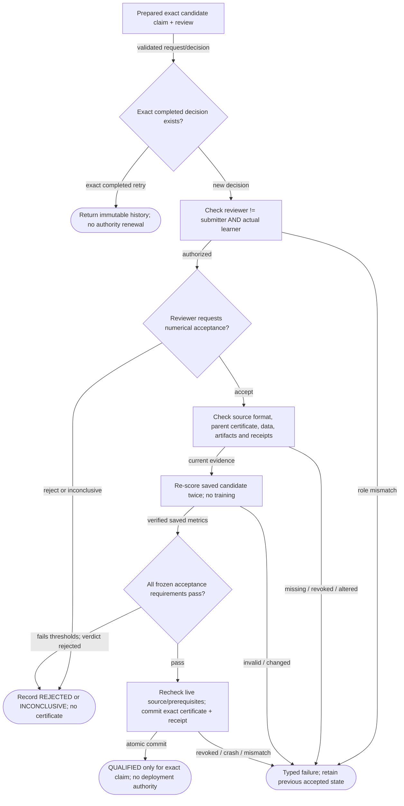
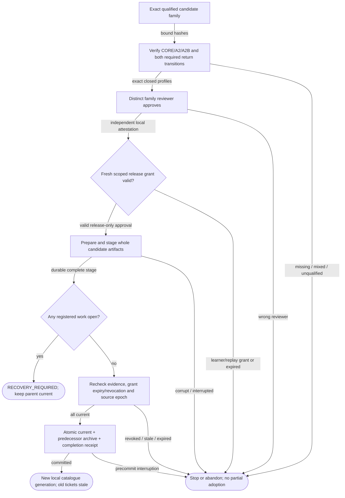
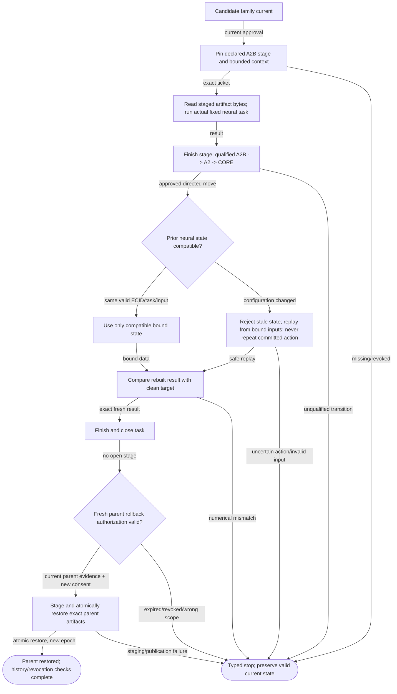

# CandidateAcceptance001 — bounded integrated acceptance logic

A separate installed candidate-evidence adapter closes the local human-assisted learning/adoption/rollback loop. Roles remain attestations; no self-approval, native Runtime permit, generic neural-state migration or production authority.

## Candidate evidence and independent local qualification

**ID:** `candidate_evidence`  
**Owner:** CandidateEvidence resolves numerical lineage; Qualifications owns review/certificates  
**Status:** canonical; implementation: `partial-simulator`  
**Purpose:** Accept exact new candidate format without widening legacy probe claims or treating a score as release permission.

**Inputs:** Exact existing public-owner references; Bound candidate/source hashes; Declared local reviewer/caller and explicit operation
**Outputs:** Bounded certificate or REJECTED/INCONCLUSIVE history; Typed failure
**Structural metrics:** 12 nodes; 15 transitions; normalized complexity 8. Not runtime proof.

### Flowchart



### Pseudocode

```text
VALIDATE(exact source format and claim; A2 != legacy A)
if identical completed decision: RESULT(history_only)
AUTHORIZE(reviewer not submitter AND not bound learning producer)
TRY(CHECK_PARENT_CERTIFICATE_AND_CURRENT_DATA())
if reviewer rejects or abstains: COMMIT(no_certificate); RESULT(review_status)
TRY(RELOAD_AND_EXACTLY_RECHECK_TWO_SAVED_EVALUATION_REPEATS())
if threshold failure: COMMIT(REJECTED, no_certificate)
else: RECHECK(live source, parent and local prerequisites); ATOMIC_PUBLISH(exact_certificate, receipt)
Never grant deployment authority from an evaluation or qualification result.
```

### Invariants

- New artifacts retain A2/A2B names, full candidate/parent lineage and code/environment identity.
- Parent Core approval is checked separately; it cannot substitute for candidate-family Core-only qualification.
- Actual learner producer cannot qualify itself through a different submitter label.
- Historical receipts remain readable after revocation; current use rechecks rights.

### Typed failures

- AUTHORIZATION_DENIED
- CONSTRAINT_CONFLICT
- INCOMPATIBLE_CONFIGURATION
- INSUFFICIENT_EVIDENCE
- VALIDATION_FAILED
- TRAINING_RESTRICTED
- RECOVERY_REQUIRED
- BUDGET_EXHAUSTED

### Forbidden edges

- Learner -> qualification certificate write
- CandidateEvidence -> qualification or generation private storage
- Candidate PASS -> deployment
- Candidate A2 -> legacy A relabel

### Optimization notes

- Reuse owner journal, checks and typed outcomes; no new database.
- Recheck mutable rights before current use. Immutable identity alone is not permission.
- Control cases share fixtures; unique crash/failure behavior remains tested.

## Whole candidate family adoption

**ID:** `candidate_adoption`  
**Owner:** Generations owns membership, release grant, staging and current/archive pointer  
**Status:** canonical; implementation: `partial-simulator`  
**Purpose:** Adopt only a currently qualified exact candidate family with fresh, separate release consent.

**Inputs:** Exact existing public-owner references; Bound candidate/source hashes; Declared local reviewer/caller and explicit operation
**Outputs:** Exact local publication receipt; Source-preserving typed failure
**Structural metrics:** 11 nodes; 15 transitions; normalized complexity 8. Not runtime proof.

### Flowchart



### Pseudocode

```text
TRY(REQUIRE_EXACT_CANDIDATE_FAMILY_AND_QUALIFIED_CORE_ONLY())
AUTHORIZE(distinct_generation_reviewer)
AUTHORIZE(fresh_release_request, exact_source_epoch, exact_target, caller, expiry)
PREPARE_AND_STAGE_THROUGH_EXISTING_GENERATIONS_OWNER()
REQUIRE(no_open_registered_stage, RECOVERY_REQUIRED)
TRY(RECHECK_PARENT_AND_CANDIDATE_EVIDENCE_DATA_AND_RELEASE())
ATOMIC_PUBLISH(current_target, archived_parent, completion_receipt)
if exact completed retry: return historical receipt WITHOUT republish
```

### Invariants

- Only source-format-specific family membership is allowed; every family includes Core-only and qualified returns.
- Publication changes one existing owner transaction, not a second current pointer.
- Training approval and replay grants never authorize generation adoption.

### Typed failures

- AUTHORIZATION_DENIED
- CONSTRAINT_CONFLICT
- INCOMPATIBLE_CONFIGURATION
- INSUFFICIENT_EVIDENCE
- VALIDATION_FAILED
- TRAINING_RESTRICTED
- RECOVERY_REQUIRED
- BUDGET_EXHAUSTED

### Forbidden edges

- Trainer -> publish generation
- Qualification -> release grant
- Old grant -> different target/source
- Unfinished stage -> generation switch

### Optimization notes

- Reuse owner journal, checks and typed outcomes; no new database.
- Recheck mutable rights before current use. Immutable identity alone is not permission.
- Control cases share fixtures; unique crash/failure behavior remains tested.

## Candidate task, Core-only return and approved rollback

**ID:** `candidate_task_rollback`  
**Owner:** CatalogController / TaskRecord / Generations; candidate session only performs bounded numerical work  
**Status:** canonical; implementation: `partial-simulator`  
**Purpose:** Execute the staged new family; preserve task identity; return safely; rollback with new consent.

**Inputs:** Exact existing public-owner references; Bound candidate/source hashes; Declared local reviewer/caller and explicit operation
**Outputs:** Finished candidate task and exact parent rollback; Typed stop
**Structural metrics:** 13 nodes; 18 transitions; normalized complexity 8. Not runtime proof.

### Flowchart



### Pseudocode

```text
PIN(exact_generation_epoch, profile, task, input_hash)
READ_STAGED_ARTIFACTS(); RUN_BOUNDED_CANDIDATE()
FINISH_STAGE(); REQUIRE(qualified_directed_transition)
if neural identity differs: REJECT_CACHE(); REPLAY_SAFE(bound_inputs, committed_receipts)
REQUIRE(rebuilt == fresh_target, VALIDATION_FAILED)
RETURN_TO_CORE_ONLY(); FINISH_AND_CLOSE_TASK()
AUTHORIZE(fresh_parent_rollback_request); STAGE(); ATOMIC_PUBLISH(parent_at_new_epoch)
AUDIT(history != renewed permission, revoked_prerequisite_blocks_use, mock_effect_count == 1)
```

### Invariants

- No arbitrary cache migration, reverse transitions or broadened task claims.
- Rollback restores parent artifact identity, not the old epoch or external world.
- Old publish receipt never republishes or executes a task.
- Original parent report and accepted Core/A/B stay unchanged.

### Typed failures

- AUTHORIZATION_DENIED
- CONSTRAINT_CONFLICT
- INCOMPATIBLE_CONFIGURATION
- INSUFFICIENT_EVIDENCE
- VALIDATION_FAILED
- TRAINING_RESTRICTED
- RECOVERY_REQUIRED
- BUDGET_EXHAUSTED

### Forbidden edges

- Rollback -> repeat committed external effect
- Closed task -> hidden reverse transition
- Historical candidate receipt -> new authorization

### Optimization notes

- Reuse owner journal, checks and typed outcomes; no new database.
- Recheck mutable rights before current use. Immutable identity alone is not permission.
- Control cases share fixtures; unique crash/failure behavior remains tested.
