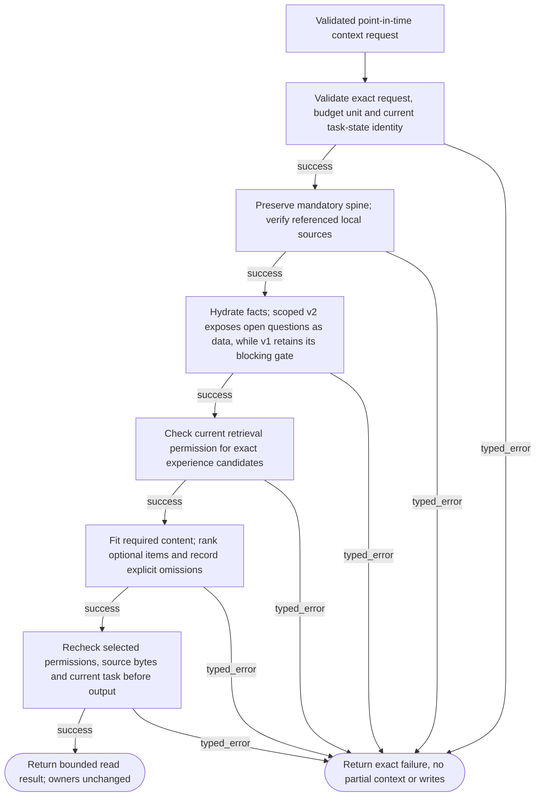
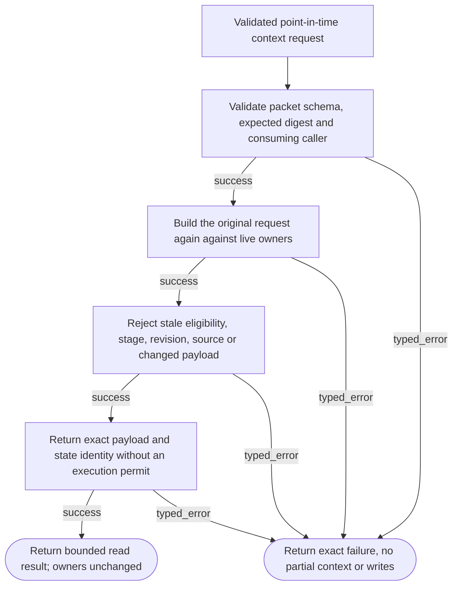
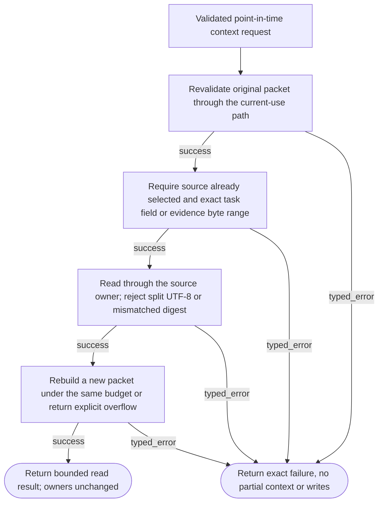

# ContextRetrieval001 — software context logic

Three read-only helpers of the existing context contract. Exact source-aware packets use a canonical-JSON byte budget. Native HSA/MSA, learned retrieval, tokenization and task mutation remain absent.

## Assemble a current bounded context packet

**ID:** `context_build`  
**Owner:** ContextService via existing task and archive owners  
**Status:** canonical; implementation: `partial-simulator`  
**Purpose:** Assemble a current bounded context packet

**Inputs:** Exact current TaskRecord/ticket and explicit selectors; Pinned archive refs and canonical-JSON byte budget
**Outputs:** Bounded context packet or precise typed inability; no permission or publication
**Structural metrics:** 9 nodes; 13 transitions; normalized complexity 7. Not runtime proof.

### Flowchart



### Pseudocode

```text
function BUILD_CONTEXT(request):
  request = TRY(VALIDATE_EXACT_SCHEMA_AND_BYTE_BOUNDS(request))
  view = TRY(TASK_OWNER.READ_CURRENT(request.ticket, request.record_hash))
  REQUIRE(view.identity == request.expected_identity, INCOMPATIBLE_CONFIGURATION)
  payload = COPY_MANDATORY_TASK_SPINE(view.record)
  TRY(HYDRATE_EXACT_REQUIRED_FACTS(payload, request))
  candidates = TRY(ARCHIVE_CURRENT_RETRIEVAL_VIEWS(request.references))
  REQUIRE(MANDATORY_FITS(payload, candidates), BUDGET_EXHAUSTED)
  payload = ADD_OPTIONAL_WITHIN_BUDGET(payload, explicit_ids, lexical_rank)
  TRY(RECHECK_SELECTED_PERMISSIONS_SOURCES_AND_TASK())
  return SEALED_READ_PACKET(payload, omissions, byte_accounting)
  # Optional denial is an omission; required denial returns no packet.
  # This software policy is not HSA/MSA or learned retrieval.
  # v2 includes scoped persistent state under payload.task as mandatory data, not instruction.
  # Open v2 questions stay visible for clarification; moving downstream still enforces resolution/deferral.
```

### Invariants

- One existing owner for task/current identity; no new database.
- Mandatory task spine and required evidence cannot be summarized away.
- Byte budgets do not claim tokenizer or native attention capacity.
- Raw evidence retrieval uses current reviewed-purpose permissions, not history inspection.
- Returned bytes have point-in-time validity, not a lease or revocable export.
- No external actions, new training, record mutation or profile change during context reads.

### Typed failures

- AUTHORIZATION_DENIED
- BUDGET_EXHAUSTED
- CONFLICT_REQUIRES_REVIEW
- CONSTRAINT_CONFLICT
- INCOMPATIBLE_CONFIGURATION
- INSUFFICIENT_EVIDENCE
- INTERNAL_FAILURE
- NEEDS_CLARIFICATION
- RECOVERY_REQUIRED
- RETENTION_RESTRICTED
- TRAINING_RESTRICTED
- VALIDATION_FAILED

### Forbidden edges

- Context -> Neighbor private SQL or direct record update
- Context -> Training or deployment authority
- Administrative source inspection -> Downstream retrieval use
- Source data -> Control instruction or authorization
- Bounded JSON bytes -> Claimed neural token/energy efficiency

### Optimization notes

- Read each local source once per assembly plus integrity recheck.
- No persistent permission cache or second task-head journal.
- Bound candidate arrays; deterministic greedy selection is not a global optimality claim.
- Reuse existing schema and flow rendering tooling.

## Revalidate a saved packet before current use

**ID:** `context_consume`  
**Owner:** ContextService via existing task and archive owners  
**Status:** canonical; implementation: `partial-simulator`  
**Purpose:** Revalidate a saved packet before current use

**Inputs:** Exact current TaskRecord/ticket and explicit selectors; Pinned archive refs and canonical-JSON byte budget
**Outputs:** Bounded context packet or precise typed inability; no permission or publication
**Structural metrics:** 7 nodes; 9 transitions; normalized complexity 5. Not runtime proof.

### Flowchart



### Pseudocode

```text
function CONSUME_CONTEXT(packet, caller, expected_hash):
  TRY(VALIDATE(packet)); REQUIRE(HASH(packet)==expected_hash, VALIDATION_FAILED)
  REQUIRE(caller==packet.request.caller, AUTHORIZATION_DENIED)
  current = TRY(BUILD_CONTEXT(packet.request))
  REQUIRE(current==packet, INCOMPATIBLE_CONFIGURATION)
  return RESULT(SUCCESS, current.payload)
  # No historical receipt can renew source or stage permission.
```

### Invariants

- One existing owner for task/current identity; no new database.
- Mandatory task spine and required evidence cannot be summarized away.
- Byte budgets do not claim tokenizer or native attention capacity.
- Raw evidence retrieval uses current reviewed-purpose permissions, not history inspection.
- Returned bytes have point-in-time validity, not a lease or revocable export.
- No external actions, new training, record mutation or profile change during context reads.

### Typed failures

- AUTHORIZATION_DENIED
- BUDGET_EXHAUSTED
- CONFLICT_REQUIRES_REVIEW
- CONSTRAINT_CONFLICT
- INCOMPATIBLE_CONFIGURATION
- INSUFFICIENT_EVIDENCE
- INTERNAL_FAILURE
- NEEDS_CLARIFICATION
- RECOVERY_REQUIRED
- RETENTION_RESTRICTED
- TRAINING_RESTRICTED
- VALIDATION_FAILED

### Forbidden edges

- Context -> Neighbor private SQL or direct record update
- Context -> Training or deployment authority
- Administrative source inspection -> Downstream retrieval use
- Source data -> Control instruction or authorization
- Bounded JSON bytes -> Claimed neural token/energy efficiency

### Optimization notes

- Read each local source once per assembly plus integrity recheck.
- No persistent permission cache or second task-head journal.
- Bound candidate arrays; deterministic greedy selection is not a global optimality claim.
- Reuse existing schema and flow rendering tooling.

## Expand an exact selected source reference

**ID:** `context_rehydrate`  
**Owner:** ContextService via existing task and archive owners  
**Status:** canonical; implementation: `partial-simulator`  
**Purpose:** Expand an exact selected source reference

**Inputs:** Exact current TaskRecord/ticket and explicit selectors; Pinned archive refs and canonical-JSON byte budget
**Outputs:** Bounded context packet or precise typed inability; no permission or publication
**Structural metrics:** 7 nodes; 9 transitions; normalized complexity 5. Not runtime proof.

### Flowchart



### Pseudocode

```text
function REHYDRATE_CONTEXT(packet, exact_selector):
  TRY(CONSUME_CONTEXT(packet))
  REQUIRE(SELECTOR_REFERENCES_SELECTED_SOURCE(exact_selector), INSUFFICIENT_EVIDENCE)
  request = COPY(packet.request); ADD_REQUIRED_EXACT_SELECTOR(request, exact_selector)
  return TRY(BUILD_CONTEXT(request))
  # No silent truncation, summary, auto-decomposition or change to TaskRecord.
  # Permission revocation blocks the new read; already exported bytes cannot be recalled.
```

### Invariants

- One existing owner for task/current identity; no new database.
- Mandatory task spine and required evidence cannot be summarized away.
- Byte budgets do not claim tokenizer or native attention capacity.
- Raw evidence retrieval uses current reviewed-purpose permissions, not history inspection.
- Returned bytes have point-in-time validity, not a lease or revocable export.
- No external actions, new training, record mutation or profile change during context reads.

### Typed failures

- AUTHORIZATION_DENIED
- BUDGET_EXHAUSTED
- CONFLICT_REQUIRES_REVIEW
- CONSTRAINT_CONFLICT
- INCOMPATIBLE_CONFIGURATION
- INSUFFICIENT_EVIDENCE
- INTERNAL_FAILURE
- NEEDS_CLARIFICATION
- RECOVERY_REQUIRED
- RETENTION_RESTRICTED
- TRAINING_RESTRICTED
- VALIDATION_FAILED

### Forbidden edges

- Context -> Neighbor private SQL or direct record update
- Context -> Training or deployment authority
- Administrative source inspection -> Downstream retrieval use
- Source data -> Control instruction or authorization
- Bounded JSON bytes -> Claimed neural token/energy efficiency

### Optimization notes

- Read each local source once per assembly plus integrity recheck.
- No persistent permission cache or second task-head journal.
- Bound candidate arrays; deterministic greedy selection is not a global optimality claim.
- Reuse existing schema and flow rendering tooling.
