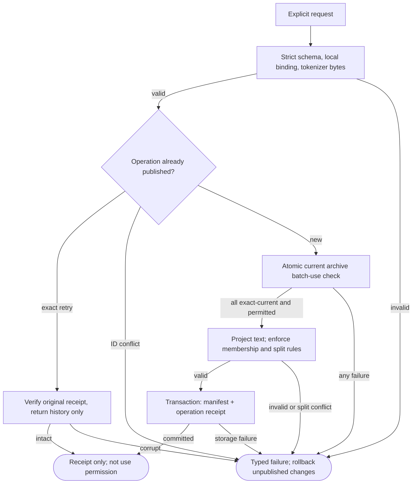
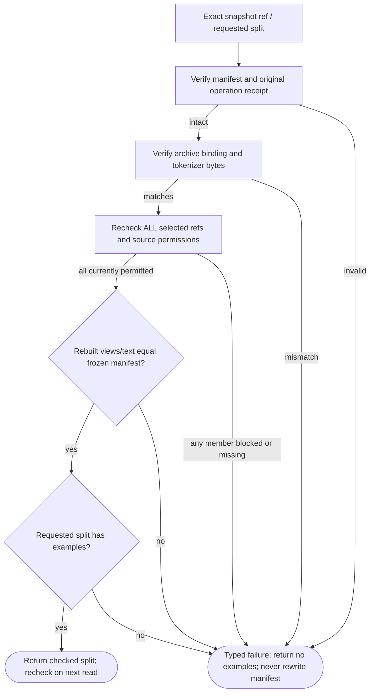

# DatasetSnapshot001 — implementation logic

Two helpers of the existing Builder/Dataset Curator and Experience Archive. These graphs describe software contracts, not learned curation or release authorization.

## DatasetSnapshot001 — build / historical retry

**ID:** `dataset_snapshot_build`  
**Owner:** dataset_store (archive checks delegated to public experience_store methods)  
**Status:** canonical local helper; authenticated authority and neural learning deferred; implementation: `partial-simulator`  
**Purpose:** Bounded DatasetSnapshot001 helper inside Builder/Dataset Curator, not another cognitive system.

**Inputs:** Exact versioned request/snapshot ref; Bound archive; Pinned tokenizer artifact
**Outputs:** Snapshot receipt or permitted examples; Typed non-success with no partial output
**Structural metrics:** 9 nodes; 14 transitions; normalized complexity 8. Not runtime proof.

### Flowchart



### Pseudocode

```text
BUILD(request): normalize; verify local archive binding and actual tokenizer bytes
  if exact prior operation: return verified historical receipt, not examples
  TRY(archive.read_batch_for_use(exact_references, training))
  TRY(project_and_validate_membership_and_splits())
  TRY(ATOMIC_PUBLISH(manifest, operation_receipt))
  return RESULT(SUCCESS, immutable_snapshot_reference)
  on failure: return RESULT(original_code); no partial snapshot
```

### Invariants

- Exact immutable membership and sources
- All selected revisions/purposes checked; no silent subset
- No training, external actions or automatic review

### Typed failures

- AUTHORIZATION_DENIED
- BUDGET_EXHAUSTED
- CONFLICT_REQUIRES_REVIEW
- CONSTRAINT_CONFLICT
- INCOMPATIBLE_CONFIGURATION
- INSUFFICIENT_EVIDENCE
- INTERNAL_FAILURE
- RECOVERY_REQUIRED
- RETENTION_RESTRICTED
- TRAINING_RESTRICTED
- VALIDATION_FAILED

### Forbidden edges

- Snapshot -> Archive private SQL
- Snapshot -> Runtime checkpoint mutation
- Receipt -> Automatic training grant

### Optimization notes

- Deterministic text projection; no custom executable transforms.
- Archive batch consistency is point-in-time, not a cross-store lease.

## DatasetSnapshot001 — current-use gate

**ID:** `dataset_snapshot_read`  
**Owner:** dataset_store (archive checks delegated to public experience_store methods)  
**Status:** canonical local helper; authenticated authority and neural learning deferred; implementation: `partial-simulator`  
**Purpose:** Bounded DatasetSnapshot001 helper inside Builder/Dataset Curator, not another cognitive system.

**Inputs:** Exact versioned request/snapshot ref; Bound archive; Pinned tokenizer artifact
**Outputs:** Snapshot receipt or permitted examples; Typed non-success with no partial output
**Structural metrics:** 8 nodes; 11 transitions; normalized complexity 6. Not runtime proof.

### Flowchart



### Pseudocode

```text
READ(snapshot, expected_hash, split, tokenizer):
  TRY(verify exact immutable manifest and operation receipt)
  TRY(verify archive identity and tokenizer bytes)
  TRY(archive.read_batch_for_use(ALL manifest references, training))
  REQUIRE(rederived manifest equals stored manifest, VALIDATION_FAILED)
  REQUIRE(requested split has members, INSUFFICIENT_EVIDENCE)
  return RESULT(SUCCESS, examples with lineage; point-in-time gate only)
  on failure: return RESULT(original_code); no partial output or silent membership rewrite
```

### Invariants

- Exact immutable membership and sources
- All selected revisions/purposes checked; no silent subset
- No training, external actions or automatic review

### Typed failures

- AUTHORIZATION_DENIED
- BUDGET_EXHAUSTED
- CONFLICT_REQUIRES_REVIEW
- CONSTRAINT_CONFLICT
- INCOMPATIBLE_CONFIGURATION
- INSUFFICIENT_EVIDENCE
- INTERNAL_FAILURE
- RECOVERY_REQUIRED
- RETENTION_RESTRICTED
- TRAINING_RESTRICTED
- VALIDATION_FAILED

### Forbidden edges

- Snapshot -> Archive private SQL
- Snapshot -> Runtime checkpoint mutation
- Receipt -> Automatic training grant

### Optimization notes

- Deterministic text projection; no custom executable transforms.
- Archive batch consistency is point-in-time, not a cross-store lease.
