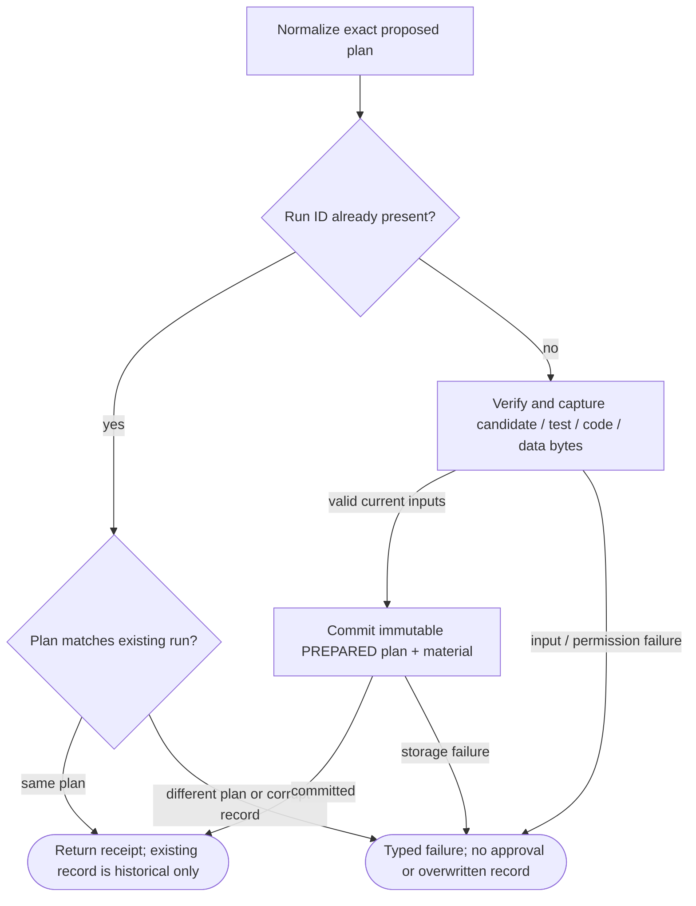
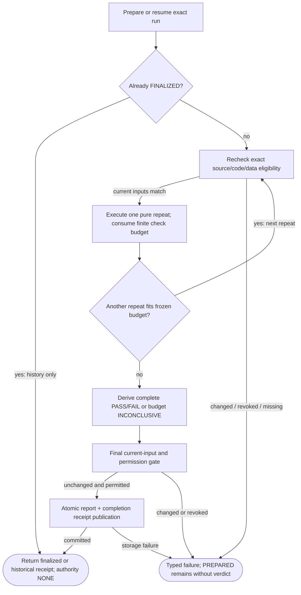
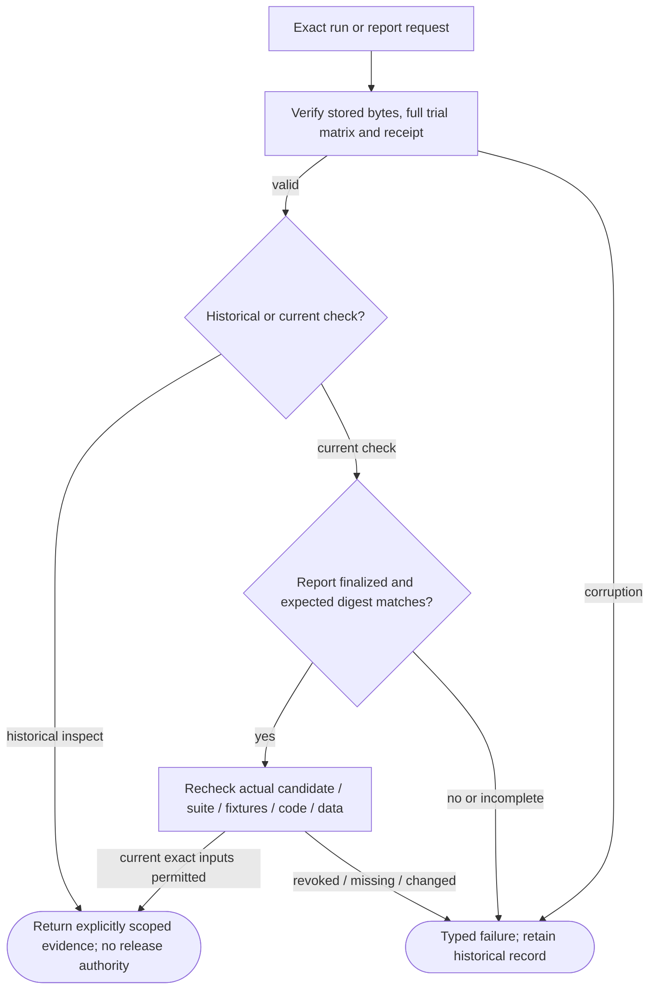

# EvaluationRun001 — pseudocode implementation flows

Three helpers under the existing evaluation/qualification boundary. A completed development evaluation is NOT qualification or deployment permission. A successful operation may return a FAIL or INCONCLUSIVE evaluation verdict.

## EvaluationRun001 — exact plan and preparation

**ID:** `evaluation_prepare`  
**Owner:** evaluation_store (public source gates in evaluation_inputs)  
**Status:** local synthetic integer protocol only; implementation: `partial-simulator`  
**Purpose:** Capture reproducible development observations without granting data reuse or release authority.

**Inputs:** EvaluationPlan / exact report reference; Candidate+suite+fixture bytes; Optional current-use development snapshot adapter
**Outputs:** Prepared/finalized immutable run receipt; Historical report or typed failure; never an approval token
**Structural metrics:** 7 nodes; 9 transitions; normalized complexity 5. Not runtime proof.

### Flowchart



### Pseudocode

```text
function PREPARE(plan):
  VALIDATE(plan); prior = LOOKUP(plan.run_id)
  if prior: REQUIRE(prior.plan == plan, CONSTRAINT_CONFLICT); return HISTORICAL_RECEIPT(prior)
  material = TRY(CAPTURE_EXACT_CURRENT_INPUTS(plan))
  ATOMIC_PUBLISH(PREPARED(plan, material))
  return RESULT(SUCCESS, prepared_receipt_with_no_verdict)
```

### Invariants

- Suite thresholds/test identities are pinned before computation.
- Only pure bounded integer checks can replay.
- Any result says authority NONE.
- Prepared runs have no verdict; finalization publishes report+receipt together.
- A valid report may say PASS, FAIL or INCONCLUSIVE; syscall SUCCESS is not evaluation PASS.

### Typed failures

- AUTHORIZATION_DENIED
- BUDGET_EXHAUSTED
- CAPABILITY_UNAVAILABLE
- CONFLICT_REQUIRES_REVIEW
- CONSTRAINT_CONFLICT
- INCOMPATIBLE_CONFIGURATION
- INSUFFICIENT_EVIDENCE
- INTERNAL_FAILURE
- RECOVERY_REQUIRED
- TRAINING_RESTRICTED
- VALIDATION_FAILED

### Forbidden edges

- Evaluator -> deployment
- Evaluation consumer -> private archive storage
- Stored historical score -> renewed data permission
- Artifact text -> dynamic code execution

### Optimization notes

- Replay bounded pure work instead of retaining half-trusted trial checkpoints.
- Recheck mutable source permissions; do not cache authority.
- One owner for evaluation rows, none for production configuration.

## EvaluationRun001 — bounded repeats and publication

**ID:** `evaluation_execute`  
**Owner:** evaluation_store (public source gates in evaluation_inputs)  
**Status:** local synthetic integer protocol only; implementation: `partial-simulator`  
**Purpose:** Capture reproducible development observations without granting data reuse or release authority.

**Inputs:** EvaluationPlan / exact report reference; Candidate+suite+fixture bytes; Optional current-use development snapshot adapter
**Outputs:** Prepared/finalized immutable run receipt; Historical report or typed failure; never an approval token
**Structural metrics:** 10 nodes; 13 transitions; normalized complexity 6. Not runtime proof.

### Flowchart



### Pseudocode

```text
function EXECUTE(plan):
  receipt = TRY(PREPARE(plan)); if receipt.finalized: return HISTORICAL(receipt)
  for repeat in FINITE_REPEATS(plan):
    REQUIRE(CURRENT_INPUTS_MATCH(), INCOMPATIBLE_CONFIGURATION)
    rows += PURE_CHECKS_WITH_REMAINING_BUDGET(repeat)
  report = DERIVE_VERDICT_AND_VALIDATE_EXACT_TRIAL_MATRIX(rows)
  TRY(RECHECK_INPUTS_AND_PERMISSIONS())
  ATOMIC_PUBLISH(report, exact_completion_receipt)
  return RESULT(SUCCESS, receipt_with_evaluation_verdict_and_no_authority)
```

### Invariants

- Suite thresholds/test identities are pinned before computation.
- Only pure bounded integer checks can replay.
- Any result says authority NONE.
- Prepared runs have no verdict; finalization publishes report+receipt together.
- A valid report may say PASS, FAIL or INCONCLUSIVE; syscall SUCCESS is not evaluation PASS.

### Typed failures

- AUTHORIZATION_DENIED
- BUDGET_EXHAUSTED
- CAPABILITY_UNAVAILABLE
- CONFLICT_REQUIRES_REVIEW
- CONSTRAINT_CONFLICT
- INCOMPATIBLE_CONFIGURATION
- INSUFFICIENT_EVIDENCE
- INTERNAL_FAILURE
- RECOVERY_REQUIRED
- TRAINING_RESTRICTED
- VALIDATION_FAILED

### Forbidden edges

- Evaluator -> deployment
- Evaluation consumer -> private archive storage
- Stored historical score -> renewed data permission
- Artifact text -> dynamic code execution

### Optimization notes

- Replay bounded pure work instead of retaining half-trusted trial checkpoints.
- Recheck mutable source permissions; do not cache authority.
- One owner for evaluation rows, none for production configuration.

## EvaluationRun001 — historical inspection versus current check

**ID:** `evaluation_current_use`  
**Owner:** evaluation_store (public source gates in evaluation_inputs)  
**Status:** local synthetic integer protocol only; implementation: `partial-simulator`  
**Purpose:** Capture reproducible development observations without granting data reuse or release authority.

**Inputs:** EvaluationPlan / exact report reference; Candidate+suite+fixture bytes; Optional current-use development snapshot adapter
**Outputs:** Prepared/finalized immutable run receipt; Historical report or typed failure; never an approval token
**Structural metrics:** 7 nodes; 9 transitions; normalized complexity 5. Not runtime proof.

### Flowchart



### Pseudocode

```text
function VERIFY_CURRENT(id, expected_report_hash):
  run = TRY(READ_AND_VALIDATE_HISTORY(id))
  REQUIRE(run.finalized, INSUFFICIENT_EVIDENCE)
  REQUIRE(HASH(run.report) == expected_report_hash, CONSTRAINT_CONFLICT)
  TRY(CAPTURE_EXACT_CURRENT_INPUTS(run.plan))
  return RESULT(SUCCESS, point_in_time_check_not_a_permission_lease)
```

### Invariants

- Suite thresholds/test identities are pinned before computation.
- Only pure bounded integer checks can replay.
- Any result says authority NONE.
- Prepared runs have no verdict; finalization publishes report+receipt together.
- A valid report may say PASS, FAIL or INCONCLUSIVE; syscall SUCCESS is not evaluation PASS.

### Typed failures

- AUTHORIZATION_DENIED
- BUDGET_EXHAUSTED
- CAPABILITY_UNAVAILABLE
- CONFLICT_REQUIRES_REVIEW
- CONSTRAINT_CONFLICT
- INCOMPATIBLE_CONFIGURATION
- INSUFFICIENT_EVIDENCE
- INTERNAL_FAILURE
- RECOVERY_REQUIRED
- TRAINING_RESTRICTED
- VALIDATION_FAILED

### Forbidden edges

- Evaluator -> deployment
- Evaluation consumer -> private archive storage
- Stored historical score -> renewed data permission
- Artifact text -> dynamic code execution

### Optimization notes

- Replay bounded pure work instead of retaining half-trusted trial checkpoints.
- Recheck mutable source permissions; do not cache authority.
- One owner for evaluation rows, none for production configuration.
