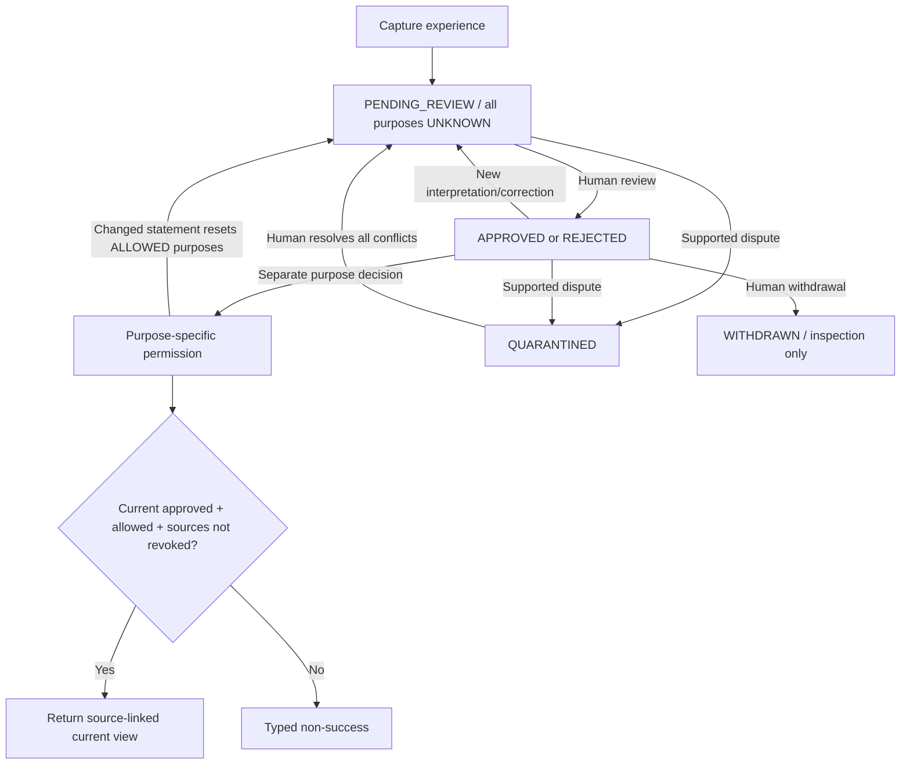

# ExperienceArchive001 — public contract and logic

**Schema v1 · MegaMind Alpha 0.4.3 · local trusted-operator prototype**


## 0.4.4 additive public-interface note
This original archive contract describes the 0.4.3 slice. DatasetSnapshot001 now
consumes it via two additive methods: `binding()` (local location/format identity)
and `read_batch_for_use(references, purpose=...)` (one transaction checking every
exact current revision, review/purpose and source revocation). Its new results also
expose the permission/review observations needed for a fixed manifest.

The earlier indexed-revocation optimization is superseded: v0.4.4 verifies the
complete local revocation ledger and event/index linkage before filtering, once
per batch. A lost/repointed index row cannot hide a withdrawal. See the new
[DatasetSnapshot contract](DATASET_SNAPSHOT_001.md) and its audit. Source/record
schema and database format remain v1; inherited APIs retain their behavior except
that corrupt revocation state now fails closed in more cases. This is not a
portable/authenticated archive identity or a cross-database permission lease.

## 1. What this subsystem owns
The persistent archive owns copied evidence bytes, capture records, interpretation
and correction revisions, review decisions, source/purpose restrictions, operation
receipts and its own current revision pointer. The existing RecoveryStore alone
continues to own active task/configuration state. An archive record is NOT memory
truth, a dataset member, a qualification certificate, or authority to train/release.

`experience_contracts.py` defines pure validation/reduction. `experience_store.py`
is the only archive database owner. `experience_intake.py` connects sealed stages
through public interfaces. `experience_cli.py` is local operator I/O. The demo
module uses fictional fixtures. Generic Aegis Runtime and neural weights are untouched.

## 2. Persistent layout and typed fields
`archive.sqlite3`, format `MegaMindAlpha.ExperienceArchive001`, schema version `1`.
Opening never initializes or repairs a missing/unknown store. Initialization is
explicit and requires an empty/new directory.

| Table | Role |
|---|---|
| `metadata` | Exact format and storage-schema identity |
| `evidence` | SHA-256 -> exact UTF-8 BLOB, content-addressed |
| `records` | Capture identity/body, origin key and current archive revision hash |
| `revisions` | Immutable revision body, parent hash and producing operation ID |
| `operations` | Exact normalized request, request digest, kind and result digest |
| `revocations` | Exact source bytes + purpose -> permanent v1 revocation operation |

Actor = `id`, `kind` (HUMAN/MODEL/SYSTEM/UNKNOWN), `version`. UNKNOWN preserves
missing attribution; it does not guess a person from a role or conversation label.
Evidence = source ID, kind, author, capture/record timestamp, MIME type, exact
content digest, generator/version where applicable, derivation parents, rights note.
SYNTHETIC requires a named generator and valid parents. All source classes are
caller declarations, not automatically detected or proved by hashing.

Capture = version, operation ID, experience ID, actor/time, observation,
source-family ID, sensitivity, evidence, proposed statement. Observation separates
caller-supplied outcome/check references from interpretation. A TASK_STAGE binds
Core generation/hash, profile/ECID, checkpoint hash, portable task-record hash,
stage/task identity and original intake-request hash. It retains exact portable
sources/receipts but does not copy runtime cache or unfinished draft buffers.

Revision = capture hash, monotone revision, parent hash, current source metadata,
statement(kind/author/uncertainty/support/superseded-statement hash), review,
conflicts/resolutions, and four independent purpose decisions. Every revision is
recomputed from its command during integrity checking; a self-consistent hash
alone does not justify an APPROVED state.

The shipped JSON Schemas define shape/bounds. `experience_contracts.py` adds
semantic validation: real UTC dates, source graphs, exact bytes, attribution,
lineage, review transitions and purpose rules. It uses the existing dependency-
free schema validator; there is no network schema resolution. Regenerate schemas
with `python tools/generate_experience_schemas.py`.

## 3. Public API
Each public store method returns:

```text
ArchiveResult {
  status: SUCCESS | typed non-success,
  data: operation-specific data or null,
  detail: explanation,
  replayed: bool,
  historical: bool
}
```

| Operation | Inputs and successful output |
|---|---|
| `ExperienceArchive.create(directory)` | Explicit new store; returns a handle; constructor failures raise ContractError |
| `ExperienceArchive(directory)` | Open existing compatible store; never recreate it implicitly |
| `capture(request)` | Exact CaptureRequest with raw evidence; returns immutable initial view/reference |
| `change(request)` | Exact MutationRequest and expected current hash; returns appended view/reference |
| `revoke_source(request)` | Human-attested source/purpose revocation; returns revocation digest |
| `inspect(id, revision_hash=None)` | Administrative current/history inspection; never grants use |
| `operation_receipt(operation_id)` | Verified historical operation binding or null; never executes anything |
| `history(id)` | Bounded ordered revision references and review statuses |
| `list_records(limit=100, after=None)` | Cursor-style administrative summary; not a training-candidate selector |
| `inspect_source(sha256)` | Administrative exact copied evidence; not a permission bypass for consumers |
| `read_for_use(id, purpose, expected_revision_hash)` | A source-linked view only if CURRENT review/purpose/revocation checks pass |
| `audit()` | Full explicit local storage/hash/reducer/lineage check with counts |
| `capture_stage(archive, bundle, recovery_store, ledger, request=...)` | Explicit one-way capture from exact sealed stage; leaves runtime unchanged |

A view contains `reference = {experience_id, revision, sha256}`, `record`, and
original normalized `capture`. `historical=true` is an inspection result, not a
statement that the old revision is current. `read_for_use` never accepts an old
hash when a different head is current. Every consumer must still recheck source
permissions when acting later; a point-in-time view is not a durable grant.

## 4. Capture preconditions / postconditions / invariants
**Pre:** compatible local store, strictly bounded request, attributable/explicitly
unknown sources, exact source hashes, valid source lineage. Runtime intake also
requires the exact published checkpoint, sealed stage, valid artifact/ECID and
complete verified mock receipts.

**Success post:** evidence/capture/initial operation/revision/head all persist;
initial review is PENDING_REVIEW, every purpose is UNKNOWN. Exact retry returns
the original receipt, even after later reviews, without reapplying it.

**Failure post:** typed outcome, no partial archive publication; runtime checkpoint
and action ledger unchanged. Lost/missing archive data is not silently recreated.

**Invariant:** observation/evidence != interpretation != correction != use permission.
Confidence, sealing, outcome labels and check references do not certify truth.

```text
CAPTURE(command):
  validate schema, bounds, source labels and exact bytes
  normalize evidence to immutable refs
  if exact prior operation: return verified history only
  if ID/origin conflicts: return CONSTRAINT_CONFLICT
  construct PENDING_REVIEW revision with UNKNOWN purpose decisions
  transaction:
    put exact evidence blobs (deduplicate by bytes, not by asserted meaning)
    persist capture + operation + revision
    publish archive head
  return exact initial reference
```

## 5. Human curation state machine

| Operation | Actor requirement | Result |
|---|---|---|
| ANNOTATE | Any valid attributed actor | New interpretation; review and prior allowed uses reset |
| CORRECT | HUMAN | New correction supersedes prior statement hash; original evidence stays |
| DISPUTE | Any valid attributed actor | Named supported conflict; QUARANTINED |
| RESOLVE | HUMAN | Resolution appended; if no open conflicts, PENDING_REVIEW |
| REVIEW | HUMAN | APPROVED or REJECTED, only after open conflicts are resolved |
| PERMISSION | HUMAN + purpose/reference/reason | Independent ALLOWED, DENIED or REVOKED decision |
| WITHDRAW | HUMAN | Terminal inspection-only record; no secure-erasure claim |

**Pre:** exact current revision hash, unique operation ID, compatible schema,
nondecreasing event timestamp, valid actor, and allowed transition.
**Success post:** immutable event + successor revision + archive head commit together.
**Failure post:** old revision remains current; invalid correction cannot leave
new evidence partially committed. A stale reviewer must inspect the new head.
**Invariants:** no silent source edit, no automatic conflict resolution, no
approval-by-confidence, no permissions inheritance from another purpose, no
historical retry that reapplies an obsolete grant.



A correction with an OPEN conflict remains QUARANTINED. Resolving a conflict is
not review approval. DENIED and REVOKED decisions are not silently cleared by a
correction. Revoked record permissions have no regrant path in schema v1.

## 6. Purpose gates and source revocation
Purposes are `memory`, `retrieval`, `training`, `redistribution`. APPROVED review
and ALLOWED for the requested purpose are both required. All source references
in the current record are checked conservatively, not only those quoted in its
latest short statement. Source revocation uses `(sha256, purpose)` and applies to
all linked records, including new captures of those same bytes. It is irreversible
in this version; any restoration semantics need a separately reviewed migration.

A rights note or permission reference is an operator attestation, NOT automatic
license analysis, verified consent or authenticated identity. Sensitive material
still requires appropriate actual authorization before use. The default corpus
here is synthetic software-test data only.

```text
READ_FOR_USE(id, purpose, expected_hash):
  validate purpose and exact-reference syntax
  verify bounded full record lineage and sources
  require expected_hash == current head
  require current status == APPROVED
  require current permission[purpose] == ALLOWED
  require no source-purpose revocation
  return curated statement + observation + exact source refs + revision identity
```

Full administrative history and evidence remain inspectable after withdrawal or
revocation. Those APIs are explicitly NOT downstream data-access authorization.
No remote recall, dataset deletion, unlearning, backup erasure or secure purge is
implemented. Do not represent logical tombstones as physical deletion.

## 7. Integration without shared-state spaghetti
The adapter reads RecoveryStore.current(), validates it and its receipts through
public interfaces, and submits an immutable observation. It does not connect to
the runtime database, revise a task, run an action, or keep a competing task pointer.
A source file is copied only through its admitted relative root, after bounded
reading and hash verification. Missing/changed/out-of-root source returns failure;
no summary is invented as a replacement.

Runtime publication and archive capture are separate transactions. A failed
archive capture does not undo a completed task. There is no automatic outbox or
at-least-once-delivery guarantee. Callers explicitly retry a stable request ID.
An already committed intake receipt is returned on exact retry, even if the task
has advanced or its original file has since disappeared. It never reactivates the
old runtime state. A different request with the same ID is rejected.

## 8. Failure outcomes
| Outcome | Typical cause / required response |
|---|---|
| VALIDATION_FAILED | Invalid schema/bytes/date/lineage; correct input or investigate corruption |
| CONSTRAINT_CONFLICT | Stale head, reused operation, duplicate origin, unsealed stage; reread state |
| CONFLICT_REQUIRES_REVIEW | Pending/rejected/quarantined record; human resolution/review required |
| AUTHORIZATION_DENIED | Consequential edit lacks HUMAN role attestation; no automatic role upgrade |
| TRAINING_RESTRICTED | Any requested purpose lacks permission or is revoked; never guess approval |
| RETENTION_RESTRICTED | Withdrawn record is inspection-only |
| INSUFFICIENT_EVIDENCE | Missing source/record/revision; recover exact evidence or stop |
| INCOMPATIBLE_CONFIGURATION | Store version or referenced runtime artifact changed |
| RECOVERY_REQUIRED | Store missing/not initialized or runtime action state unresolved |
| BUDGET_EXHAUSTED | Revision cap reached; explicit maintenance/migration needed |
| INTERNAL_FAILURE | Storage failure; inspect and retry exact request without assuming publication |

TRAINING_RESTRICTED is the inherited atlas outcome used for all purpose denials;
`purpose` identifies whether this was retrieval, memory, training or redistribution.
The old source's outcome vocabulary was not casually forked for this pass.

## 9. Durability, audit and bounds
SQLite local transactions with `synchronous=FULL`; one trusted operator/runner is
the supported deployment. Tests kill child processes at evidence/revision/head/
precommit/postcommit windows. These tests do not prove power-loss durability on
all filesystems or multi-host concurrency. BEGIN IMMEDIATE and exact head checks
prevent the tested stale-review update; no concurrent scheduler is claimed.

Request <=4 MiB serialized, each source <=1 MiB UTF-8 and 262144 characters;
new request <=32 evidence entries, accumulated record <=64 sources/conflicts,
statement <=8192 characters, history <=512 revisions; administrative list <=1000.
Source lookups for permissions use the indexed current source/purpose set. Full
`audit()` is a deliberate whole-archive operation, not hidden inference work.

The audit verifies SQLite integrity, source bytes, capture identities, event hashes,
contiguous revision lineage, reducer-derived states, current heads, source
revocations and operation/result linkage. It cannot detect every coordinated
rewrite by an attacker owning the database. Local hashes are not signatures.

## 10. Concrete command examples
Store capture and review requests as JSON files so retries reproduce the exact
request. A correction payload is:

```json
{
  "schema_version": 1,
  "operation_id": "correction:example:001",
  "experience_id": "exp1",
  "expected_revision_hash": "COPY_THE_CURRENT_SHA256_FROM_SHOW",
  "actor": {"id": "local:operator", "kind": "HUMAN", "version": "manual-v1"},
  "at": "2026-09-10T12:01:00Z",
  "reason": "The source explicitly gives m/s, not km/h.",
  "action": "CORRECT",
  "payload": {
    "statement": {"text": "The speed is 10 m/s.", "uncertainty": "LOW", "support_ids": ["e1"]},
    "evidence": []
  }
}
```

The hash placeholder must be replaced; it is intentionally not an executable
request. A purpose decision is another mutation with action PERMISSION and payload
`{"purpose":"retrieval","decision":"ALLOWED","permission_ref":"actual-review-reference"}`.
It requires the new current hash and its own operation ID. Do not grant training
merely to make a demonstration print SUCCESS.

## 11. Acceptance coverage and remaining scope
LT-05: source labels, named interpretation, human correction, conflict review,
separate eligibility, synthetic parents, no silent canonicalization — implemented
as software/fixture checks. LT-04: immutable revision and permission-revocation
prerequisites — covered; DatasetSnapshot isolation/consumption not implemented.
LT-06: authenticated host authority/autonomy grants are NOT implemented by role
strings. Core/overlay neural performance, human review quality, RAG recall,
cryptographic provenance and production security remain separate evidence needs.

Next proposed subsystem: fixed dataset snapshots via public permission-checked
references, not direct database reads. Preserve the current architectural boundary.
