# NSS recovery flowcharts

Editable Mermaid sources for the Recovery 001A/001B contract simulator. For the comprehensive build-level subsystem logic, see `PSEUDOCODE_FLOWCHART_ATLAS.md`, generated from `spec/logic_atlas.json`. Render in a Mermaid-capable Markdown viewer. These diagrams include planned systems. 001A implements serialized profile/ECID checks, integer computation/replay, and a single-runner local mock action ledger. 001B adds a durable single-runner recovery-attempt/checkpoint publication boundary. Other system boxes remain planned. External executors, neural operations, multi-runner coordination, and production deployment remain design only.

## System overview

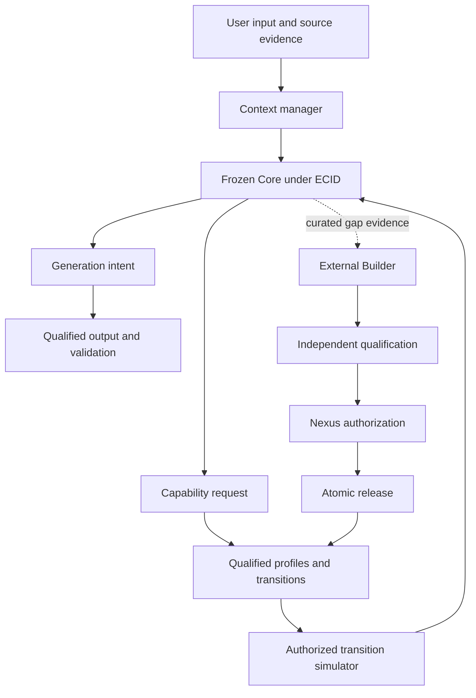

## Core package and runtime

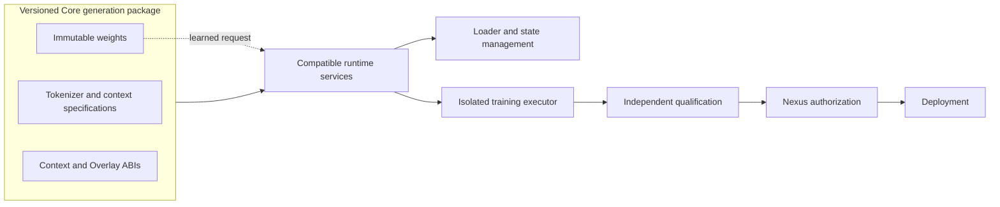

## Profiles and transitions

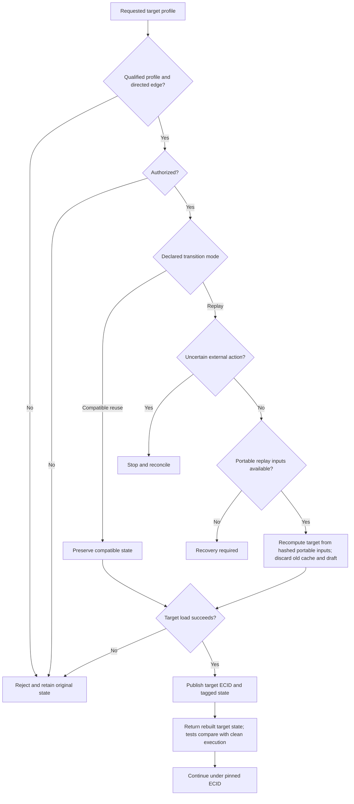

## Context and cognition

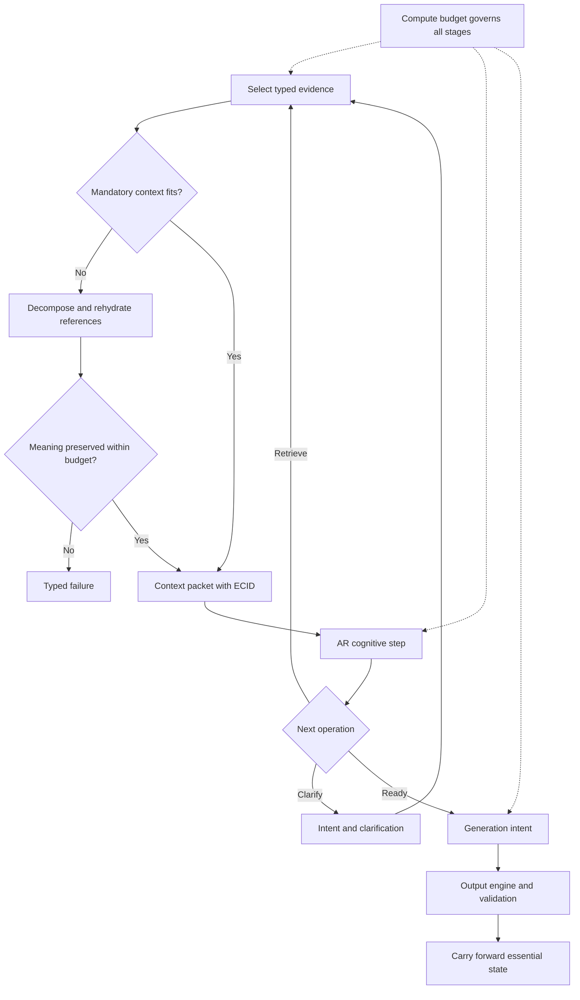

## Memory and learning eligibility

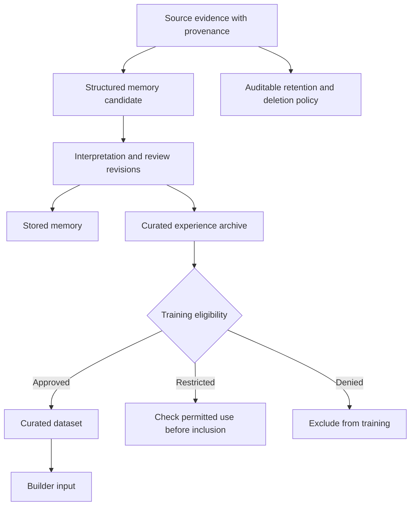

## Training and deployment

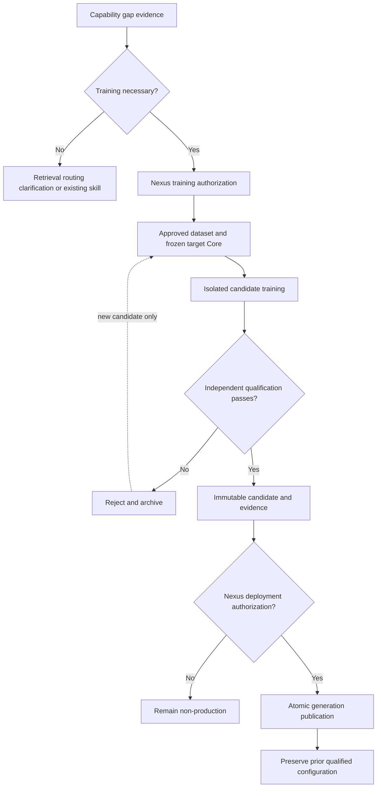

## Output and external action boundaries

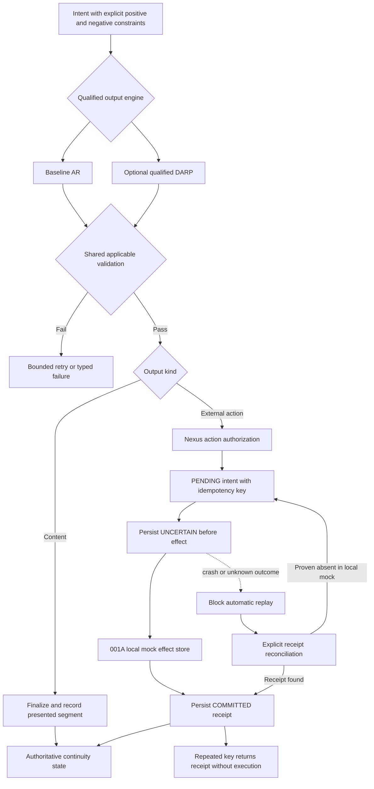

## Rare Core generation upgrade

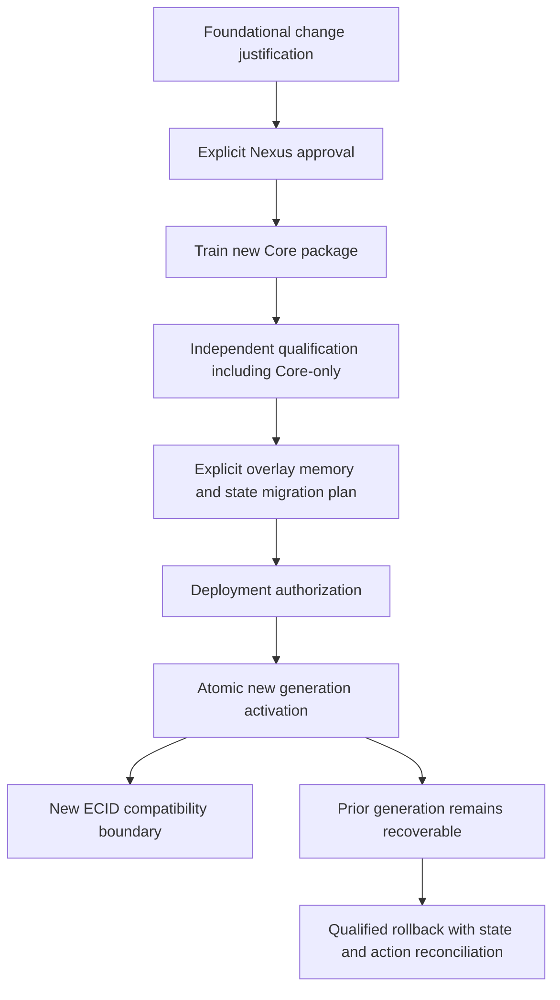

## Plain language overview

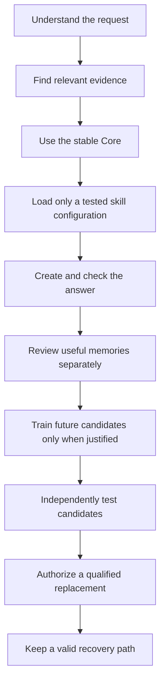

## 001A crash and restart boundary

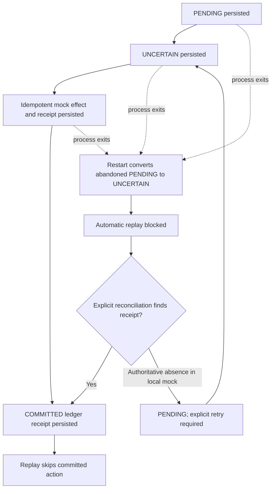

## 001B durable recovery publication boundary

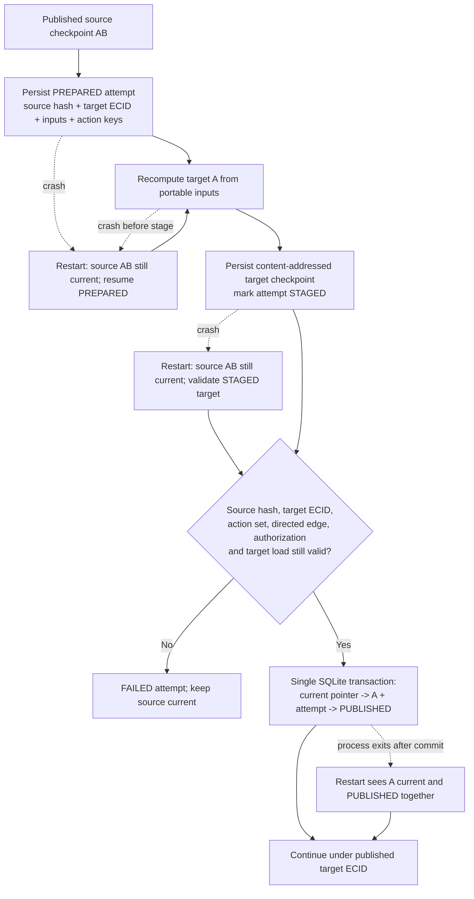

A resumed PUBLISHED attempt reads its historical result without moving the current pointer. Failed or corrupt reads return a typed modeled error and current state when readable. See the schema-v2 `checkpoint_recovery` atlas for the full status graph.
