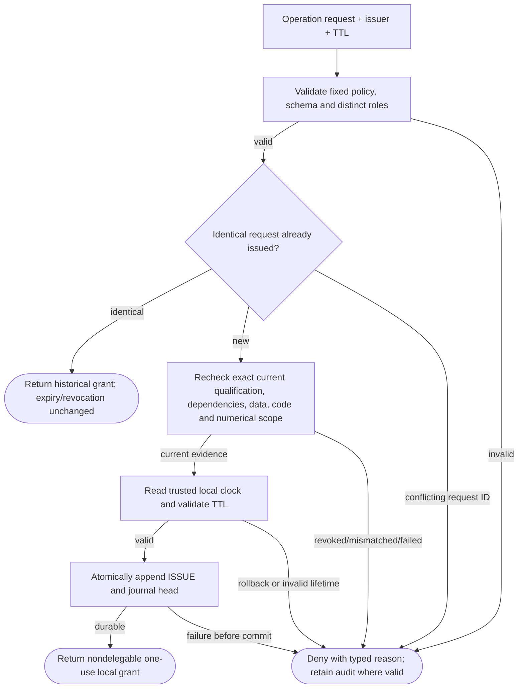
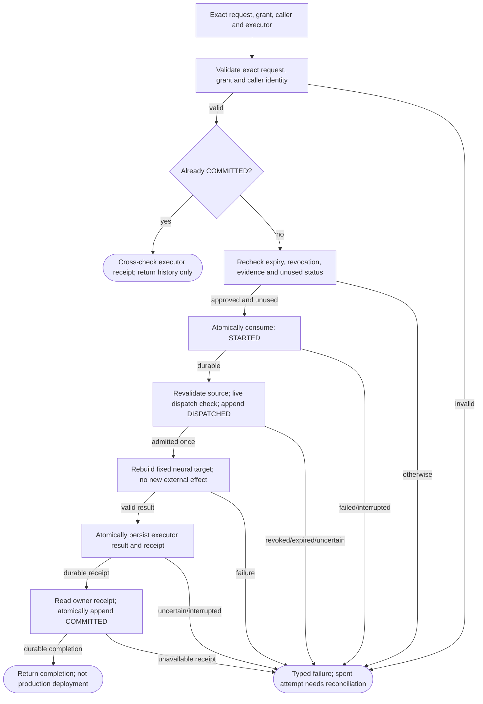
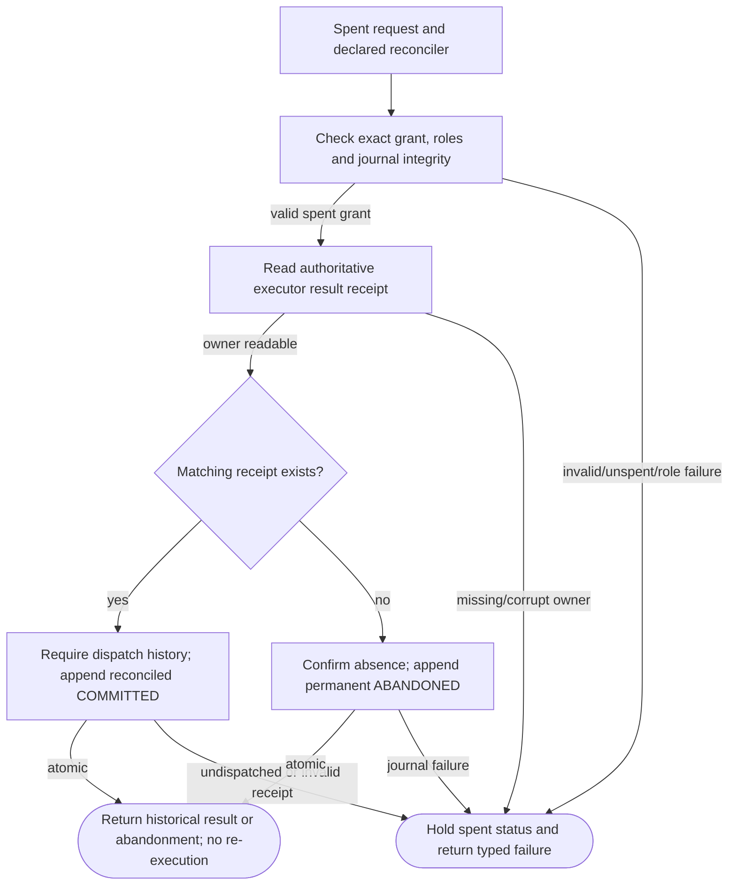

# LocalNexusPermissions002 — protocol logic

Trusted local protocol, not authenticated Nexus or an Aegis Runtime execution permit. Terminal SUCCESS can mean historical receipt or abandonment, not dispatch permission.

## Exact qualification to scoped local grant

**ID:** `permission_issue`  
**Owner:** LocalNexusPermissions002 local owners  
**Status:** Implemented local development protocol; implementation: `partial-simulator`  
**Purpose:** Bounded trusted-local replay authorization; not production security.

**Inputs:** Exact PermissionRequest; Current qualification/evidence refs; Local operator declarations
**Outputs:** Historical grant/receipt or point-in-time admission; Typed non-success without renewed authority
**Structural metrics:** 9 nodes; 12 transitions; normalized complexity 7. Not runtime proof.

### Flowchart



### Pseudocode

```text
req = VALIDATE(request, fixed_policy)
REQUIRE(distinct_local_issuer_and_executor)
IF exact_prior_issue: RETURN history_not_renewal
QUALIFIED(exact_claim_and_prerequisites, current_source)
REQUIRE(monotonic_observed_clock AND bounded_TTL)
ATOMIC_PUBLISH(issue_event, journal_head)
RETURN local_grant_without_runtime_or_deployment_authority
```

### Invariants

- Local declarations are not authentication; a host grant is not an Aegis Runtime permit.
- Grants bind exact caller/task/operation, source state, action receipts, qualification claim, numerical environment and code.
- Single-use consumption precedes dispatch; unresolved consumed attempts never automatically retry.
- History inspection and reconciliation do not renew current authority or data permissions.
- No production checkpoint publication, external action creation, delegation or deployment authority.

### Typed failures

- AUTHORIZATION_DENIED
- BUDGET_EXHAUSTED
- CONSTRAINT_CONFLICT
- INCOMPATIBLE_CONFIGURATION
- INSUFFICIENT_EVIDENCE
- RECOVERY_REQUIRED
- TRAINING_RESTRICTED
- VALIDATION_FAILED
- CAPABILITY_UNAVAILABLE

### Forbidden edges

- Permission owner cannot edit qualification, dataset, neural or action-owner SQL.
- Qualification certificate cannot replace an operation grant.
- A consumed grant cannot be reset to GRANTED.
- A caller-provided result cannot substitute for the executor owner receipt.

### Optimization notes

- Bounded fixed fixture scope; no unbounded request loop.
- Reuse semantic owner APIs, not duplicated SQL or cached authorization.

## Single-use consumption, dispatch and receipt binding

**ID:** `permission_use`  
**Owner:** LocalNexusPermissions002 local owners  
**Status:** Implemented local development protocol; implementation: `partial-simulator`  
**Purpose:** Bounded trusted-local replay authorization; not production security.

**Inputs:** Exact PermissionRequest; Current qualification/evidence refs; Local operator declarations
**Outputs:** Historical grant/receipt or point-in-time admission; Typed non-success without renewed authority
**Structural metrics:** 12 nodes; 17 transitions; normalized complexity 9. Not runtime proof.

### Flowchart



### Pseudocode

```text
VALIDATE(request, grant, exact_caller)
IF COMMITTED: REQUIRE(owner_receipt_matches); RETURN history
AUTHORIZE(current_evidence, clock, unused_grant)
ATOMIC_PUBLISH(STARTED)
VALIDATE(real_source_state, existing_action_receipts)
AUTHORIZE(current_evidence, clock); ATOMIC_PUBLISH(DISPATCHED)
result = fixed_neural_replay_without_external_actions()
ATOMIC_PUBLISH(executor_result_and_receipt)
ATOMIC_PUBLISH(COMMITTED_from_executor_receipt)
ON interruption: do_not_retry_consumed_grant
```

### Invariants

- Local declarations are not authentication; a host grant is not an Aegis Runtime permit.
- Grants bind exact caller/task/operation, source state, action receipts, qualification claim, numerical environment and code.
- Single-use consumption precedes dispatch; unresolved consumed attempts never automatically retry.
- History inspection and reconciliation do not renew current authority or data permissions.
- No production checkpoint publication, external action creation, delegation or deployment authority.

### Typed failures

- AUTHORIZATION_DENIED
- BUDGET_EXHAUSTED
- CONSTRAINT_CONFLICT
- INCOMPATIBLE_CONFIGURATION
- INSUFFICIENT_EVIDENCE
- RECOVERY_REQUIRED
- TRAINING_RESTRICTED
- VALIDATION_FAILED
- CAPABILITY_UNAVAILABLE

### Forbidden edges

- Permission owner cannot edit qualification, dataset, neural or action-owner SQL.
- Qualification certificate cannot replace an operation grant.
- A consumed grant cannot be reset to GRANTED.
- A caller-provided result cannot substitute for the executor owner receipt.

### Optimization notes

- Bounded fixed fixture scope; no unbounded request loop.
- Reuse semantic owner APIs, not duplicated SQL or cached authorization.

## Explicit spent-grant reconciliation or abandonment

**ID:** `permission_reconcile`  
**Owner:** LocalNexusPermissions002 local owners  
**Status:** Implemented local development protocol; implementation: `partial-simulator`  
**Purpose:** Bounded trusted-local replay authorization; not production security.

**Inputs:** Exact PermissionRequest; Current qualification/evidence refs; Local operator declarations
**Outputs:** Historical grant/receipt or point-in-time admission; Typed non-success without renewed authority
**Structural metrics:** 8 nodes; 11 transitions; normalized complexity 6. Not runtime proof.

### Flowchart



### Pseudocode

```text
REQUIRE(explicit_reconciler_role AND exact_spent_grant)
receipt = executor.lookup(exact_request, grant_hash)
IF receipt: REQUIRE(dispatch_was_admitted); ATOMIC_PUBLISH(COMMITTED)
ELSE: ATOMIC_PUBLISH(ABANDONED_permanently)
DO_NOT_DISPATCH; DO_NOT_RESTORE_GRANT; RETURN history
```

### Invariants

- Local declarations are not authentication; a host grant is not an Aegis Runtime permit.
- Grants bind exact caller/task/operation, source state, action receipts, qualification claim, numerical environment and code.
- Single-use consumption precedes dispatch; unresolved consumed attempts never automatically retry.
- History inspection and reconciliation do not renew current authority or data permissions.
- No production checkpoint publication, external action creation, delegation or deployment authority.

### Typed failures

- AUTHORIZATION_DENIED
- BUDGET_EXHAUSTED
- CONSTRAINT_CONFLICT
- INCOMPATIBLE_CONFIGURATION
- INSUFFICIENT_EVIDENCE
- RECOVERY_REQUIRED
- TRAINING_RESTRICTED
- VALIDATION_FAILED
- CAPABILITY_UNAVAILABLE

### Forbidden edges

- Permission owner cannot edit qualification, dataset, neural or action-owner SQL.
- Qualification certificate cannot replace an operation grant.
- A consumed grant cannot be reset to GRANTED.
- A caller-provided result cannot substitute for the executor owner receipt.

### Optimization notes

- Bounded fixed fixture scope; no unbounded request loop.
- Reuse semantic owner APIs, not duplicated SQL or cached authorization.
