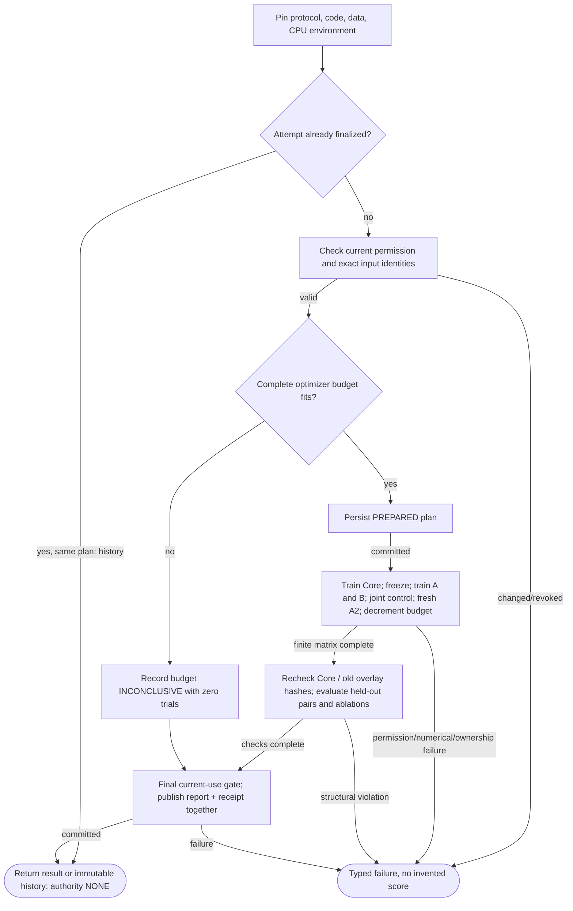
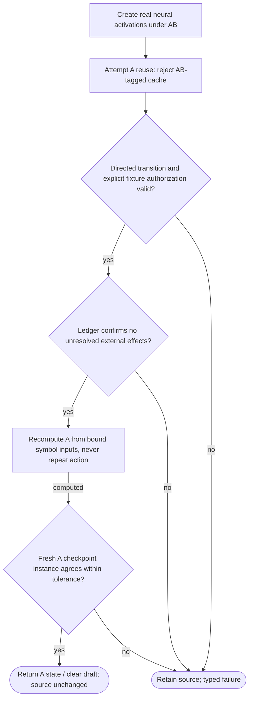
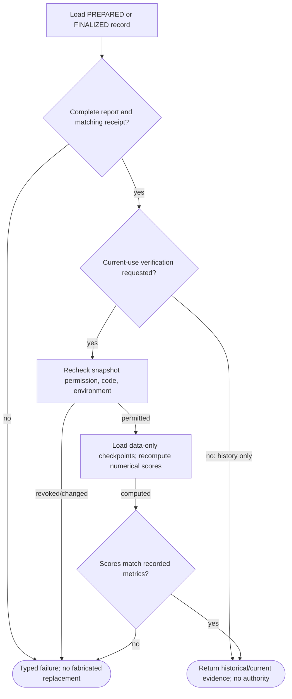

# NeuralProbe001 — implementation logic

Three subordinate experiment flows. `partial-simulator` is the inherited schema-v2 coverage label; the forward computation is real PyTorch, but approval and runtime hardware remain fixtures. Not production qualification.

## NeuralProbe001 — frozen Core and candidate training

**ID:** `neural_train`  
**Owner:** neuralprobe001 / neural_backend / neural_records through public owner APIs  
**Status:** Optional CPU neural development probe; not native NSS release qualification; implementation: `partial-simulator`  
**Purpose:** Train and test a tiny frozen-Core linear transducer; authority NONE.

**Inputs:** Pinned numerical protocol/code/environment; Permission-checked train/validation snapshot; Developer-visible held-out pair fixture
**Outputs:** JSON neural checkpoints and numerical report; Typed operational failure without fabricated score
**Structural metrics:** 11 nodes; 15 transitions; normalized complexity 7. Not runtime proof.

### Flowchart



### Pseudocode

```text
VALIDATE(protocol); REQUIRE(current_inputs_match, INCOMPATIBLE_CONFIGURATION)
if finalized_exact_attempt: return HISTORICAL_RECEIPT
TRY(data.current_use_gate); persist PREPARED
if required_updates > budget: finalize INCONCLUSIVE; return
for each declared precision and seed:
  train Core on TRAIN only; freeze and hash every tensor
  train A and B separately through frozen Core
  train matched joint baseline; train fresh A2; preserve B
  check no-op, ownership and unchanged accepted hashes
  evaluate held-out pairs, ablations and retained-domain Gen2
TRY(final_current_use_gate); ATOMIC_PUBLISH(report, receipt)
```

### Invariants

- Core and old overlay tensors remain exact after freeze.
- All loops have a finite predeclared optimizer/update budget.
- Exact history never renews revoked data permission.
- Only one explicit profile is selected per neural call.
- Numerical ternary Core is not packed BitNet execution.

### Typed failures

- AUTHORIZATION_DENIED
- BUDGET_EXHAUSTED
- CAPABILITY_UNAVAILABLE
- CONFLICT_REQUIRES_REVIEW
- CONSTRAINT_CONFLICT
- INCOMPATIBLE_CONFIGURATION
- INSUFFICIENT_EVIDENCE
- INTERNAL_FAILURE
- RECOVERY_REQUIRED
- TRAINING_RESTRICTED
- VALIDATION_FAILED

### Forbidden edges

- Candidate training -> accepted Core mutation
- Numerical PASS -> release authority
- Neural adapter -> integer evaluation checker reinterpretation
- Training -> private archive SQL
- Artifact -> arbitrary Python or pickle loading

### Optimization notes

- No performance gain inferred from success.
- Matched joint control has equal trainable params/update/token count, different supervision.
- Low-rank deltas computed separately; Core not merged/unmerged.

## NeuralProbe001 — ephemeral real neural-state recovery

**ID:** `neural_recovery`  
**Owner:** neuralprobe001 / neural_backend / neural_records through public owner APIs  
**Status:** Optional CPU neural development probe; not native NSS release qualification; implementation: `partial-simulator`  
**Purpose:** Train and test a tiny frozen-Core linear transducer; authority NONE.

**Inputs:** Pinned numerical protocol/code/environment; Permission-checked train/validation snapshot; Developer-visible held-out pair fixture
**Outputs:** JSON neural checkpoints and numerical report; Typed operational failure without fabricated score
**Structural metrics:** 8 nodes; 9 transitions; normalized complexity 4. Not runtime proof.

### Flowchart



### Pseudocode

```text
REQUIRE(state.task/input/ECID binding valid, INCOMPATIBLE_CONFIGURATION)
REQUIRE(directed edge + explicit simulated authorization, AUTHORIZATION_DENIED)
TRY(ledger.ensure_replay_safe(task)); reject stale activations
target = forward(frozen Core + A, exact portable inputs)
REQUIRE(allclose(target, clean_A), VALIDATION_FAILED)
return target with empty draft; do not publish into integer RecoveryStore
```

### Invariants

- Core and old overlay tensors remain exact after freeze.
- All loops have a finite predeclared optimizer/update budget.
- Exact history never renews revoked data permission.
- Only one explicit profile is selected per neural call.
- Numerical ternary Core is not packed BitNet execution.

### Typed failures

- AUTHORIZATION_DENIED
- BUDGET_EXHAUSTED
- CAPABILITY_UNAVAILABLE
- CONFLICT_REQUIRES_REVIEW
- CONSTRAINT_CONFLICT
- INCOMPATIBLE_CONFIGURATION
- INSUFFICIENT_EVIDENCE
- INTERNAL_FAILURE
- RECOVERY_REQUIRED
- TRAINING_RESTRICTED
- VALIDATION_FAILED

### Forbidden edges

- Candidate training -> accepted Core mutation
- Numerical PASS -> release authority
- Neural adapter -> integer evaluation checker reinterpretation
- Training -> private archive SQL
- Artifact -> arbitrary Python or pickle loading

### Optimization notes

- No performance gain inferred from success.
- Matched joint control has equal trainable params/update/token count, different supervision.
- Low-rank deltas computed separately; Core not merged/unmerged.

## NeuralProbe001 — verification and historical evidence

**ID:** `neural_evidence`  
**Owner:** neuralprobe001 / neural_backend / neural_records through public owner APIs  
**Status:** Optional CPU neural development probe; not native NSS release qualification; implementation: `partial-simulator`  
**Purpose:** Train and test a tiny frozen-Core linear transducer; authority NONE.

**Inputs:** Pinned numerical protocol/code/environment; Permission-checked train/validation snapshot; Developer-visible held-out pair fixture
**Outputs:** JSON neural checkpoints and numerical report; Typed operational failure without fabricated score
**Structural metrics:** 8 nodes; 10 transitions; normalized complexity 5. Not runtime proof.

### Flowchart



### Pseudocode

```text
record = VALIDATE(report + receipt + artifact hashes)
if inspection_only: return HISTORY_WITHOUT_AUTHORITY
TRY(current_use_gate)
models = LOAD_ALLOWLISTED_JSON_TENSORS(record.artifacts)
metrics = RECOMPUTE_HELDOUT_CHECKS(models)
REQUIRE(metrics == recorded_metrics, VALIDATION_FAILED)
return verified local evidence; qualification and deployment remain separate
```

### Invariants

- Core and old overlay tensors remain exact after freeze.
- All loops have a finite predeclared optimizer/update budget.
- Exact history never renews revoked data permission.
- Only one explicit profile is selected per neural call.
- Numerical ternary Core is not packed BitNet execution.

### Typed failures

- AUTHORIZATION_DENIED
- BUDGET_EXHAUSTED
- CAPABILITY_UNAVAILABLE
- CONFLICT_REQUIRES_REVIEW
- CONSTRAINT_CONFLICT
- INCOMPATIBLE_CONFIGURATION
- INSUFFICIENT_EVIDENCE
- INTERNAL_FAILURE
- RECOVERY_REQUIRED
- TRAINING_RESTRICTED
- VALIDATION_FAILED

### Forbidden edges

- Candidate training -> accepted Core mutation
- Numerical PASS -> release authority
- Neural adapter -> integer evaluation checker reinterpretation
- Training -> private archive SQL
- Artifact -> arbitrary Python or pickle loading

### Optimization notes

- No performance gain inferred from success.
- Matched joint control has equal trainable params/update/token count, different supervision.
- Low-rank deltas computed separately; Core not merged/unmerged.
