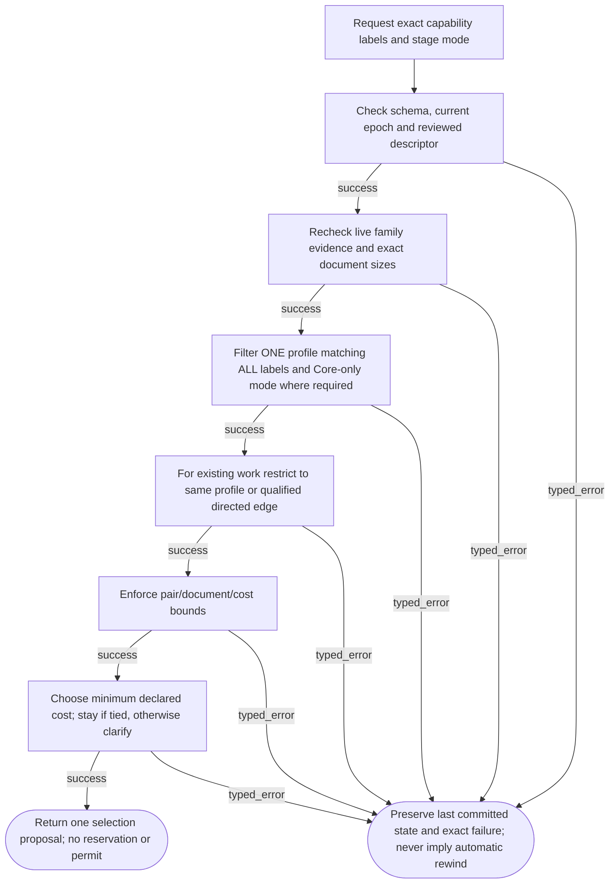
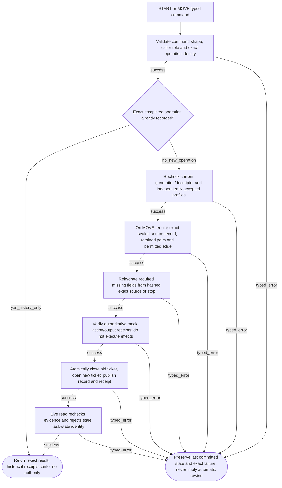
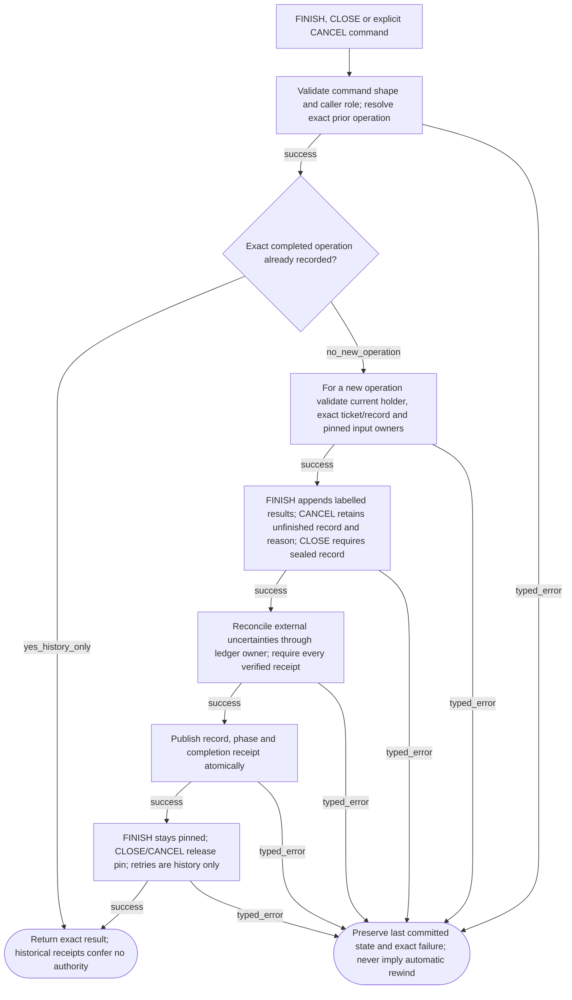

# OverlayCatalogController001 — implementation logic

Three helpers for reviewed catalogue selection and task-bound stage lifecycle. Cost/labels are fixtures; no learned routing, native paging, or execution authority.

## Exact catalogue lookup and stage selection

**ID:** `catalog_select`  
**Owner:** Catalogue Controller / Generation journal owner  
**Status:** canonical; implementation: `partial-simulator`  
**Purpose:** Return one permitted profile, not a synthetic mixture.

**Inputs:** Reviewed exact catalogue/request and current generation; Portable TaskRecord and exact managed-stage identity; Public source/qualification/ledger owners
**Outputs:** Selected profile or atomic task-stage receipt; Explicit failure preserving prior state; no execution permit
**Structural metrics:** 9 nodes; 13 transitions; normalized complexity 7. Not runtime proof.

### Flowchart



### Pseudocode

```text
function SELECT(request, source_stage_or_none):
  TRY(VALIDATE(request)); TRY(CURRENT_CATALOGUE(request))
  candidates = one_profile_covering_ALL_labels_and_mode(request)
  REQUIRE(candidates_not_empty, CAPABILITY_UNAVAILABLE)
  candidates = same_profile_or_qualified_directed_edge(candidates, source_stage)
  REQUIRE(candidates_not_empty, INCOMPATIBLE_CONFIGURATION)
  candidates = within_explicit_declared_budget(candidates)
  REQUIRE(candidates_not_empty, BUDGET_EXHAUSTED)
  return unique_minimum_or_current_tie_else_NEEDS_CLARIFICATION(candidates)
  # Selection is a proposal, not a reservation or execution permit.
```

### Invariants

- One current profile per registered stage; CORE mandatory.
- Profile changes require an explicitly qualified directed edge; no automatic multi-hop.
- Record, old/new ticket, task head and receipt commit in one existing journal.
- Live use rechecks eligibility; inspection is not use.
- Stage/revision/epoch identity changes invalidate old caches.
- Labels/cost units are reviewed fixtures, not learned intelligence or measured VRAM/energy.
- A failed current-use read after successful publication does not roll the publication back; history and live permission remain separate.

### Typed failures

- AUTHORIZATION_DENIED
- BUDGET_EXHAUSTED
- CAPABILITY_UNAVAILABLE
- CONSTRAINT_CONFLICT
- INCOMPATIBLE_CONFIGURATION
- INSUFFICIENT_EVIDENCE
- INTERNAL_FAILURE
- NEEDS_CLARIFICATION
- RECOVERY_REQUIRED
- TRAINING_RESTRICTED
- VALIDATION_FAILED

### Forbidden edges

- Catalogue labels -> New qualification or deployment authority
- Entry matches -> Inferred union/subset
- Plain unpin -> Discard unfinished managed task
- Closed receipt -> Renewed task admission
- Controller -> Neighbor private SQL or effect execution

### Optimization notes

- Bounded exact-profile decision table; prefer staying on equal declared cost.
- Reuse TaskRecord preservation/source/finish helpers; one transaction owner.
- Generate all views with the existing shared tool; retain unique regression scenarios.

## Atomic task admission and handoff

**ID:** `catalog_task_handoff`  
**Owner:** Catalogue Controller / Generation journal owner  
**Status:** canonical; implementation: `partial-simulator`  
**Purpose:** Bind real catalogue tickets to shared portable TaskRecords.

**Inputs:** Reviewed exact catalogue/request and current generation; Portable TaskRecord and exact managed-stage identity; Public source/qualification/ledger owners
**Outputs:** Selected profile or atomic task-stage receipt; Explicit failure preserving prior state; no execution permit
**Structural metrics:** 11 nodes; 17 transitions; normalized complexity 9. Not runtime proof.

### Flowchart



### Pseudocode

```text
function ADMIT_OR_MOVE(command):
  TRY(VALIDATE(command)); if exact_completed_retry: return HISTORY_ONLY
  selected = TRY(SELECT(command.request, source))
  if MOVE: REQUIRE(source_is_sealed_and_exact, CONSTRAINT_CONFLICT)
  record = TRY(ADVANCE_RECORD_OR_VALIDATE_INITIAL(record, exact_sources))
  TRY(REPLAY_SAFE(authoritative_ledger)); TRY(VERIFY_COMPLETE_RECEIPTS(record))
  return ATOMIC_PUBLISH(record, source_ticket_closed, new_ticket, task_head, receipt)
  # No integer ECID relabelling, foreign cache migration or external execution.
```

### Invariants

- One current profile per registered stage; CORE mandatory.
- Profile changes require an explicitly qualified directed edge; no automatic multi-hop.
- Record, old/new ticket, task head and receipt commit in one existing journal.
- Live use rechecks eligibility; inspection is not use.
- Stage/revision/epoch identity changes invalidate old caches.
- Labels/cost units are reviewed fixtures, not learned intelligence or measured VRAM/energy.
- A failed current-use read after successful publication does not roll the publication back; history and live permission remain separate.

### Typed failures

- AUTHORIZATION_DENIED
- BUDGET_EXHAUSTED
- CAPABILITY_UNAVAILABLE
- CONSTRAINT_CONFLICT
- INCOMPATIBLE_CONFIGURATION
- INSUFFICIENT_EVIDENCE
- INTERNAL_FAILURE
- NEEDS_CLARIFICATION
- RECOVERY_REQUIRED
- TRAINING_RESTRICTED
- VALIDATION_FAILED

### Forbidden edges

- Catalogue labels -> New qualification or deployment authority
- Entry matches -> Inferred union/subset
- Plain unpin -> Discard unfinished managed task
- Closed receipt -> Renewed task admission
- Controller -> Neighbor private SQL or effect execution

### Optimization notes

- Bounded exact-profile decision table; prefer staying on equal declared cost.
- Reuse TaskRecord preservation/source/finish helpers; one transaction owner.
- Generate all views with the existing shared tool; retain unique regression scenarios.

## Task completion and explicit cancellation

**ID:** `catalog_task_completion`  
**Owner:** Catalogue Controller / Generation journal owner  
**Status:** canonical; implementation: `partial-simulator`  
**Purpose:** Preserve work before lifting the generation publication barrier.

**Inputs:** Reviewed exact catalogue/request and current generation; Portable TaskRecord and exact managed-stage identity; Public source/qualification/ledger owners
**Outputs:** Selected profile or atomic task-stage receipt; Explicit failure preserving prior state; no execution permit
**Structural metrics:** 10 nodes; 15 transitions; normalized complexity 8. Not runtime proof.

### Flowchart



### Pseudocode

```text
function COMPLETE(command):
  TRY(VALIDATE(command)); if exact_completed_retry: return HISTORY_ONLY
  REQUIRE(exact_holder_ticket_and_record_revision, INCOMPATIBLE_CONFIGURATION)
  record = APPEND_RESULTS_OR_RECEIPTS_WITHOUT_OVERWRITING_HISTORY(command)
  if CLOSE: REQUIRE(record.stage.sealed, CONSTRAINT_CONFLICT)
  TRY(VERIFY_COMPLETE_RECEIPTS(record)); # uncertain effects block closure
  return ATOMIC_PUBLISH(record, phase, closed_if_CLOSE_or_CANCEL, receipt)
  # May preserve completed work after withdrawal, never authorize new computation.
```

### Invariants

- One current profile per registered stage; CORE mandatory.
- Profile changes require an explicitly qualified directed edge; no automatic multi-hop.
- Record, old/new ticket, task head and receipt commit in one existing journal.
- Live use rechecks eligibility; inspection is not use.
- Stage/revision/epoch identity changes invalidate old caches.
- Labels/cost units are reviewed fixtures, not learned intelligence or measured VRAM/energy.
- Historical receipt lookup precedes current ticket validation and never reopens a closed stage.
- A failed current-use read after successful publication does not roll the publication back; history and live permission remain separate.

### Typed failures

- AUTHORIZATION_DENIED
- BUDGET_EXHAUSTED
- CAPABILITY_UNAVAILABLE
- CONSTRAINT_CONFLICT
- INCOMPATIBLE_CONFIGURATION
- INSUFFICIENT_EVIDENCE
- INTERNAL_FAILURE
- NEEDS_CLARIFICATION
- RECOVERY_REQUIRED
- TRAINING_RESTRICTED
- VALIDATION_FAILED

### Forbidden edges

- Catalogue labels -> New qualification or deployment authority
- Entry matches -> Inferred union/subset
- Plain unpin -> Discard unfinished managed task
- Closed receipt -> Renewed task admission
- Controller -> Neighbor private SQL or effect execution

### Optimization notes

- Bounded exact-profile decision table; prefer staying on equal declared cost.
- Reuse TaskRecord preservation/source/finish helpers; one transaction owner.
- Generate all views with the existing shared tool; retain unique regression scenarios.
