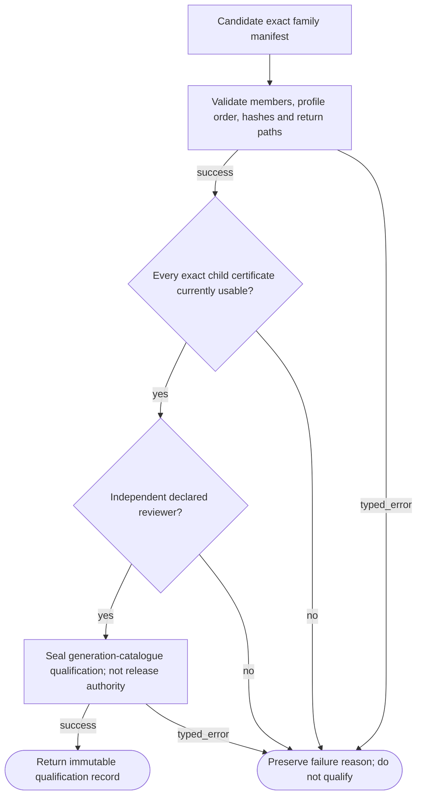
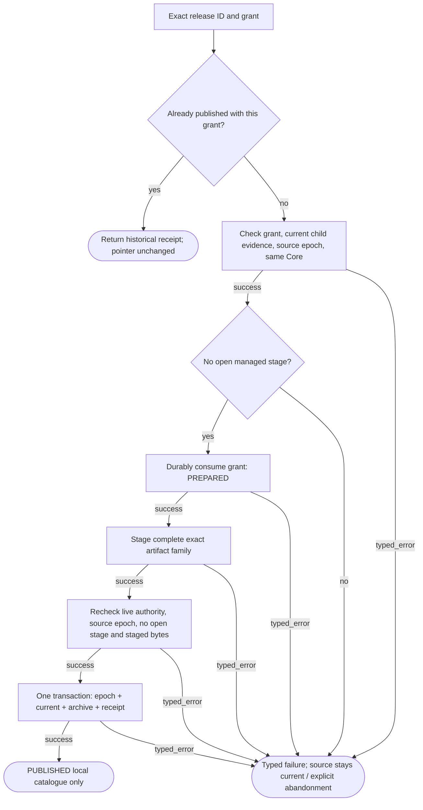
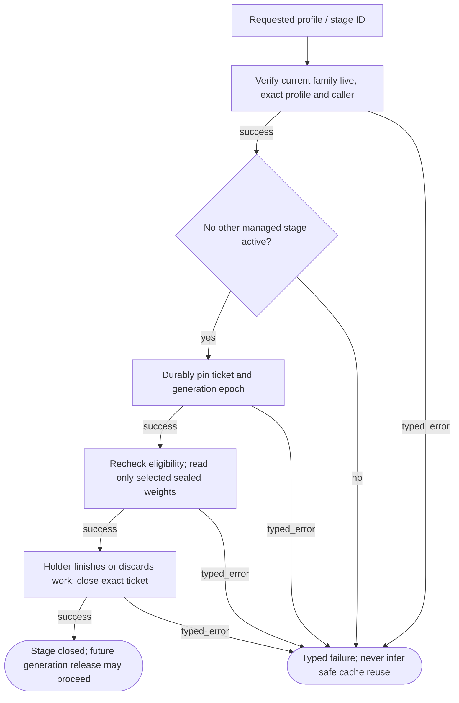

# OverlayGenerationManager001 — local catalogue lifecycle

A whole family is staged and its catalogue pointer/archive/receipt published atomically. This is not device loading or production deployment. History is not renewed permission.

## Generation family qualification

**ID:** `generation_family_qualify`  
**Owner:** Generation evidence adapter / local reviewer  
**Status:** canonical; implementation: `partial-simulator`  
**Purpose:** Check exact selected members, QAP closure, Core-only returns and live child evidence. This establishes no untested neural claim.

**Inputs:** Exact immutable generation/qualification references; Declared local operator and scoped release request; Current generation epoch / managed stage
**Outputs:** Typed result or unchanged historical receipt; Preserved source on failure; no serving or production permission
**Structural metrics:** 7 nodes; 9 transitions; normalized complexity 5. Not runtime proof.

### Flowchart



### Pseudocode

```text
function QUALIFY_GENERATION(manifest, reviewer):
  manifest = TRY(VALIDATE_EXACT_FAMILY(manifest))
  REQUIRE(Core_only_profile_and_qualified_returns, INCOMPATIBLE_CONFIGURATION)
  TRY(CHECK_EACH_EXACT_CHILD_CLAIM_CURRENT(manifest))
  REQUIRE(reviewer != producer_and_has_role, AUTHORIZATION_DENIED)
  return ATOMIC_APPEND_IMMUTABLE_CLOSURE_CERTIFICATE(manifest, reviewer)
  # Certificate is evidence, not a release grant; no new neural accuracy claim.
```

### Invariants

- Core-only profile is unconditional.
- Every allowed profile has a directed qualified return to Core-only.
- Membership and catalogue are immutable; no inferred subset or union.
- Independent local role declarations are not authenticated identity.

### Typed failures

- AUTHORIZATION_DENIED
- BUDGET_EXHAUSTED
- CAPABILITY_UNAVAILABLE
- CONSTRAINT_CONFLICT
- INCOMPATIBLE_CONFIGURATION
- INSUFFICIENT_EVIDENCE
- INTERNAL_FAILURE
- RECOVERY_REQUIRED
- TRAINING_RESTRICTED
- VALIDATION_FAILED

### Forbidden edges

- Generation release -> Replay operation grant reuse
- Generation manager -> Neighbor private storage
- Publication -> In-flight state reuse
- Historical receipt -> Renewed authority
- Candidate producer -> Own generation qualification

### Optimization notes

- Shared journal mechanics, separate owner stores and reducers.
- No separate mutable current/archive/revocation indexes; reconstruct from bounded verified events.
- One publication transaction; no automatic external replay.

## Bounded whole-generation release

**ID:** `generation_release`  
**Owner:** Generation catalogue / release role  
**Status:** canonical; implementation: `partial-simulator`  
**Purpose:** Stage exact selected weights and atomically update current epoch, predecessor archive and release receipt; never switch in-flight work.

**Inputs:** Exact immutable generation/qualification references; Declared local operator and scoped release request; Current generation epoch / managed stage
**Outputs:** Typed result or unchanged historical receipt; Preserved source on failure; no serving or production permission
**Structural metrics:** 11 nodes; 15 transitions; normalized complexity 8. Not runtime proof.

### Flowchart



### Pseudocode

```text
function ADOPT_RELEASE(id, grant):
  if exact_receipt_exists: return HISTORY_WITHOUT_PUBLICATION
  TRY(AUTHORIZE_EXACT_LOCAL_RELEASE(grant))
  TRY(CHECK_FAMILY_LIVE_AND_SOURCE_EPOCH())
  REQUIRE(no_open_managed_stage, RECOVERY_REQUIRED)
  TRY(PREPARE_AND_CONSUME_ONCE(id))
  staged = TRY(STAGE_EXACT_ARTIFACTS())
  TRY(RECHECK_AUTHORITY_SOURCE_EPOCH_AND_BYTES())
  return ATOMIC_PUBLISH(current=target, archive=previous, receipt=completed)
# Resume only local staging with live checks. Expired/withdrawn consumed work must be abandoned.
# Rollback is a new explicit approved release, never reuse of an old grant.
```

### Invariants

- Source remains current until commit.
- Publication, predecessor archival and receipt are the same atomic event.
- Rollback requires exact previously published target plus fresh approval and current evidence.
- No Core replacement, external effects, or runtime permit in this operation.
- A generation epoch is never recycled, even when returning to identical weights.

### Typed failures

- AUTHORIZATION_DENIED
- BUDGET_EXHAUSTED
- CAPABILITY_UNAVAILABLE
- CONSTRAINT_CONFLICT
- INCOMPATIBLE_CONFIGURATION
- INSUFFICIENT_EVIDENCE
- INTERNAL_FAILURE
- RECOVERY_REQUIRED
- TRAINING_RESTRICTED
- VALIDATION_FAILED

### Forbidden edges

- Generation release -> Replay operation grant reuse
- Generation manager -> Neighbor private storage
- Publication -> In-flight state reuse
- Historical receipt -> Renewed authority
- Candidate producer -> Own generation qualification

### Optimization notes

- Shared journal mechanics, separate owner stores and reducers.
- No separate mutable current/archive/revocation indexes; reconstruct from bounded verified events.
- One publication transaction; no automatic external replay.

## Managed stage pin and read

**ID:** `generation_managed_stage`  
**Owner:** Generation catalogue stage gate  
**Status:** canonical; implementation: `partial-simulator`  
**Purpose:** Pin one current qualified profile to an exact generation epoch; hand only its selected artifacts to the bounded consumer.

**Inputs:** Exact immutable generation/qualification references; Declared local operator and scoped release request; Current generation epoch / managed stage
**Outputs:** Typed result or unchanged historical receipt; Preserved source on failure; no serving or production permission
**Structural metrics:** 8 nodes; 11 transitions; normalized complexity 6. Not runtime proof.

### Flowchart



### Pseudocode

```text
function PIN_MANAGED_STAGE(profile, caller):
  TRY(CHECK_CURRENT_FAMILY_LIVE())
  REQUIRE(profile_in_released_exact_QAPs, INCOMPATIBLE_CONFIGURATION)
  REQUIRE(no_open_managed_stage, RECOVERY_REQUIRED)
  ticket = PIN(store, generation_epoch, profile_ecid, stage_id, caller)
  return ticket
function READ_MANAGED_STAGE(ticket):
  TRY(CHECK_EXACT_OPEN_TICKET_AND_CURRENT_ELIGIBILITY())
  return SEALED_CORE_AND_ONLY_SELECTED_PROFILE_WEIGHTS()
# Holder must finish/recover/discard its state before close; close executes no external action.
# Reopened stores expose tickets for explicit recovery, never automatic unpinning.
```

### Invariants

- One active approved profile per managed stage.
- Unlisted subsets remain unavailable.
- Closed or stale tickets reject current state reuse.
- Core-only returns only Core weights; staged cold membership does not all become active.
- Register all work; no unmanaged processes or multiple workers claimed.

### Typed failures

- AUTHORIZATION_DENIED
- BUDGET_EXHAUSTED
- CAPABILITY_UNAVAILABLE
- CONSTRAINT_CONFLICT
- INCOMPATIBLE_CONFIGURATION
- INSUFFICIENT_EVIDENCE
- INTERNAL_FAILURE
- RECOVERY_REQUIRED
- TRAINING_RESTRICTED
- VALIDATION_FAILED

### Forbidden edges

- Generation release -> Replay operation grant reuse
- Generation manager -> Neighbor private storage
- Publication -> In-flight state reuse
- Historical receipt -> Renewed authority
- Candidate producer -> Own generation qualification

### Optimization notes

- Shared journal mechanics, separate owner stores and reducers.
- No separate mutable current/archive/revocation indexes; reconstruct from bounded verified events.
- One publication transaction; no automatic external replay.
