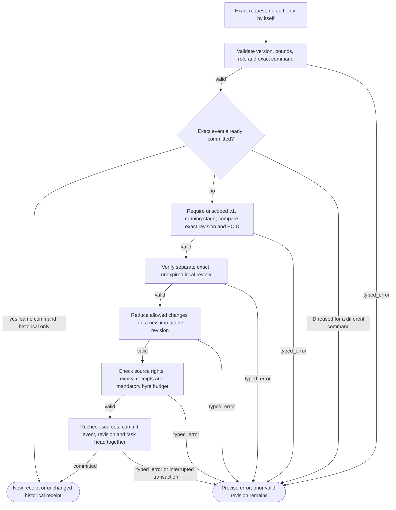
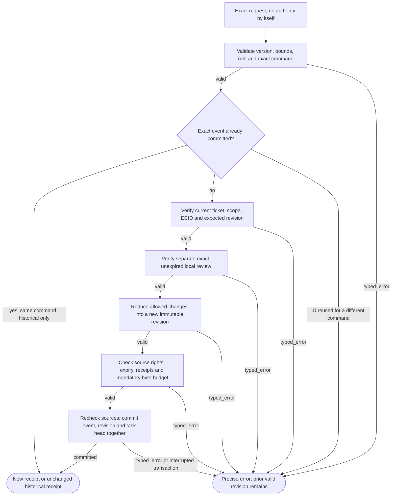
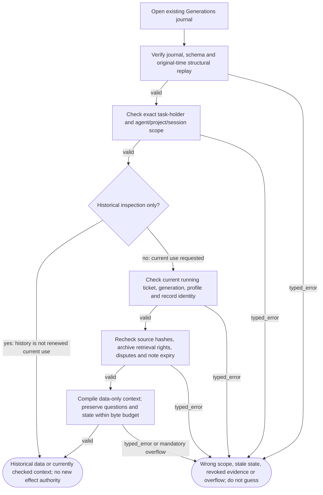

# PersistentState001 — reviewed scoped state logic

Three helper flows extend existing Generations/TaskRecord and read-only context. Local reviewer labels are attestations; data is not root instruction, permission, truth or learned temporal state.

## Explicit legacy-to-scoped state admission

**ID:** `state_admission`  
**Owner:** Generations via pure state contracts/reducer and existing evidence readers  
**Status:** canonical; implementation: `partial-simulator`  
**Purpose:** Explicit legacy-to-scoped state admission

**Inputs:** Exact task ticket, scoped schema-v2 command or read; Pinned sources/archive, current configuration, declared local reviewer
**Outputs:** Atomic new TaskRecord+receipt, unchanged history, or typed failure without mutation
**Structural metrics:** 10 nodes; 16 transitions; normalized complexity 9. Not runtime proof.

### Flowchart



### Pseudocode

```text
function BIND_STATE(command):
  TRY(VALIDATE_BIND_SCHEMA(command)); TRY(CHECK_LOCAL_OPERATOR())
  if SAME_EVENT_EXISTS: REQUIRE(EXACT_COMMAND_MATCH, CONSTRAINT_CONFLICT); return HISTORICAL_RECEIPT
  old = TRY(READ_CURRENT_UNSCOPED_RUNNING_TASK())
  TRY(CHECK_EXPECTED_REVISION_HASH_ECID(old, command))
  TRY(CHECK_EXACT_REVIEWER_ROLE_SCOPE_EXPIRY(command))
  next = COPY(old) + PINNED_SCOPE_POLICY_ARCHIVE_AND_EMPTY_STATE
  TRY(CHECK_ADMITTED_SOURCES_RECEIPTS_AND_BYTES(next))
  TRY(RECHECK_CURRENT_RIGHTS())
  return ATOMIC_PUBLISH(event, next_revision, task_head, receipt)
  # Original v1 record remains in journal; no implicit migration of historical closed sessions.
```

### Invariants

- One existing state owner/journal; no second current-state store.
- Scope and instruction-policy reference cannot change through generated deltas.
- Every initial-policy state write requires exact separate declared human review.
- Current-use reads recheck source permissions, scope, ECID and expiry; history does not renew use.
- Core/overlay artifacts and external effects are not modified by state operations.
- Mandatory state/context overflow fails explicitly; notes expire only through reviewed receipt-backed removal.

### Typed failures

- AUTHORIZATION_DENIED
- BUDGET_EXHAUSTED
- CONFLICT_REQUIRES_REVIEW
- CONSTRAINT_CONFLICT
- INCOMPATIBLE_CONFIGURATION
- INSUFFICIENT_EVIDENCE
- INTERNAL_FAILURE
- NEEDS_CLARIFICATION
- RECOVERY_REQUIRED
- RETENTION_RESTRICTED
- TRAINING_RESTRICTED
- VALIDATION_FAILED

### Forbidden edges

- State proposal -> root instruction or permission mutation
- State update -> neural training / tool dispatch
- History read -> fresh retrieval/training/serving permission
- Unreviewed or disputed note -> authoritative current claim
- Legacy record -> invented agent/project/session attribution

### Optimization notes

- Reuse existing Generations transaction and source readers; no persistent permission cache.
- Pure structural reducer supports replay at original event time, not renewed authority.
- Canonical JSON byte accounting is not a tokenizer/energy benchmark.

## Reviewed allowlisted symbolic state update

**ID:** `state_delta`  
**Owner:** Generations via pure state contracts/reducer and existing evidence readers  
**Status:** canonical; implementation: `partial-simulator`  
**Purpose:** Reviewed allowlisted symbolic state update

**Inputs:** Exact task ticket, scoped schema-v2 command or read; Pinned sources/archive, current configuration, declared local reviewer
**Outputs:** Atomic new TaskRecord+receipt, unchanged history, or typed failure without mutation
**Structural metrics:** 10 nodes; 16 transitions; normalized complexity 9. Not runtime proof.

### Flowchart



### Pseudocode

```text
function UPDATE_STATE(command):
  TRY(VALIDATE_EXACT_DELTA_SCHEMA(command)); TRY(CHECK_LOCAL_OPERATOR())
  if SAME_EVENT_EXISTS: REQUIRE(EXACT_COMMAND_MATCH, CONSTRAINT_CONFLICT); return HISTORICAL_RECEIPT
  old = TRY(READ_CURRENT_SCOPED_UNSEALED_TASK())
  TRY(CHECK_EXPECTED_REVISION_HASH_ECID(old, command))
  TRY(CHECK_SEPARATE_EXACT_UNEXPIRED_REVIEW(command))
  next = TRY(PURE_ALLOWLISTED_REDUCTION(old, command))
  TRY(CHECK_EXACT_SOURCES_ARCHIVE_RETRIEVAL_IDENTITY_REVIEW(next))
  TRY(CHECK_NOTE_EXPIRY_MANDATORY_BUDGET_AND_ACTION_RECEIPTS(next))
  TRY(RECHECK_DELTA_AND_REMAINING_STATE_SOURCES())
  return ATOMIC_PUBLISH(event, next_revision, task_head, receipt)
  # SET_GOAL, ADD/RESOLVE/DEFER_QUESTION, ADD/RETIRE/EXPIRE_NOTE only.
  # Retirement can remove a blocked/expired note; original bytes stay in revision history.
  # A received user clarification must equal the exact admitted user source, not a generated answer.
```

### Invariants

- One existing state owner/journal; no second current-state store.
- Scope and instruction-policy reference cannot change through generated deltas.
- Every initial-policy state write requires exact separate declared human review.
- Current-use reads recheck source permissions, scope, ECID and expiry; history does not renew use.
- Core/overlay artifacts and external effects are not modified by state operations.
- Mandatory state/context overflow fails explicitly; notes expire only through reviewed receipt-backed removal.

### Typed failures

- AUTHORIZATION_DENIED
- BUDGET_EXHAUSTED
- CONFLICT_REQUIRES_REVIEW
- CONSTRAINT_CONFLICT
- INCOMPATIBLE_CONFIGURATION
- INSUFFICIENT_EVIDENCE
- INTERNAL_FAILURE
- NEEDS_CLARIFICATION
- RECOVERY_REQUIRED
- RETENTION_RESTRICTED
- TRAINING_RESTRICTED
- VALIDATION_FAILED

### Forbidden edges

- State proposal -> root instruction or permission mutation
- State update -> neural training / tool dispatch
- History read -> fresh retrieval/training/serving permission
- Unreviewed or disputed note -> authoritative current claim
- Legacy record -> invented agent/project/session attribution

### Optimization notes

- Reuse existing Generations transaction and source readers; no persistent permission cache.
- Pure structural reducer supports replay at original event time, not renewed authority.
- Canonical JSON byte accounting is not a tokenizer/energy benchmark.

## Scoped restart, current context use and historical inspection

**ID:** `state_reuse`  
**Owner:** Generations via pure state contracts/reducer and existing evidence readers  
**Status:** canonical; implementation: `partial-simulator`  
**Purpose:** Scoped restart, current context use and historical inspection

**Inputs:** Exact task ticket, scoped schema-v2 command or read; Pinned sources/archive, current configuration, declared local reviewer
**Outputs:** Atomic new TaskRecord+receipt, unchanged history, or typed failure without mutation
**Structural metrics:** 9 nodes; 13 transitions; normalized complexity 7. Not runtime proof.

### Flowchart



### Pseudocode

```text
function READ_STATE_OR_CONTEXT(task, scope, caller, mode):
  TRY(VERIFY_EXISTING_JOURNAL_AND_REVISIONS())
  TRY(CHECK_EXACT_LOCAL_HOLDER_AND_SCOPE())
  if mode == HISTORY: return ORIGINAL_RECORDS_WITH_REVIEW_LINEAGE_AND_NO_NEW_PERMISSION
  view = TRY(READ_CURRENT_RUNNING_TASK_AND_ARTIFACTS())
  TRY(CHECK_SOURCE_HASHES_CURRENT_RETRIEVAL_RIGHTS_AND_EXPIRY())
  packet = TRY(CONTEXT_SERVICE.BUILD_WITH_FULL_STATE_DATA(view))
  REQUIRE(MANDATORY_PACKET_FITS, BUDGET_EXHAUSTED)
  TRY(RECHECK_AT_CONSUMPTION())
  return packet
  # Blocking questions remain in v2 packets so clarification can be requested.
  # They still block downstream MOVE unless explicitly resolved or deferred.
  # No implicit session migration, no neural-state reconstruction, no effect replay.
```

### Invariants

- One existing state owner/journal; no second current-state store.
- Scope and instruction-policy reference cannot change through generated deltas.
- Every initial-policy state write requires exact separate declared human review.
- Current-use reads recheck source permissions, scope, ECID and expiry; history does not renew use.
- Core/overlay artifacts and external effects are not modified by state operations.
- Mandatory state/context overflow fails explicitly; notes expire only through reviewed receipt-backed removal.

### Typed failures

- AUTHORIZATION_DENIED
- BUDGET_EXHAUSTED
- CONFLICT_REQUIRES_REVIEW
- CONSTRAINT_CONFLICT
- INCOMPATIBLE_CONFIGURATION
- INSUFFICIENT_EVIDENCE
- INTERNAL_FAILURE
- NEEDS_CLARIFICATION
- RECOVERY_REQUIRED
- RETENTION_RESTRICTED
- TRAINING_RESTRICTED
- VALIDATION_FAILED

### Forbidden edges

- State proposal -> root instruction or permission mutation
- State update -> neural training / tool dispatch
- History read -> fresh retrieval/training/serving permission
- Unreviewed or disputed note -> authoritative current claim
- Legacy record -> invented agent/project/session attribution

### Optimization notes

- Reuse existing Generations transaction and source readers; no persistent permission cache.
- Pure structural reducer supports replay at original event time, not renewed authority.
- Canonical JSON byte accounting is not a tokenizer/energy benchmark.
