# Aegis NSS pseudocode flowchart atlas

> **Status:** implementation specification framework, not executable NSS proof. The JSON source of truth is `spec/logic_atlas.json`; this document is generated from it.

## Why this exists

The purpose of this atlas is to make subsystem logic reviewable *before* implementation, so future code can be compressed without deleting contract semantics. Each flow has typed inputs/outputs, a state graph, typed failure exits, forbidden edges, invariants, pseudocode, and basic complexity metrics.

### Compression rule

**Compress repeated implementation mechanics, not decisions or invariants.** Shared guards such as validation, authorization, qualification, replay safety, hashing, and atomic publication should become common primitives only after tests prove equivalent behavior.

## Shared pseudocode primitives

- `REQUIRE` — Abort the current flow immediately with the supplied typed non-success outcome unless the predicate is true.
- `VALIDATE` — Validate schema plus semantic invariants.
- `RESOLVE` — Resolve an exact immutable reference; never guess a missing artifact.
- `HASH` — Content-address identity material.
- `QUALIFIED` — Check claim/profile/transition against bound qualification evidence.
- `AUTHORIZE` — Request scoped authorization from Nexus; no implicit authority carry-forward.
- `PIN` — Bind state to an exact ECID/configuration identity.
- `BUDGET` — Reserve/release bounded compute, context, or refinement budget.
- `ATOMIC_PUBLISH` — Stage fully, then atomically publish or preserve prior valid state.
- `REPLAY_SAFE` — Check durable action evidence; unresolved effects block replay. Reconciliation is explicit, never a hidden automatic retry.
- `REHYDRATE` — Load only the externally referenced context required for the current step.
- `COMPACT` — Produce minimal carry-forward state while preserving required dependencies.
- `RESULT` — Return typed success or typed non-success outcome.
- `AUDIT` — Append immutable/auditable decision or lifecycle evidence.
- `IDEMPOTENT_EXECUTE` — Execute side effect under idempotency key and durable commit semantics.
- `TRY` — Unwrap a typed result only on SUCCESS; propagate its non-success code unchanged. Helper failures are implicit exits from every process node.

## Global rules

- Compress implementation, not contract meaning: factor repeated guards into shared primitives only after behavior is test-covered.
- Every terminal path returns a typed outcome.
- Every production mutation is staged and atomically published or leaves the prior valid state intact.
- Every side effect is separated from replayable computation and has idempotency/reconciliation semantics.
- No subsystem reaches into another subsystem internals; use versioned typed public contracts.
- Research mechanisms (HSA/MSA, recurrent depth, DARP, directional-guidance implementations) are independently qualified and are not prerequisites for proving overlay composition.
- Core-only execution remains mandatory for each Core generation.
- Terminal maps contain allowed outcome sets. Grouped failure exits preserve the actual error code; they do not translate every failure into one generic status.
- Every helper failure implicitly exits through the declared failure envelope. Graphs are summaries, not exhaustive executable programs. TRY and REQUIRE are fail-fast.
- All loops consume finite budgets and have stalled/no-progress exits. Graph reachability alone does not prove termination.
- Canonical describes design authority, not implementation. The implementation field states the available simulator coverage.
- Forbidden-edge statements are reviewed architectural constraints; the graph validator does not inspect runtime imports/calls or enforce these prose rules.

## 01. Master implementation spine

**ID:** `master`<br>
**Owner:** NSS runtime + Nexus governance<br>
**Status:** `canonical`; implementation: `design-only`<br>
**Purpose:** Canonical allowed execution and learning paths. Lower-level modules may not invent shortcut dependencies.

**Inputs:** `Request|Event`; `Qualified artifacts`; `Runtime observations`<br>
**Outputs:** `Observed Result`; `MemoryCandidate`; `ExperienceRecord`; `PublishedConfiguration`<br>
**Logic metrics:** 17 nodes · 20 transitions · 4 decisions · normalized cyclomatic complexity 6

### Flowchart

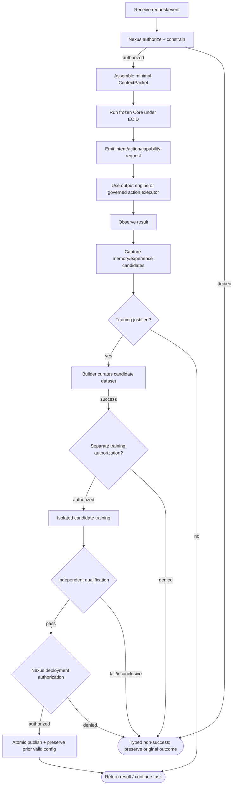

### Pseudocode

```text
function NSS_STEP(request, state):
  grant = TRY(AUTHORIZE(request, state.ecid))
  packet = TRY(CONTEXT_PACKET(request, state, grant))
  core_result = TRY(CORE_STEP(packet, state))
  observed = TRY(EXECUTE_INTENT_WITH_FRESH_SCOPED_AUTH(core_result.intent))
  TRY(CAPTURE_CANDIDATES(observed))
  if TRAINING_JUSTIFIED(observed): QUEUE_SEPARATE_GOVERNED_LEARNING_JOB(observed)
  return RESULT(SUCCESS, observed)
# The learning branch is asynchronous: Builder -> training authorization -> Trainer
# -> independent qualification -> fresh deployment authorization -> atomic release.
```

### Invariants

- Production changes only through qualified, authorized atomic publication.
- Training never mutates production state.
- Every externally meaningful state is versioned/auditable.

### Typed failures

- `AUTHORIZATION_DENIED`
- `BUDGET_EXHAUSTED`
- `CONSTRAINT_CONFLICT`
- `INCOMPATIBLE_CONFIGURATION`
- `INSUFFICIENT_EVIDENCE`
- `INTERNAL_FAILURE`
- `QUALIFICATION_FAILED`
- `RECOVERY_REQUIRED`
- `VALIDATION_FAILED`

### Forbidden edges

- ✕ Trainer -> Deployment
- ✕ Builder -> Production promotion
- ✕ Core -> Filesystem/hardware
- ✕ Memory -> Automatic training
- ✕ Optional research mechanism -> Core mutation

### Optimization notes

- Keep master orchestration thin: delegate domain logic; never duplicate subsystem checks here.

## 02. Primary Core + Core Generation Package

**ID:** `core`<br>
**Owner:** Primary Core / Core package boundary<br>
**Status:** `canonical`; implementation: `partial-simulator`<br>
**Purpose:** Separates immutable learned weights from the versioned package and runtime interfaces required to run them.

**Inputs:** `CoreGenerationPackage`; `ContextPacket`; `ActiveOverlayState?`<br>
**Outputs:** `CoreResult`; `CapabilityRequest`; `GenerationIntentCandidate`<br>
**Logic metrics:** 8 nodes · 8 transitions · 2 decisions · normalized cyclomatic complexity 3

### Flowchart

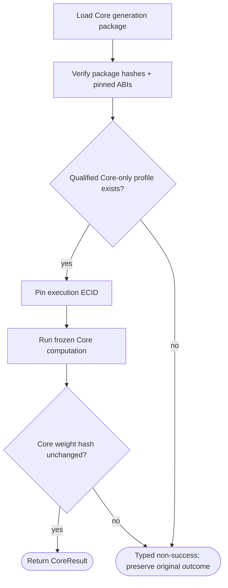

### Pseudocode

```text
function CORE_STEP(packet, state):
  pkg = RESOLVE(state.core_package) or return RESULT(CHECKPOINT_INVALID)
  REQUIRE(VALIDATE(pkg) and pkg.core_only_qualified, INCOMPATIBLE_CONFIGURATION)
  before = HASH(pkg.core_weights)
  out = INFER_FROZEN(pkg, packet, state.active_overlays)
  REQUIRE(HASH(pkg.core_weights) == before, CORE_MUTATION_DETECTED)
  return RESULT(SUCCESS, out)
```

### Invariants

- Core weights immutable within generation.
- Core-only operation is mandatory for every Core generation.
- Core identity and package identity are explicit.

### Typed failures

- `ABI_MISMATCH`
- `AUTHORIZATION_DENIED`
- `BUDGET_EXHAUSTED`
- `CHECKPOINT_INVALID`
- `CONSTRAINT_CONFLICT`
- `CORE_MUTATION_DETECTED`
- `INCOMPATIBLE_CONFIGURATION`
- `INSUFFICIENT_EVIDENCE`
- `INTERNAL_FAILURE`
- `RECOVERY_REQUIRED`
- `VALIDATION_FAILED`

### Forbidden edges

- ✕ Core -> Direct tool execution
- ✕ Core -> Direct overlay file loading
- ✕ Runtime software -> Reclassified as neural weights

### Optimization notes

- Hash once at trusted load boundary in production; keep debug re-hash/assert in tests.

## 03. Tokenizer + Context ABI

**ID:** `token_context_abi`  
**Owner:** Core generation package + Context Manager  
**Status:** canonical; implementation: `partial-simulator`  
**Purpose:** Pins token semantics and defines the typed bridge between large NSS state and native Core context.

**Inputs:** RawInput; SourceRefs[]; CoreGenerationId; ContextBudget
**Outputs:** TokenSequence; ContextPacket
**Structural metrics:** 10 nodes; 11 transitions; normalized complexity 4. Not runtime proof.

### Flowchart

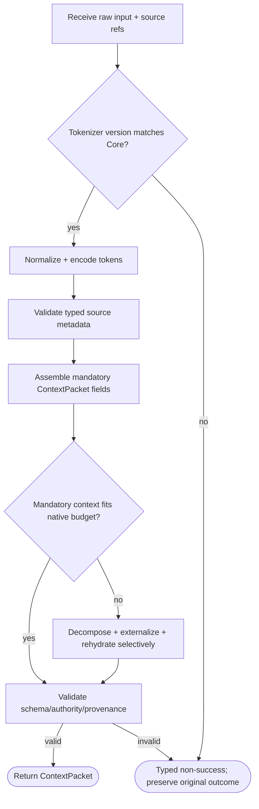

### Pseudocode

```text
function CONTEXT_PACKET(request, state, grant):
  REQUIRE(request.tokenizer == state.core.tokenizer, TOKENIZER_MISMATCH)
  sources = VALIDATE_SOURCES(state.addressable_context)
  packet = ASSEMBLE_MINIMAL(request, state, sources)
  if not FITS(packet): packet = OVERFLOW_RECOVERY(packet)
  REQUIRE(FITS(packet) and VALIDATE(packet), CONTEXT_ABI_MISMATCH)
  return packet
```

### Invariants

- Token/control semantics pinned to Core generation.
- Provenance survives compression/externalization.
- Mandatory goals and resolved clarifications survive packet rebuild.

### Typed failures

- AUTHORIZATION_DENIED
- BUDGET_EXHAUSTED
- CONSTRAINT_CONFLICT
- CONTEXT_ABI_MISMATCH
- INCOMPATIBLE_CONFIGURATION
- INSUFFICIENT_EVIDENCE
- INTERNAL_FAILURE
- MANDATORY_CONTEXT_OVERFLOW
- RECOVERY_REQUIRED
- SOURCE_VALIDATION_FAILED
- TOKENIZER_MISMATCH
- VALIDATION_FAILED

### Forbidden edges

- Tokenizer -> Silent vocabulary drift
- Summary -> Replace higher-authority evidence
- ContextPacket -> Silent native-budget overflow

### Optimization notes

- Do not serialize latent/structured state into prose unless the Core ABI requires it.
- ContextRetrieval001 schema 1 is a bounded software packet ABI, not tokenization: budgets count canonical JSON UTF-8 bytes; native tokenizer integration remains separate.

## 04. HSA/MSA Context Manager

**ID:** `context_manager`  
**Owner:** Context runtime  
**Status:** research; implementation: `partial-simulator`  
**Purpose:** Selects the smallest sufficient high-value context for the current step. HSA/MSA is a separately qualified mechanism, not required for the overlay thesis.

**Inputs:** Goal; WorkingState; AddressableContextRefs[]; Budget
**Outputs:** SelectedContextRefs[]; MissingDependencyReport
**Structural metrics:** 12 nodes; 14 transitions; normalized complexity 5. Not runtime proof.

### Flowchart

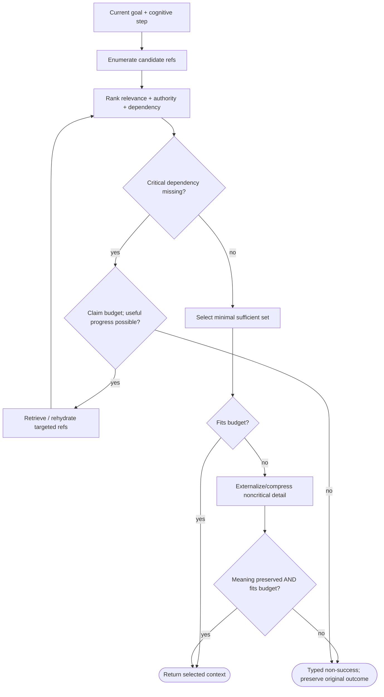

### Pseudocode

```text
function SELECT_CONTEXT(goal, step, refs, budget):
  while TRY(BUDGET.claim_one(budget)):
    ranked = RANK(refs, relevance, authority, dependency)
    if MISSING_CRITICAL(ranked):
      fresh = TRY(REHYDRATE(NEXT_CRITICAL_REF(ranked)))
      REQUIRE(ADDS_CRITICAL_EVIDENCE(fresh, refs), INSUFFICIENT_EVIDENCE)
      refs = UNION(refs, fresh)
      continue
    selected = MINIMAL_SUFFICIENT(ranked, goal, step)
    if not FITS(selected, budget): selected = TRY(COMPACT_OR_EXTERNALIZE(selected))
    REQUIRE(MEANING_PRESERVED(selected), VALIDATION_FAILED)
    REQUIRE(FITS(selected, budget), BUDGET_EXHAUSTED)
    return RESULT(SUCCESS, selected)
  return RESULT(BUDGET_EXHAUSTED)
```

### Invariants

- Selector never mutates evidence.
- Critical dependencies outrank token savings.
- Selection quality must be measured against a simpler baseline.

### Typed failures

- AUTHORIZATION_DENIED
- BUDGET_EXHAUSTED
- CONSTRAINT_CONFLICT
- INCOMPATIBLE_CONFIGURATION
- INSUFFICIENT_EVIDENCE
- INTERNAL_FAILURE
- RECOVERY_REQUIRED
- REHYDRATION_FAILED
- VALIDATION_FAILED

### Forbidden edges

- Context selector -> Source mutation
- Semantic similarity -> Override authority blindly
- Compression -> Drop active dependency

### Optimization notes

- Prefer top-k/threshold selection plus dependency closure over repeated full rescoring when evidence supports it.
- v0.4.11 implements only the explicit-ID/lexical software baseline in context_retrieval_flows.json. The native HSA/MSA mechanism above remains research; no semantic/minimality claim.

## 05. Compute Discipline Controller

**ID:** `compute_discipline`<br>
**Owner:** Cross-cutting Core/runtime policy<br>
**Status:** `canonical-policy`; implementation: `design-only`<br>
**Purpose:** Allocates context, recurrent depth, overlay loading and output refinement only when expected utility justifies cost.

**Inputs:** `TaskDifficultyEstimate`; `Uncertainty`; `AvailableBudget`; `CandidateOperations[]`<br>
**Outputs:** `BudgetGrant`; `Stop/Ask/Retrieve/Continue decision`<br>
**Logic metrics:** 9 nodes · 10 transitions · 2 decisions · normalized cyclomatic complexity 4

### Flowchart

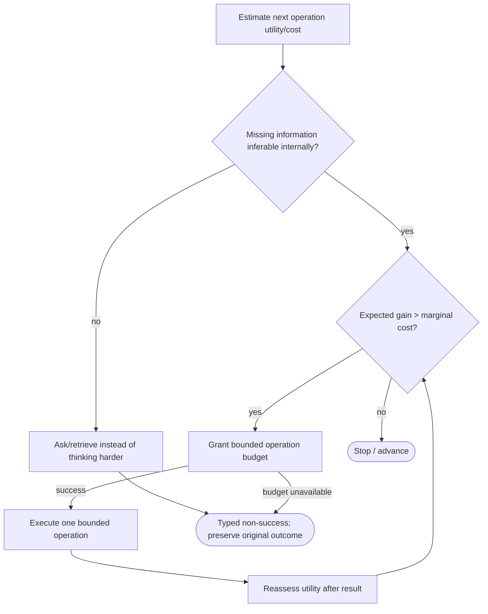

### Pseudocode

```text
function SHOULD_SPEND(op, state, budget):
  if NEEDS_USER_INFO(op, state): return RESULT(NEEDS_CLARIFICATION)
  if NEEDS_RETRIEVABLE_INFO(op, state): return RESULT(CONTEXT_REQUIRED)
  gain = EXPECTED_UTILITY_GAIN(op, state)
  cost = MARGINAL_COST(op)
  if gain <= cost: return RESULT(SUCCESS, STOP)
  REQUIRE(BUDGET.claim(cost, budget), BUDGET_EXHAUSTED)
  return RESULT(SUCCESS, RUN_ONCE)
# Caller reassesses after one operation; unused budget is not permission to loop.
```

### Invariants

- More compute is not inherently better cognition.
- Output length is independent of internal compute spent.
- Budget control applies across retrieval, recurrence, overlays and refinement.

### Typed failures

- `AUTHORIZATION_DENIED`
- `BUDGET_EXHAUSTED`
- `CONSTRAINT_CONFLICT`
- `CONTEXT_REQUIRED`
- `INCOMPATIBLE_CONFIGURATION`
- `INSUFFICIENT_EVIDENCE`
- `INTERNAL_FAILURE`
- `NEEDS_CLARIFICATION`
- `RECOVERY_REQUIRED`
- `VALIDATION_FAILED`

### Forbidden edges

- ✕ Unused budget -> Reason to continue
- ✕ Unknowable user intent -> Recurrent compute
- ✕ Cheap tokens -> Unlimited generation

### Optimization notes

- Centralize budget arbitration; do not repeat ad-hoc token/depth limits in every subsystem.

## 06. Working Space + Autoregressive Control Loop

**ID:** `working_ar`  
**Owner:** Generations (managed TaskRecord heads); RecoveryStore (legacy recovery simulator); learned AR loop remains research  
**Status:** canonical; implementation: `partial-simulator`  
**Purpose:** Advances compact task state and preserves typed stage handoffs. StageHandoff001 implements only record validation, sealed boundaries and deterministic recovery; learned AR steps remain design-only.

**Inputs:** ContextPacket; WorkingState; CoreResult; TaskRecord v1; StageHandoffRequest v1; Exact source checkpoint hash; Admitted profile/transition fixtures; Scoped TaskRecord v2 and reviewed schema-v2 state commands
**Outputs:** WorkingState; NextOperation; GenerationIntentCandidate; Checkpoint v2 with TaskRecord; Typed stage result with historical flag
**Structural metrics:** 15 nodes; 20 transitions; normalized complexity 8. Not runtime proof.

### Flowchart

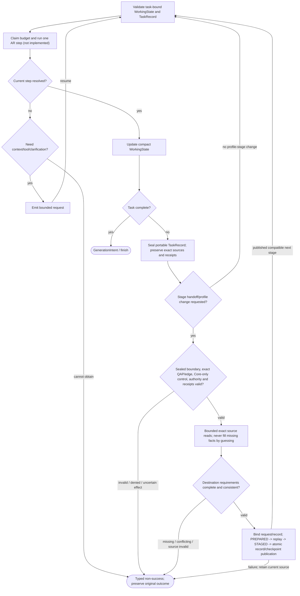

### Pseudocode

```text
function AR_LOOP(state, budget):
  while not state.task_complete:
    REQUIRE(BUDGET.claim(STEP_COST, budget), BUDGET_EXHAUSTED)
    step = TRY(CORE_STEP(state.context, state))
    if step.needs_request:
      return RESULT(NEEDS_CLARIFICATION if step.needs_user else CONTEXT_REQUIRED, step.request)
    REQUIRE(PROGRESSES(step, state), INSUFFICIENT_EVIDENCE)
    state = TRY(COMPACT(APPLY(step, state)))
  return RESULT(SUCCESS, TRY(BUILD_GENERATION_INTENT(state)))
# Implemented StageHandoff001 sub-boundary; AR_LOOP above remains design-only.
function HANDOFF(request, target_profile, source):
  REQUIRE(exact_hash(source) == request.source_hash, INCOMPATIBLE_CONFIGURATION)
  REQUIRE(source.stage.sealed and NEXT_STAGE_VALID(request), CONSTRAINT_CONFLICT)
  REQUIRE(DECLARED_QAP_AND_EDGE(source, target_profile), INCOMPATIBLE_CONFIGURATION)
  REQUIRE(FRESH_SIMULATED_AUTHORIZATION(), AUTHORIZATION_DENIED)
  TRY(VERIFY_ALL_ACTION_AND_OUTPUT_RECEIPTS(source.task))
  record = TRY(COPY_AND_REHYDRATE_EXACT_REQUIRED_FIELDS(source.record, request))
  # Missing information yields NEEDS_CLARIFICATION / INSUFFICIENT_EVIDENCE, not a guess.
  # CONTROL/EVALUATION requires Core-only; every retry binds the same request and record.
  return TRY(DURABLE_RECOVERY_WITH_BOUND_RECORD(source, target_profile, record))
# PUBLISHED retry returns historical=True without fresh execution or pointer changes.
  # PersistentState001: Generations owns managed heads and journal revisions.
  # REVIEWED_STATE_DELTA = exact expected revision + scope + ECID + source refs + separate local review.
  # TRY(Generations.task_operation(REVIEWED_STATE_DELTA)) commits only allowlisted data and receipt.
  # Legacy RecoveryStore remains a separate bounded simulator, not a competing managed-task head.
```

### Invariants

- Goal/constraints/clarifications survive state updates.
- Intermediate states are disposable unless explicitly promoted.
- Each outer-loop step has one declared objective.
- Exactly one profile/ECID per published task stage; this prototype has one execution caller, not a concurrent scheduler.
- TaskRecord, profile, cache and attempt status publish in the existing single SQLite transaction; no second current-state store.
- Only missing required fact properties may be completed from exact local evidence. Assumptions do not become facts.
- Historical PUBLISHED results are reads and never reactivate the historical profile.
- CONTROL/EVALUATION stages require a Core-only profile and compatible cache.
- Task completion / semantic evaluation is not implemented by record sealing.
- PersistentState001 admits legacy state explicitly; scopes never arise from inferred identity.
- Reviewed source-backed state remains data, cannot rewrite protected policy or weights, and rechecks current retrieval eligibility.
- Mutable symbolic state is not evidence of useful trained neural memory.

### Typed failures

- AUTHORIZATION_DENIED
- BUDGET_EXHAUSTED
- CAPABILITY_UNAVAILABLE
- CONSTRAINT_CONFLICT
- CONTEXT_REQUIRED
- INCOMPATIBLE_CONFIGURATION
- INSUFFICIENT_EVIDENCE
- INTERNAL_FAILURE
- NEEDS_CLARIFICATION
- RECOVERY_REQUIRED
- VALIDATION_FAILED

### Forbidden edges

- Working Space -> Automatic Memory
- Transient reasoning -> Evidence
- AR loop -> Weight mutation
- Stage handoff -> Perform an external effect
- Source completion -> Infer a missing unit
- Unqualified union -> Stage activation
- Historical receipt -> Fresh activation authority

### Optimization notes

- Keep state normalized and referential; store source handles instead of copied blobs.
- One durable current pointer; per-call source read cache; no generic workflow engine or new memory archive.

## 07. Recurrent Depth Controller

**ID:** `recurrent_depth`<br>
**Owner:** Primary Core research mechanism<br>
**Status:** `research`; implementation: `design-only`<br>
**Purpose:** Reuses the same frozen reasoning block to refine one unresolved step with adaptive depth.

**Inputs:** `WorkingState`; `CurrentStep`; `Context`; `Budget`<br>
**Outputs:** `RefinedState`; `Halt/Retrieve/Clarify/Advance decision`<br>
**Logic metrics:** 7 nodes · 8 transitions · 3 decisions · normalized cyclomatic complexity 4

### Flowchart

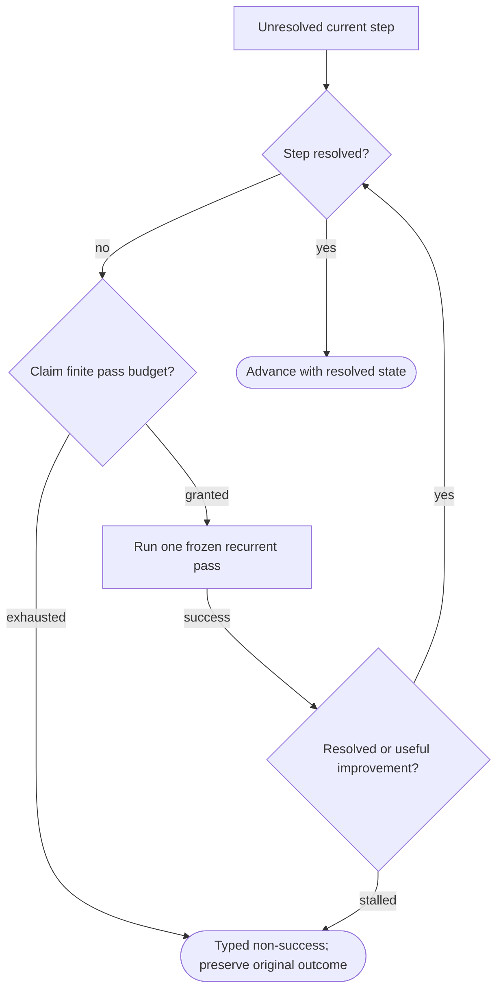

### Pseudocode

```text
function REFINE_STEP(state, max_budget):
  prev = QUALITY(state)
  while not RESOLVED(state):
    REQUIRE(BUDGET.claim(DEPTH_COST, max_budget), BUDGET_EXHAUSTED)
    candidate = TRY(RECURRENT_PASS(state))
    if RESOLVED(candidate): return RESULT(SUCCESS, candidate)
    gain = QUALITY(candidate) - prev
    REQUIRE(gain > HALT_THRESHOLD, DEPTH_STALLED)
    state, prev = candidate, QUALITY(candidate)
  return RESULT(SUCCESS, state)
```

### Invariants

- Same accepted weights across recurrent passes.
- Current AR step remains fixed until explicit advance.
- Extra depth requires measurable expected benefit.

### Typed failures

- `AUTHORIZATION_DENIED`
- `BUDGET_EXHAUSTED`
- `CONSTRAINT_CONFLICT`
- `CONTEXT_REQUIRED`
- `DEPTH_STALLED`
- `INCOMPATIBLE_CONFIGURATION`
- `INSUFFICIENT_EVIDENCE`
- `INTERNAL_FAILURE`
- `NEEDS_CLARIFICATION`
- `RECOVERY_REQUIRED`
- `VALIDATION_FAILED`

### Forbidden edges

- ✕ Recurrent inference -> Train weights
- ✕ Depth -> Replace clarification
- ✕ No progress -> Infinite loop

### Optimization notes

- Use shared block and latent state; avoid generating natural-language chains solely to feed the next pass.

## 08. Ambiguity / Clarification Gate

**ID:** `ambiguity_gate`<br>
**Owner:** Primary Core cognition policy<br>
**Status:** `canonical`; implementation: `design-only`<br>
**Purpose:** Prevents silent arbitrary choice among materially different interpretations while avoiding unnecessary questions.

**Inputs:** `IntentCandidates[]`; `ConsequenceEstimate`; `Reversibility`; `AvailableContext`<br>
**Outputs:** `ResolvedIntent`; `AssumptionRecord`; `ClarificationRequest`<br>
**Logic metrics:** 9 nodes · 10 transitions · 3 decisions · normalized cyclomatic complexity 4

### Flowchart

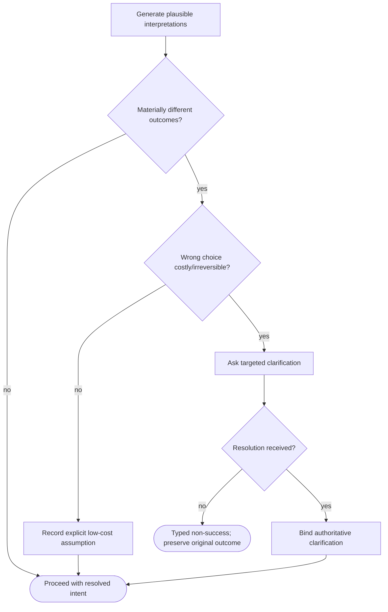

### Pseudocode

```text
function RESOLVE_AMBIGUITY(candidates, stakes):
  if EQUIVALENT_OUTCOMES(candidates): return RESULT(SUCCESS, BEST(candidates))
  if stakes.low_and_reversible: return RESULT(SUCCESS, RECORD_ASSUMPTION(BEST(candidates)))
  return RESULT(NEEDS_CLARIFICATION, TARGETED_QUESTION(candidates))
```

### Invariants

- Clarification is proportional to ambiguity x consequence.
- User resolution becomes authoritative task state.
- Do not spend compute guessing information only the user/external world can supply.

### Typed failures

- `AUTHORIZATION_DENIED`
- `BUDGET_EXHAUSTED`
- `CONSTRAINT_CONFLICT`
- `INCOMPATIBLE_CONFIGURATION`
- `INSUFFICIENT_EVIDENCE`
- `INTERNAL_FAILURE`
- `NEEDS_CLARIFICATION`
- `RECOVERY_REQUIRED`
- `VALIDATION_FAILED`

### Forbidden edges

- ✕ High-impact ambiguity -> Silent guess
- ✕ Resolved clarification -> Dropped while dependency active
- ✕ Uncertainty alone -> Mandatory interruption

### Optimization notes

- Three-way branch only: proceed, explicit assumption, clarify. Avoid elaborate confidence trees.

## 09. Overlay Index + Neural Reserve

**ID:** `overlay_index`  
**Owner:** Overlay registry/storage runtime  
**Status:** canonical; implementation: `partial-simulator`  
**Purpose:** Read an exact reviewed catalogue for the current generation and choose one approved bounded profile. Metadata labels/costs are fixtures, not independent capability evidence.

**Inputs:** CapabilityQuery; CoreGenerationId; CurrentOverlayGeneration
**Outputs:** OverlayRef[]; DependencyClosure; ResidencyPlan
**Structural metrics:** 9 nodes; 10 transitions; normalized complexity 4. Not runtime proof.

### Flowchart

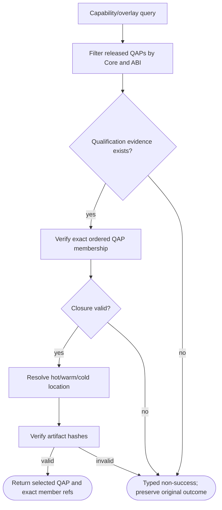

### Pseudocode

```text
function LOOKUP_AND_SELECT(request, current_task):
  TRY(VALIDATE(request)); descriptor = TRY(CURRENT_REVIEWED_CATALOGUE(request))
  TRY(CHECK_CURRENT_FAMILY_EVIDENCE_AND_SOURCE_ELIGIBILITY(descriptor))
  candidates = ONE_PROFILE_COVERING_ALL_EXACT_LABELS(request)
  REQUIRE(no_inferred_subset_or_union, INCOMPATIBLE_CONFIGURATION)
  candidates = FILTER_MODE_BOUNDS_AND_QUALIFIED_DIRECTED_EDGES(candidates)
  profile = SELECT_ONE_QUALIFIED_PROFILE(candidates,
    rule=LOWEST_DECLARED_COST, keep_current_if_tied=True, otherwise=NEEDS_CLARIFICATION)
  return RESULT(SUCCESS, profile)  # proposal, not reservation or permission
  # Current implementation: catalog_select/catalog_task_handoff/catalog_task_completion.
  # No learned selection, VRAM paging or Runtime execution permit.
```

### Invariants

- Every OverlayRef resolves to immutable artifact identity.
- Dependencies/exclusions explicit.
- Index returns evidence metadata, not a compatibility promise beyond qualified scope.

### Typed failures

- ARTIFACT_MISSING
- AUTHORIZATION_DENIED
- BUDGET_EXHAUSTED
- CAPABILITY_UNAVAILABLE
- CHECKSUM_MISMATCH
- CONSTRAINT_CONFLICT
- DEPENDENCY_CONFLICT
- INCOMPATIBLE_CONFIGURATION
- INSUFFICIENT_EVIDENCE
- INTERNAL_FAILURE
- NEEDS_CLARIFICATION
- NO_VALID_OVERLAY
- RECOVERY_REQUIRED
- TRAINING_RESTRICTED
- UNQUALIFIED_CONFIGURATION
- VALIDATION_FAILED

### Forbidden edges

- Index -> Infer neural compatibility from tensor shape
- Index -> Candidate promotion
- Cold artifact -> Activate without Loader

### Optimization notes

- Cache verified metadata by immutable hash; recheck artifact bytes at load/trust boundary.

## 10. Overlay Loader + QAP + ECID

**ID:** `overlay_runtime`<br>
**Owner:** Overlay runtime<br>
**Status:** `canonical`; implementation: `partial-simulator`<br>
**Purpose:** Activates only qualified profiles through qualified directed transitions and handles stale in-flight state safely.

**Inputs:** `RequestedQAP`; `CurrentECID`; `OverlayRefs[]`; `AuthorizationToken`; `ResourceState`<br>
**Outputs:** `PublishedECID`; `ActiveProfile`; `RecoveryReport`<br>
**Logic metrics:** 11 nodes · 14 transitions · 4 decisions · normalized cyclomatic complexity 6

### Flowchart

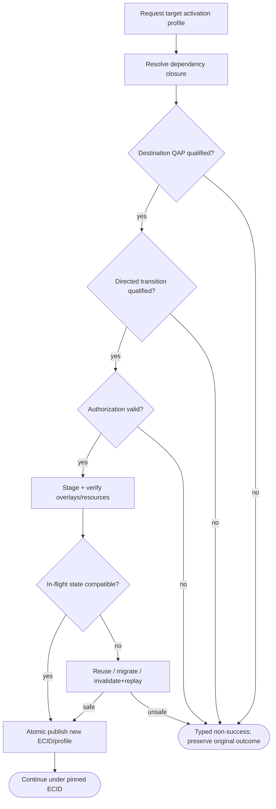

### Pseudocode

```text
function ACTIVATE(target, state):
  refs = TRY(FIND_OVERLAYS(target, state.config))
  REQUIRE(QUALIFIED(target.qap) and QUALIFIED(state.profile -> target.qap), TRANSITION_UNQUALIFIED)
  REQUIRE(AUTHORIZE(target, state.ecid), AUTHORIZATION_DENIED)
  staged = TRY(STAGE(refs))
  plan = TRY(STATE_TRANSITION_PLAN(state, target))
  REQUIRE(REPLAY_SAFE(state.task), RECOVERY_REQUIRED)
  rebuilt = TRY(APPLY_QUALIFIED_REUSE_OR_REPLAY(plan, state))
  return TRY(ATOMIC_PUBLISH(staged, rebuilt, preserve=state))
# Migration is design-only and must not be inferred from the 001A/001B simulator.
```

### Invariants

- Destination profile and transition both qualified.
- Continuing computation is pinned to resulting ECID.
- Failed transition preserves source configuration.
- StageHandoff001 annotated checkpoints additionally bind the exact TaskRecord and handoff request; legacy v1 behavior is preserved.

### Typed failures

- `AUTHORIZATION_DENIED`
- `BUDGET_EXHAUSTED`
- `CONSTRAINT_CONFLICT`
- `INCOMPATIBLE_CONFIGURATION`
- `INSUFFICIENT_EVIDENCE`
- `INTERNAL_FAILURE`
- `RECOVERY_REQUIRED`
- `RESOURCE_UNAVAILABLE`
- `TRANSITION_UNQUALIFIED`
- `VALIDATION_FAILED`

### Forbidden edges

- ✕ QAP -> Every subset assumed valid
- ✕ Registry switch -> Silent stale-cache reuse
- ✕ Partial stage -> Production activation
- ✕ Loader -> Core mutation

### Optimization notes

- Keep QAP lookup + transition lookup O(1) by IDs; precompute dependency closures per released generation.
- See docs/STAGE_HANDOFF_001.md for the bounded portable-record extension, not a full implementation of this flow.

## 11. Overlay Generation Lifecycle

**ID:** `overlay_generation`  
**Owner:** Generation catalogue / release role  
**Status:** canonical; implementation: `partial-simulator`  
**Purpose:** Qualified generation-wide catalogue release with separately approved local grant, sealed artifacts, managed-stage barrier, atomic epoch/archive/receipt and explicit rollback. Production serving remains deferred.

**Inputs:** Exact immutable generation/qualification references; Declared local operator and scoped release request; Current generation epoch / managed stage
**Outputs:** Typed result or unchanged historical receipt; Preserved source on failure; no serving or production permission
**Structural metrics:** 11 nodes; 10 transitions; normalized complexity 3. Not runtime proof.

### Flowchart

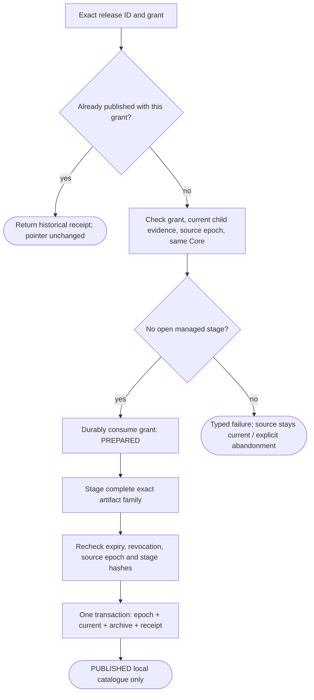

### Pseudocode

```text
function ADOPT_RELEASE(id, grant):
  if exact_receipt_exists: return HISTORY_WITHOUT_PUBLICATION
  TRY(AUTHORIZE_EXACT_LOCAL_RELEASE(grant))
  TRY(CHECK_FAMILY_LIVE_AND_SOURCE_EPOCH())
  REQUIRE(no_open_managed_stage, RECOVERY_REQUIRED)
  TRY(PREPARE_AND_CONSUME_ONCE(id))
  staged = TRY(STAGE_EXACT_ARTIFACTS())
  TRY(RECHECK_AUTHORITY_SOURCE_EPOCH_AND_BYTES())
  return ATOMIC_PUBLISH(current=target, archive=previous, receipt=completed)
# Resume only local staging with live checks. Expired/withdrawn consumed work must be abandoned.
# Rollback is a new explicit approved release, never reuse of an old grant.
```

### Invariants

- Source remains current until commit.
- Publication, predecessor archival and receipt are the same atomic event.
- Rollback requires exact previously published target plus fresh approval and current evidence.
- No Core replacement, external effects, or runtime permit in this operation.
- A generation epoch is never recycled, even when returning to identical weights.
- Installed original and candidate families have distinct formats and profile names; no arbitrary cross-family mixing.

### Typed failures

- AUTHORIZATION_DENIED
- BUDGET_EXHAUSTED
- CAPABILITY_UNAVAILABLE
- CONSTRAINT_CONFLICT
- INCOMPATIBLE_CONFIGURATION
- INSUFFICIENT_EVIDENCE
- INTERNAL_FAILURE
- RECOVERY_REQUIRED
- TRAINING_RESTRICTED
- VALIDATION_FAILED

### Forbidden edges

- Generation release -> Replay operation grant reuse
- Generation manager -> Neighbor private storage
- Publication -> In-flight state reuse
- Historical receipt -> Renewed authority
- Candidate producer -> Own generation qualification

### Optimization notes

- Shared journal mechanics, separate owner stores and reducers.
- No separate mutable current/archive/revocation indexes; reconstruct from bounded verified events.
- One publication transaction; no automatic external replay.

## 12. Memory System

**ID:** `memory`<br>
**Owner:** Memory subsystem<br>
**Status:** `canonical`; implementation: `design-only`<br>
**Purpose:** Preserves evidence, structured memory, interpretation and review as distinct provenance-bearing layers.

**Inputs:** `MemoryCandidate`; `RawEvidenceRef`; `ReviewEvent?`<br>
**Outputs:** `MemoryRecord`; `ReviewRequired`; `RejectedCandidate`<br>
**Logic metrics:** 10 nodes · 11 transitions · 2 decisions · normalized cyclomatic complexity 4

### Flowchart

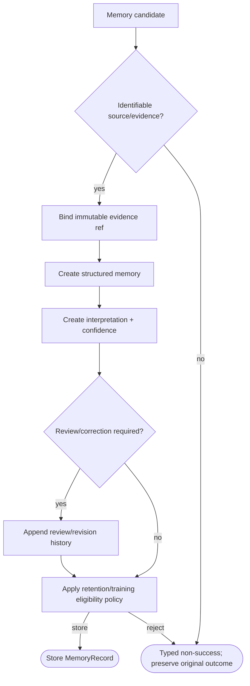

### Pseudocode

```text
function INGEST_MEMORY(candidate):
  REQUIRE(candidate.source_ref, SOURCE_UNKNOWN)
  evidence = TRY(BIND_EVIDENCE(candidate.source_ref))
  structured = TRY(STRUCTURE(candidate, evidence))
  interpretation = TRY(INTERPRET(structured))
  reviewed = TRY(APPLY_REVIEW_IF_REQUIRED(interpretation))
  REQUIRE(STORAGE_ALLOWED(reviewed), RETENTION_RESTRICTED)
  return RESULT(SUCCESS, TRY(STORE_MEMORY(evidence, structured, reviewed)))
```

### Invariants

- Raw evidence immutable against silent rewrite.
- Interpretation distinguishable from evidence.
- Training eligibility is separate from memory persistence.

### Typed failures

- `AUTHORIZATION_DENIED`
- `BUDGET_EXHAUSTED`
- `CONFLICT_REQUIRES_REVIEW`
- `CONSTRAINT_CONFLICT`
- `INCOMPATIBLE_CONFIGURATION`
- `INSUFFICIENT_EVIDENCE`
- `INTERNAL_FAILURE`
- `RECOVERY_REQUIRED`
- `RETENTION_RESTRICTED`
- `SOURCE_UNKNOWN`
- `VALIDATION_FAILED`

### Forbidden edges

- ✕ Interpretation -> Overwrite evidence
- ✕ Memory -> Automatic training
- ✕ Correction -> Erase revision history

### Optimization notes

- Normalize references; avoid duplicating raw evidence bodies into every memory record.

## 13. Experience Archive

**ID:** `experience`  
**Owner:** Experience Archive (experience_contracts + experience_store; explicit intake via experience_intake)  
**Status:** canonical; implementation: `partial-simulator`  
**Purpose:** Capture source-linked experience; append human review/corrections and scoped permissions; expose only a current permitted curated view. No automatic training.

**Inputs:** CaptureRequest v1 with evidence bytes and explicit actor; MutationRequest v1 with exact expected revision hash; SourceRevocation v1; UseRequest with purpose and current revision hash; BatchUseRequest v1: up to 32 exact revision refs and one purpose
**Outputs:** Typed ArchiveResult with exact revision reference or non-success; Inspection-only history/source bytes; Permitted current curated view (not a dataset or release authorization); Atomic point-in-time batch of approved views with review/permission observations
**Structural metrics:** 12 nodes; 17 transitions; normalized complexity 8. Not runtime proof.

### Flowchart

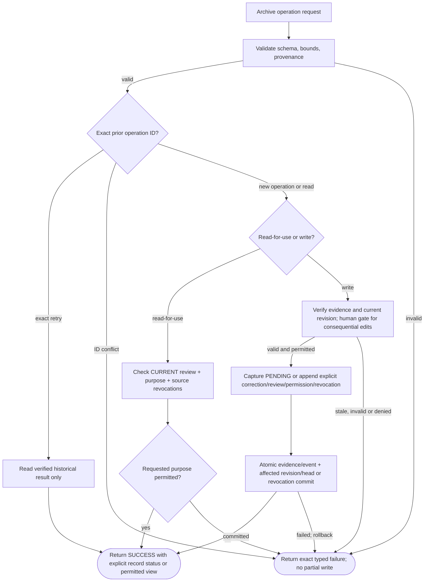

### Pseudocode

```text
function ARCHIVE_OPERATION(request):
  command = TRY(VALIDATE_AND_NORMALIZE(request))
  begin local archive transaction
  if exact prior operation: return RESULT(SUCCESS, VERIFIED_HISTORY_ONLY(command))
  if conflicting operation ID: return RESULT(CONSTRAINT_CONFLICT)
  if read_for_use:
    state = TRY(VERIFY_CURRENT_LINEAGE_AND_EXACT_REFERENCE(command))
    TRY(CHECK_CURRENT_REVIEW_PURPOSE_AND_SOURCE_REVOCATIONS(state, command.purpose))
    return RESULT(SUCCESS, CURRENT_SOURCE_LINKED_VIEW(state))
  prior = TRY(VERIFY_CAPTURE_OR_EXPECTED_HEAD(command))
  TRY(REQUIRE_HUMAN_ATTESTATION_WHERE_APPLICABLE(command))
  target = TRY(REDUCE_RECORD_OR_SOURCE_REVOCATION(prior, command))
  TRY(ATOMIC_PUBLISH(evidence, command, target, affected_archive_pointers))
  return RESULT(SUCCESS, TYPED_OPERATION_RECEIPT(target))
  on non_success: ROLLBACK_ARCHIVE_ONLY; return RESULT(original_code)
BATCH_USE(refs, purpose): validate all exact-current refs in one archive transaction; return all permitted views or typed failure.
Validate both revocation event/index linkage and source bindings before granting use; missing/repointed index rows fail closed.
DatasetSnapshot001 consumes only this public use interface; separate snapshot publication is not an archive authorization lease.
```

### Invariants

- Raw evidence and capture observation remain separate from interpretations/corrections.
- Capture is PENDING_REVIEW with all use purposes UNKNOWN; confidence does not approve.
- Human role is local attestation, not authenticated Nexus authority.
- Changes append event/revision and atomically update the archive head, never the runtime checkpoint.
- One use purpose does not grant any other purpose; statement changes invalidate prior ALLOWED purposes.
- Open disputes are quarantined; resolution still requires separate review.
- Source-purpose revocation blocks all linked current/historical use; historic operation reads never regrant.
- Withdraw is logical restriction, not secure erasure; no automatic training or release.
- Missing/repointed revocation-index rows cannot restore revoked permission.

### Typed failures

- AUTHORIZATION_DENIED
- BUDGET_EXHAUSTED
- CONFLICT_REQUIRES_REVIEW
- CONSTRAINT_CONFLICT
- INCOMPATIBLE_CONFIGURATION
- INSUFFICIENT_EVIDENCE
- INTERNAL_FAILURE
- RECOVERY_REQUIRED
- RETENTION_RESTRICTED
- TRAINING_RESTRICTED
- VALIDATION_FAILED

### Forbidden edges

- Archive -> Automatic optimizer input
- Interpretation -> Overwrite raw evidence
- Archive -> Runtime checkpoint mutation
- Model judgment -> Human approval authority
- Historical grant -> Bypass current revocation
- Archive -> Production release

### Optimization notes

- One content-addressed evidence blob may serve multiple records; provenance metadata remains per record.
- Full per-record lineage verification is bounded to 512 revisions; no unsafe cross-call validation cache.
- 25-flow atlas remains a structural specification; software coverage does not prove learned curation.
- The local revocation ledger is fully verified once per batch. Future indexed optimization must preserve integrity tests.

## 14. Knowledge Space

**ID:** `knowledge`<br>
**Owner:** Knowledge subsystem<br>
**Status:** `canonical`; implementation: `design-only`<br>
**Purpose:** Stores updateable facts and source-sensitive information outside neural weights with freshness and authority tracking.

**Inputs:** `KnowledgeSource`; `UpdateEvent`; `Query`<br>
**Outputs:** `KnowledgeRef[]`; `Freshness/ConflictMetadata`<br>
**Logic metrics:** 9 nodes · 10 transitions · 2 decisions · normalized cyclomatic complexity 4

### Flowchart

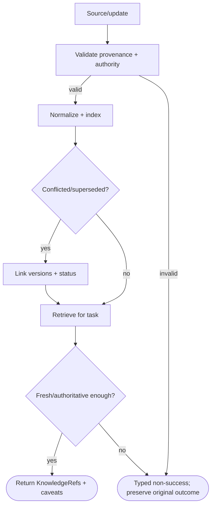

### Pseudocode

```text
function RETRIEVE_KNOWLEDGE(query):
  refs = INDEX_LOOKUP(query)
  refs = RANK(refs, authority, freshness, relevance)
  refs = [r for r in refs if VALID_SOURCE(r)]
  if not refs: return RESULT(INSUFFICIENT_EVIDENCE)
  return RESULT(SUCCESS, refs)
```

### Invariants

- Changing facts preferentially external.
- Conflicts remain explicit.
- Retrieved knowledge carries source/freshness metadata.

### Typed failures

- `AUTHORIZATION_DENIED`
- `BUDGET_EXHAUSTED`
- `CONSTRAINT_CONFLICT`
- `INCOMPATIBLE_CONFIGURATION`
- `INSUFFICIENT_EVIDENCE`
- `INTERNAL_FAILURE`
- `RECOVERY_REQUIRED`
- `RETRIEVAL_FAILED`
- `SOURCE_INVALID`
- `STALE_OR_CONFLICTED`
- `VALIDATION_FAILED`

### Forbidden edges

- ✕ Knowledge record -> Silent Core training
- ✕ Summary -> Erase source provenance
- ✕ Old fact -> Overwrite newer authority silently

### Optimization notes

- Index by immutable source/version IDs; cache rankings separately from source records.

## 15. Builder + Dataset Curator

**ID:** `builder`  
**Owner:** LearnerCoordinator + LearningCycles; existing archive, snapshot and numerical owners  
**Status:** canonical; implementation: `partial-simulator`  
**Purpose:** Human-assisted fixed-recipe learning through exact review-only proposals; learned gap diagnosis and autonomous curation remain design-only.

**Inputs:** CapabilityGapEvidence; ExperienceRefs[]; ExternalDatasetRefs[]; CapabilityInventory; DatasetBuildRequest v1 with exact revisions, splits and tokenizer identity (local implemented subset); LearningPlan v1 and separate local training attestation
**Outputs:** CandidateTrainingSpec; DatasetManifest; NoTrainDecision; DatasetSnapshot reference; training-purpose read with current eligibility (implemented subset, not a training grant); Immutable candidate/evaluation refs and review-only proposal; no self-qualification
**Structural metrics:** 9 nodes; 11 transitions; normalized complexity 5. Not runtime proof.

### Flowchart

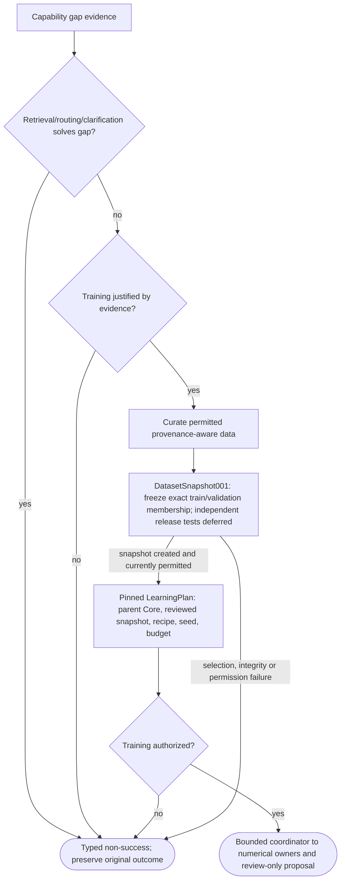

### Pseudocode

```text
Gap diagnosis remains human supplied; the following cycle is implemented.
TRY(PREPARE_EXACT_LEARNING_PLAN())
AUTHORIZE(separate_local_operator, training_only, expiry)
TRY(DATASET_SNAPSHOT(request, archive, tokenizer)) # explicit revisions; current training-purpose gate
TRY(CLAIM_AND_EXECUTE_ONCE_OR_RECOVER_SEALED_OWNER_RECEIPT(TRAIN))
TRY(CLAIM_AND_EXECUTE_ONCE_OR_RECOVER_SEALED_OWNER_RECEIPT(EVALUATE))
TRY(REVERIFY_NUMERICAL_EVIDENCE_AND_CURRENT_ELIGIBILITY())
return RESULT(SUCCESS, REVIEW_ONLY_PROPOSAL(qualification=INSUFFICIENT_EVIDENCE))
Unfinished dispatch returns RECOVERY_REQUIRED, never silent repeat training.
See dataset_snapshot_flows.json and bounded_learner_flows.json; no deployment edge.
```

### Invariants

- Builder proposes only.
- Held-out evaluation material not silently leaked into training.
- Dataset permission/provenance explicit.
- Immutable membership never follows changing archive heads.
- Every consumption rechecks exact current revisions and training permission; no silent filtering.
- Validation data here are development data, not protected independent qualification holdout.
- Local HUMAN metadata is an attestation, not authenticated authority.

### Typed failures

- AUTHORIZATION_DENIED
- BUDGET_EXHAUSTED
- CONFLICT_REQUIRES_REVIEW
- CONSTRAINT_CONFLICT
- DATA_RESTRICTED
- INCOMPATIBLE_CONFIGURATION
- INSUFFICIENT_EVIDENCE
- INTERNAL_FAILURE
- RECOVERY_REQUIRED
- RETENTION_RESTRICTED
- TRAINING_NOT_JUSTIFIED
- TRAINING_RESTRICTED
- VALIDATION_FAILED

### Forbidden edges

- Builder -> Core mutation
- Builder -> Candidate promotion
- Curator -> Drop provenance
- Builder -> Train when retrieval solves gap
- DatasetSnapshots -> Private archive SQL/history as a consumption bypass
- DatasetSnapshot receipt -> Automatic trainer/production authority

### Optimization notes

- Perform cheap existing-capability check before expensive dataset assembly.
- Batch eligibility is checked in one archive transaction; no continuing authority cache.
- Pure allowlisted projections do not execute content or tokenize it.

## 16. Overlay Trainer

**ID:** `overlay_trainer`  
**Owner:** Installed learner_recipe + candidate_records using shared numerical journal mechanics  
**Status:** canonical; implementation: `partial-simulator`  
**Purpose:** Bounded opt-in new-A2 training against exact frozen Core; generic training, resource sandboxing and learned objectives remain absent.

**Inputs:** FrozenCorePackage; CandidateTrainingSpec; DatasetManifest
**Outputs:** CandidateOverlayArtifacts; TrainingReport
**Structural metrics:** 9 nodes; 9 transitions; normalized complexity 3. Not runtime proof.

### Flowchart

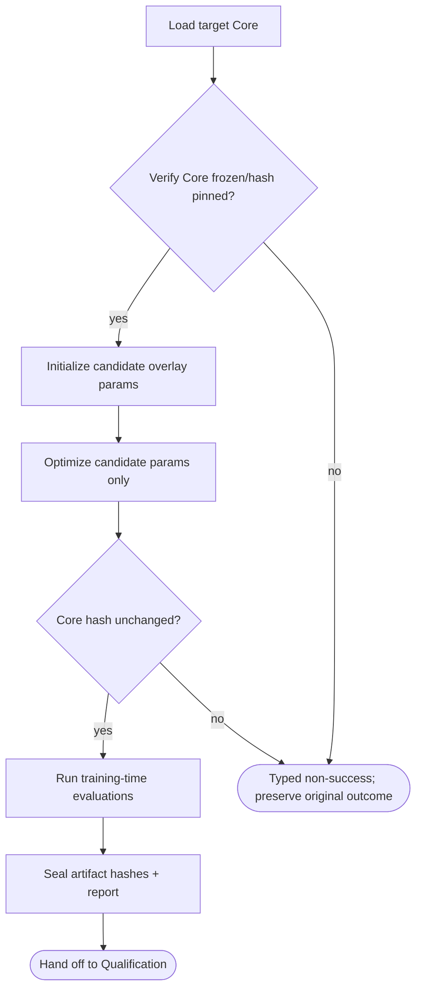

### Pseudocode

```text
function TRAIN_OVERLAY(core, spec):
  REQUIRE(HASH(core.weights) == spec.core_hash, CHECKPOINT_INVALID)
  FREEZE(core)
  candidate = INIT_OVERLAY(spec)
  for batch in spec.train_data: OPTIMIZE(candidate, core, batch)
  REQUIRE(HASH(core.weights) == spec.core_hash, CORE_MUTATION_DETECTED)
  return RESULT(SUCCESS, SEAL(candidate, spec))
Implemented specialization: fixed rank-4 A2 against NeuralProbe001 parent; existing Core/A/B untouched.
An unresolved dispatch cannot silently restart; existing finalized owner receipts are reused.
Scoring against developer-visible synthetic fixtures is not independent release qualification.
```

### Invariants

- Only candidate parameters update.
- Core hash before/after identical.
- Dataset lineage preserved in report.

### Typed failures

- AUTHORIZATION_DENIED
- BUDGET_EXHAUSTED
- CHECKPOINT_INVALID
- CONSTRAINT_CONFLICT
- CORE_MUTATION_DETECTED
- DATASET_INVALID
- INCOMPATIBLE_CONFIGURATION
- INSUFFICIENT_EVIDENCE
- INTERNAL_FAILURE
- RECOVERY_REQUIRED
- RESOURCE_FAILURE
- TRAINING_DIVERGED
- VALIDATION_FAILED

### Forbidden edges

- Trainer -> Production overlay mutation
- Trainer -> Deployment
- Trainer -> Change target Core

### Optimization notes

- Keep optimizer state scoped to candidate; stream batches and checkpoint candidate only.

## 17. Qualification Authority + Evidence Binding

**ID:** `qualification`  
**Owner:** QualificationEvidence002 local journal + built-in numerical evidence adapter  
**Status:** implemented trusted-local development workflow; authentication and independent scientific validation absent; implementation: `partial-simulator`  
**Purpose:** Exact claim review, current eligibility and durable history; no execution or deployment permit.

**Inputs:** PinnedQualificationRequest; LocalReviewerDecision; PublicProbeEvidence; ExactPrerequisiteRefs
**Outputs:** HistoricalReceipt; ClaimScopedCertificate or no certificate; CurrentUseObservation or typed failure
**Structural metrics:** 13 nodes; 18 transitions; normalized complexity 9. Not runtime proof.

### Flowchart

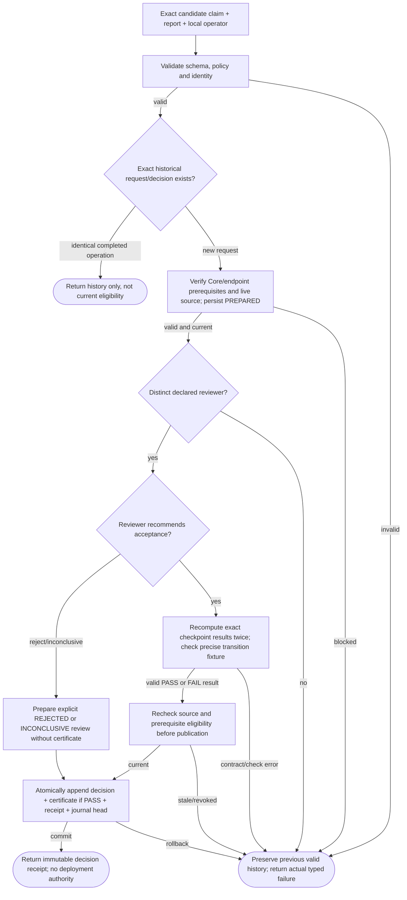

### Pseudocode

```text
VALIDATE(exact source: original probe OR installed CandidateEvidence001, never mix)
REQUIRE(reviewer differs from submitter AND actual candidate trainer, AUTHORIZATION_DENIED)
if exact terminal retry: return immutable history; no current authority
TRY(CHECK_LIVE_PARENT_AND_CANDIDATE_LINEAGE_AND_PREREQUISITES())
TRY(RELOAD_AND_CHECK_SAVED_NUMERICAL_REPORTS_WITH_FROZEN_CRITERIA())
RECHECK(source permission, parent certificate, exact local profile prerequisites)
ATOMIC_PUBLISH(QUALIFIED / REJECTED / INCONCLUSIVE decision and receipt)
Current use independently rechecks eligibility; certification does not authorize deployment.
```

### Invariants

- Evidence binds exact hashes/configuration/test versions.
- Qualification is claim-scoped.
- Qualification and deployment authorization remain separate.
- EvaluationRun001 PASS/FAIL/INCONCLUSIVE records are not QualificationEvidence or deployment authorization.
- Exact Core-only and endpoint prerequisites required.
- Roles are local attestations, not authenticated identities.
- Candidate check and human decision are distinct.
- History does not restore source permission or claim eligibility.
- All mutations append an event and head in one transaction.
- No evaluation PASS self-promotes.
- A2/A2B candidate evidence cannot masquerade as original A/AB.
- The candidate learning producer cannot review its own evidence under a separate request-producer label.

### Typed failures

- AUTHORIZATION_DENIED
- BUDGET_EXHAUSTED
- CONSTRAINT_CONFLICT
- INCOMPATIBLE_CONFIGURATION
- INSUFFICIENT_EVIDENCE
- RECOVERY_REQUIRED
- TRAINING_RESTRICTED
- VALIDATION_FAILED
- CAPABILITY_UNAVAILABLE

### Forbidden edges

- Producer -> own review
- Certificate -> implicit deployment
- AB approval -> inferred subset/reverse transition
- Qualification -> source SQL or report mutation
- Revoked evidence -> new use via historical retry

### Optimization notes

- Store exact source identities plus compact verification, not duplicate training tensors.
- One bounded event log owns decisions and revocation; no competing current/permission pointer.
- Check pinned bytes and fresh permissions at consumption; hashes do not authenticate hostile edits.
- Detailed flows: spec/qualification_evidence_flows.json; only NeuralProbe001 is currently supported.

## 18. Generation Intent

**ID:** `generation_intent`<br>
**Owner:** Cognition-to-output bridge<br>
**Status:** `canonical`; implementation: `design-only`<br>
**Purpose:** Converts resolved cognition into a structured authoritative description of what the output engine must preserve.

**Inputs:** `ResolvedWorkingState`; `SelectedEvidenceRefs[]`; `ExplicitConstraints`; `PolicyConstraints`<br>
**Outputs:** `GenerationIntent`<br>
**Logic metrics:** 8 nodes · 7 transitions · 1 decisions · normalized cyclomatic complexity 2

### Flowchart

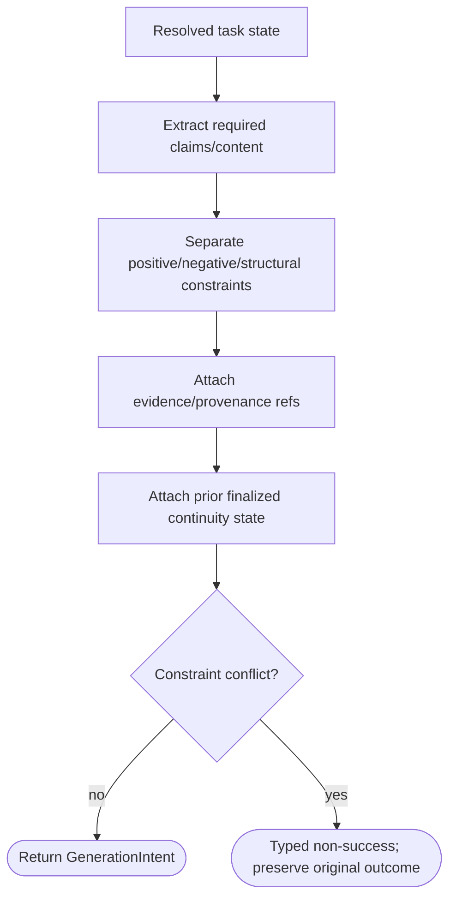

### Pseudocode

```text
function BUILD_GENERATION_INTENT(state):
  gi = GenerationIntent(
    goal=state.goal,
    claims=REQUIRED_CLAIMS(state),
    attractors=EXPLICIT_POSITIVE_CONSTRAINTS(state),
    repulsors=EXPLICIT_OR_POLICY_NEGATIVE_CONSTRAINTS(state),
    evidence_refs=state.evidence_refs,
    continuity=state.finalized_continuity)
  REQUIRE(not CONFLICTS(gi), CONSTRAINT_CONFLICT)
  return gi
```

### Invariants

- Intent is authoritative output contract.
- Repulsors derive from explicit intent or applicable policy.
- Evidence refs preserved through generation.

### Typed failures

- `AUTHORIZATION_DENIED`
- `BUDGET_EXHAUSTED`
- `CONSTRAINT_CONFLICT`
- `INCOMPATIBLE_CONFIGURATION`
- `INSUFFICIENT_EVIDENCE`
- `INTERNAL_FAILURE`
- `NEEDS_CLARIFICATION`
- `RECOVERY_REQUIRED`
- `VALIDATION_FAILED`

### Forbidden edges

- ✕ Output engine -> Redefine intent
- ✕ Critical constraints -> Reduced to vague free-text prompt
- ✕ Negative constraint -> Invented preference

### Optimization notes

- Use structured fields/IDs; free-text prompt is a presentation/debug view, not the source of truth.

## 19. Directional Guidance

**ID:** `directional_guidance`<br>
**Owner:** Generation/training objective layer<br>
**Status:** `research-policy`; implementation: `design-only`<br>
**Purpose:** Applies attraction toward requested properties and repulsion from explicitly unwanted/policy-constrained targets without erasing generic requested traits.

**Inputs:** `GenerationIntent`; `CandidateState`; `GuidanceBudget`<br>
**Outputs:** `GuidedState`; `ConstraintMetrics`<br>
**Logic metrics:** 7 nodes · 7 transitions · 2 decisions · normalized cyclomatic complexity 3

### Flowchart

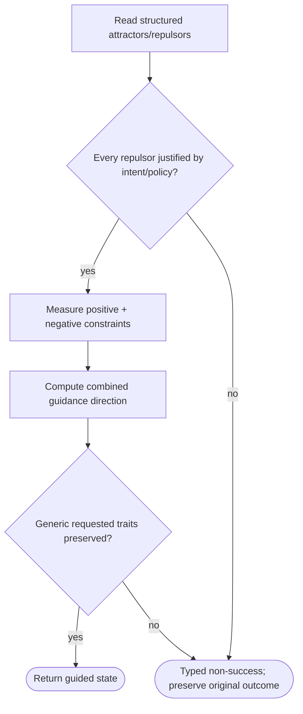

### Pseudocode

```text
function GUIDE(state, intent):
  REQUIRE(ALL_REPULSORS_JUSTIFIED(intent), CONSTRAINT_CONFLICT)
  objective = POSITIVE_LOSS(intent.attractors) + NEGATIVE_PENALTY(intent.repulsors)
  guided = OPTIMIZE_STATE(state, objective)
  REQUIRE(PRESERVES_GENERIC_TRAITS(guided, intent), VALIDATION_FAILED)
  return RESULT(SUCCESS, guided)
```

### Invariants

- Positive/negative intent remains separable.
- Implementation may use combined descent objective; literal ascent is optional.
- Constraint source is auditable.

### Typed failures

- `AUTHORIZATION_DENIED`
- `BUDGET_EXHAUSTED`
- `CONSTRAINT_CONFLICT`
- `INCOMPATIBLE_CONFIGURATION`
- `INSUFFICIENT_EVIDENCE`
- `INTERNAL_FAILURE`
- `RECOVERY_REQUIRED`
- `VALIDATION_FAILED`

### Forbidden edges

- ✕ Guidance -> Invent negative preference
- ✕ Repulsion -> Blanket suppression of generic requested concept
- ✕ Specific identity avoidance -> Erase unrelated traits

### Optimization notes

- Combine objectives into one scoring pass where possible; avoid separate full model passes per constraint.

## 20. DARP / Segmented Diffusion Output

**ID:** `darp`<br>
**Owner:** Optional output research mechanism<br>
**Status:** `research`; implementation: `design-only`<br>
**Purpose:** Refines each output segment as a whole, then presents finalized segments autoregressively with explicit continuity state.

**Inputs:** `GenerationIntent`; `PriorFinalizedState`; `ModalityCapability`; `RefinementBudget`<br>
**Outputs:** `FinalizedSegment`; `CarryForwardContinuity`<br>
**Logic metrics:** 9 nodes · 9 transitions · 2 decisions · normalized cyclomatic complexity 3

### Flowchart

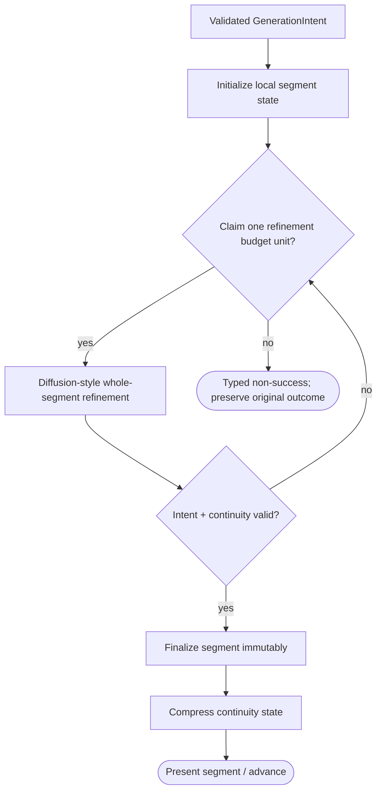

### Pseudocode

```text
function DARP_SEGMENT(intent, prior, budget):
  z = TRY(INIT_SEGMENT(intent, prior))
  while BUDGET.claim(REFINE_COST, budget):
    z = TRY(REFINE(z, intent, prior))
    if VALID(z, intent, prior):
      final = FINALIZE(z)
      return RESULT(SUCCESS, final, COMPACT_CONTINUITY(final))
    REQUIRE(PROGRESSING(z), VALIDATION_FAILED)
  return RESULT(BUDGET_EXHAUSTED)
# AR fallback requires its own budget and the same applicable output constraints.
```

### Invariants

- Within-segment refinement; between-segment presentation is autoregressive.
- Finalized segment conditions future continuity.
- Baseline AR output uses equivalent applicable validation.

### Typed failures

- `AUTHORIZATION_DENIED`
- `BUDGET_EXHAUSTED`
- `CAPABILITY_UNAVAILABLE`
- `CONSTRAINT_CONFLICT`
- `INCOMPATIBLE_CONFIGURATION`
- `INSUFFICIENT_EVIDENCE`
- `INTERNAL_FAILURE`
- `RECOVERY_REQUIRED`
- `VALIDATION_FAILED`

### Forbidden edges

- ✕ DARP -> Prerequisite for overlay proof
- ✕ Unfinalized draft -> Authoritative task state
- ✕ DARP -> Redefine GenerationIntent

### Optimization notes

- Refine in latent/segment space; avoid repeated full textual drafts if equivalent latent updates suffice.

## 21. Multimodal Space + ABI

**ID:** `multimodal`<br>
**Owner:** Multimodal runtime boundary<br>
**Status:** `planned`; implementation: `design-only`<br>
**Purpose:** Provides typed modality representations and lineage without creating separate independent minds for each modality.

**Inputs:** `ArtifactRef|Stream`; `ModalityType`; `CoreIntent`; `CapabilityRef`<br>
**Outputs:** `MultimodalRef`; `GeneratedArtifactRef`; `ContinuityState`<br>
**Logic metrics:** 10 nodes · 10 transitions · 2 decisions · normalized cyclomatic complexity 3

### Flowchart

```mermaid
flowchart TD
  n_start["Input artifact or Core intent"]
  n_abi["Resolve modality + ABI version"]
  n_encode["Encode/project typed representation"]
  n_valid{"Representation valid?"}
  n_store["Store MultimodalRef + lineage"]
  n_core["Expose selected representation to Core"]
  n_decode{"Generation requested?"}
  n_generate["Decode/generate artifact"]
  n_done(["Return refs + continuity"])
  n_fail(["Typed non-success; preserve original outcome"])
  n_start --> n_abi
  n_abi --> n_encode
  n_encode --> n_valid
  n_valid -->|"yes"| n_store
  n_valid -->|"no"| n_fail
  n_store --> n_core
  n_core --> n_decode
  n_decode -->|"yes"| n_generate
  n_decode -->|"no"| n_done
  n_generate --> n_done
```

### Pseudocode

```text
function MULTIMODAL_BRIDGE(item, intent=None):
  abi = RESOLVE_MODALITY_ABI(item.type)
  ref = ENCODE_AND_VALIDATE(item, abi)
  STORE_LINEAGE(ref)
  if intent and intent.generate: return GENERATE_AND_VALIDATE(ref, intent, abi)
  return RESULT(SUCCESS, ref)
```

### Invariants

- Typed representation versioned.
- Artifact lineage preserved.
- Identity/spatial/temporal continuity validated when task requires it.

### Typed failures

- `ABI_MISMATCH`
- `AUTHORIZATION_DENIED`
- `BUDGET_EXHAUSTED`
- `CONSTRAINT_CONFLICT`
- `CONTINUITY_VALIDATION_FAILED`
- `ENCODE_FAILED`
- `INCOMPATIBLE_CONFIGURATION`
- `INSUFFICIENT_EVIDENCE`
- `INTERNAL_FAILURE`
- `MODALITY_UNSUPPORTED`
- `RECOVERY_REQUIRED`
- `VALIDATION_FAILED`

### Forbidden edges

- ✕ Modality overlay -> Required Core identity
- ✕ Artifact -> Lose lineage
- ✕ Transient modality state -> Automatic memory/training

### Optimization notes

- Keep large artifacts out of active context; pass immutable refs plus compact embeddings/metadata.

## 22. Tool / External Action Boundary

**ID:** `action_boundary`<br>
**Owner:** Nexus-governed executor boundary<br>
**Status:** `canonical`; implementation: `partial-simulator`<br>
**Purpose:** Prevents replay from duplicating side effects by separating action proposal, authorization, idempotent execution, commit evidence and reconciliation.

**Inputs:** `ActionRequest`; `AuthorizationToken`; `ToolCapabilityDescriptor`; `ActionLedger`<br>
**Outputs:** `ActionResult`; `ActionCommitRecord`; `Observation`<br>
**Logic metrics:** 10 nodes · 12 transitions · 3 decisions · normalized cyclomatic complexity 5

### Flowchart

```mermaid
flowchart TD
  n_start["ActionRequest proposal"]
  n_schema["Validate action schema/capability"]
  n_auth{"Nexus authorized?"}
  n_key["Check key binds same task and payload"]
  n_committed{"Matching committed receipt exists?"}
  n_uncertain{"Uncertain record exists?"}
  n_execute["Persist PENDING then UNCERTAIN before mock effect"]
  n_record["Verify receipt and persist COMMITTED"]
  n_done(["Return observation / prior receipt"])
  n_fail(["Typed non-success; preserve original outcome"])
  n_start --> n_schema
  n_schema --> n_auth
  n_auth -->|"yes"| n_key
  n_auth -->|"no"| n_fail
  n_key --> n_committed
  n_committed -->|"yes"| n_done
  n_committed -->|"no"| n_uncertain
  n_uncertain -->|"yes"| n_fail
  n_uncertain -->|"no"| n_execute
  n_execute --> n_record
  n_record -->|"committed"| n_done
  n_record -->|"uncertain"| n_fail
```

### Pseudocode

```text
function EXECUTE_ACTION(req, ledger, world):
  TRY(VALIDATE(req))
  REQUIRE(AUTHORIZE(req), AUTHORIZATION_DENIED)
  key = IDEMPOTENCY_KEY(req)
  old = ledger.lookup(key)
  REQUIRE(old is None or SAME_TASK_AND_PAYLOAD(old, req), CONSTRAINT_CONFLICT)
  if old and old.status == COMMITTED:
    REQUIRE(VALID_RECEIPT(old, world), VALIDATION_FAILED)
    return RESULT(SUCCESS, old.receipt)
  if old and old.status == UNCERTAIN: return RESULT(RECOVERY_REQUIRED)
  ledger.persist(PENDING, req, key)
  ledger.persist(UNCERTAIN, req, key)  # Before invoking any effect.
  receipt = TRY(IDEMPOTENT_EXECUTE(world, req, key))
  ledger.commit(key, receipt)
  return RESULT(SUCCESS, receipt)
# Startup marks abandoned PENDING uncertain. Explicit reconciliation uses receipts.
# Ledger.perform models local effects only; real scoped authorization is not implemented.
```

### Invariants

- Committed actions have durable evidence.
- Idempotency scope explicit.
- Uncertain effects block automatic replay until reconciled.

### Typed failures

- `ACTION_FAILED`
- `ACTION_RECONCILIATION_REQUIRED`
- `ACTION_UNCERTAIN`
- `AUTHORIZATION_DENIED`
- `BUDGET_EXHAUSTED`
- `CAPABILITY_UNAVAILABLE`
- `CONSTRAINT_CONFLICT`
- `INCOMPATIBLE_CONFIGURATION`
- `INSUFFICIENT_EVIDENCE`
- `INTERNAL_FAILURE`
- `RECOVERY_REQUIRED`
- `VALIDATION_FAILED`

### Forbidden edges

- ✕ Replay -> Repeat committed side effect
- ✕ Core -> Direct tool execution
- ✕ Uncertain action -> Blind automatic retry
- ✕ Checkpoint restore -> Pretend outside world rolled back

### Optimization notes

- One idempotency lookup before execution; keep action payload digest canonical to avoid duplicate semantic work.

## 23. Checkpoint + Recovery

**ID:** `checkpoint_recovery`<br>
**Owner:** Recovery runtime<br>
**Status:** `implemented-partial`; implementation: `partial-simulator`<br>
**Purpose:** Restores a known-valid configuration while replaying only safe computation and preserving externally committed effects.

**Inputs:** `FailureEvent`; `SourceCheckpoint`; `QualifiedTransition`; `ActionCommitRecords`; `Authorization`<br>
**Outputs:** `RecoveredCheckpoint`; `RecoveryReport`; `UnchangedSourceCheckpoint`<br>
**Logic metrics:** 12 nodes · 12 transitions · 2 decisions · normalized cyclomatic complexity 4

### Flowchart

```mermaid
flowchart TD
  n_start["Lookup attempt and requested scope"]
  n_status{"Attempt status?"}
  n_historical(["Return prior published result; no new replay"])
  n_guard["Recheck authorization source ECID and actions"]
  n_edge["Verify qualified directed edge and scope"]
  n_phase{"Prepared or staged?"}
  n_rebuild["Reuse or replay from portable inputs"]
  n_stage["Durably stage target"]
  n_validate["Revalidate staged target and load"]
  n_publish["CAS source; atomically publish pointer and status"]
  n_done(["Return new result and accurate replay flag"])
  n_fail(["Typed non-success; preserve original outcome"])
  n_start --> n_status
  n_status -->|"PUBLISHED"| n_historical
  n_status -->|"FAILED or mismatched request"| n_fail
  n_status -->|"new PREPARED or STAGED"| n_guard
  n_guard -->|"success"| n_edge
  n_edge -->|"success"| n_phase
  n_phase -->|"PREPARED"| n_rebuild
  n_phase -->|"STAGED"| n_validate
  n_rebuild -->|"success"| n_stage
  n_stage -->|"success"| n_validate
  n_validate -->|"success"| n_publish
  n_publish -->|"success"| n_done
```

### Pseudocode

```text
function DURABLE_RECOVER(task, target, attempt_id):
  attempt = LOOKUP_ATTEMPT(attempt_id)
  if attempt is PUBLISHED: return HISTORICAL_PUBLISHED_RESULT_WITHOUT_SWITCHING_CURRENT(attempt)
  if attempt is FAILED: return STORED_TYPED_FAILURE(attempt)
  REQUIRE(AUTHORIZE(target), AUTHORIZATION_DENIED)
  source = TRY(VALIDATE_CURRENT_SOURCE(task))
  REQUIRE(REPLAY_SAFE(ledger, task), RECOVERY_REQUIRED)
  edge = TRY(QUALIFIED_DIRECTED_EDGE(source.profile, target))
  attempt = TRY(PREPARE_OR_VERIFY_BOUND_SCOPE(attempt, source, target, ACTION_KEYS(task)))
  if attempt is PREPARED:
    result = TRY(REUSE_OR_REPLAY(edge, source, target))
    TRY(STAGE_CHECKPOINT(attempt, result))
  else: TRY(REVALIDATE_STAGED_TARGET_AND_LOAD(attempt))
  REQUIRE(CURRENT_SOURCE_UNCHANGED(attempt), INCOMPATIBLE_CONFIGURATION)
  return TRY(ATOMIC_PUBLISH_CURRENT_AND_ATTEMPT(attempt))
# Source remains current until commit; failure returns current state or None if unreadable.
# An existing attempt must match task/destination; no implicit retry of FAILED attempts.
```

### Invariants

- Source stays current until target publication.
- Recovered deterministic result matches clean target execution where applicable.
- Every unpublished resume rechecks authorization.
- StageHandoff001 annotated checkpoints additionally bind the exact TaskRecord and handoff request; legacy v1 behavior is preserved.

### Typed failures

- `ACTION_UNCERTAIN`
- `AUTHORIZATION_DENIED`
- `BUDGET_EXHAUSTED`
- `CONSTRAINT_CONFLICT`
- `INCOMPATIBLE_CONFIGURATION`
- `INSUFFICIENT_EVIDENCE`
- `INTERNAL_FAILURE`
- `RECOVERY_REQUIRED`
- `STALE_STATE`
- `TRANSITION_UNQUALIFIED`
- `VALIDATION_FAILED`

### Forbidden edges

- ✕ Recovery -> Replay committed side effect
- ✕ Stale ECID -> Silent reuse
- ✕ Failed recovery -> Corrupt source
- ✕ Checkpoint -> External-world rollback claim

### Optimization notes

- Keep recovery path pure until durable staging; single atomic publication point minimizes partial-state cases.
- See docs/STAGE_HANDOFF_001.md for the bounded portable-record extension, not a full implementation of this flow.

## 24. Core Generation Upgrade

**ID:** `core_upgrade`<br>
**Owner:** Core training + migration governance<br>
**Status:** `planned-rare`; implementation: `design-only`<br>
**Purpose:** Produces a new foundational Core generation as a new artifact identity rather than mutating the live Core.

**Inputs:** `FoundationalChangeProposal`; `ApprovedCorpus`; `EvaluationSuite`; `MigrationPlan`<br>
**Outputs:** `NewCoreGeneration`; `QualificationEvidence`; `MigrationArtifacts`<br>
**Logic metrics:** 12 nodes · 14 transitions · 4 decisions · normalized cyclomatic complexity 5

### Flowchart

```mermaid
flowchart TD
  n_start["Foundational change proposal"]
  n_approve{"Explicit approval?"}
  n_train["Train new Core candidate"]
  n_qual["Independent Core qualification"]
  n_passq{"Release thresholds met?"}
  n_migrate["Design memory/overlay/state migration"]
  n_assume{"Old overlays assumed compatible?"}
  n_identity["Run behavioral identity continuity eval"]
  n_newid["Assign new generation/package IDs"]
  n_done(["Deploy through Nexus"])
  n_fail(["Typed non-success; preserve original outcome"])
  n_releasegate{"Migration tests pass and deployment authorized?"}
  n_start --> n_approve
  n_approve -->|"yes"| n_train
  n_approve -->|"no"| n_fail
  n_train --> n_qual
  n_qual --> n_passq
  n_passq -->|"yes"| n_migrate
  n_passq -->|"no"| n_fail
  n_migrate --> n_assume
  n_assume -->|"yes"| n_fail
  n_assume -->|"no"| n_identity
  n_identity --> n_newid
  n_newid --> n_releasegate
  n_releasegate -->|"yes"| n_done
  n_releasegate -->|"no"| n_fail
```

### Pseudocode

```text
function UPGRADE_CORE(proposal, current):
  REQUIRE(AUTHORIZE_TRAINING(proposal), AUTHORIZATION_DENIED)
  candidate = TRY(TRAIN_NEW_CORE(proposal))
  REQUIRE(QUALIFIED(candidate), QUALIFICATION_FAILED)
  plan = TRY(EXPLICIT_MIGRATION_PLAN(current, candidate))
  REQUIRE(not plan.assumes_compatibility, COMPATIBILITY_UNKNOWN)
  evidence = TRY(EVALUATE_MIGRATION_AND_BEHAVIORAL_CONTINUITY(current, candidate, plan))
  REQUIRE(ACCEPTANCE_THRESHOLDS_MET(evidence), MIGRATION_UNSAFE)
  REQUIRE(AUTHORIZE_DEPLOYMENT(candidate, plan, evidence), AUTHORIZATION_DENIED)
  return TRY(RELEASE_NEW_GENERATION(candidate, plan, evidence, preserve=current))
```

### Invariants

- Old Core remains untouched/recoverable.
- New generation receives new identity.
- Compatibility and behavioral continuity are independently evaluated.

### Typed failures

- `AUTHORIZATION_DENIED`
- `BUDGET_EXHAUSTED`
- `COMPATIBILITY_UNKNOWN`
- `CONSTRAINT_CONFLICT`
- `INCOMPATIBLE_CONFIGURATION`
- `INSUFFICIENT_EVIDENCE`
- `INTERNAL_FAILURE`
- `MIGRATION_UNSAFE`
- `QUALIFICATION_FAILED`
- `RECOVERY_REQUIRED`
- `VALIDATION_FAILED`

### Forbidden edges

- ✕ Core G1 -> In-place mutation into G2
- ✕ New tokenizer/ABI -> Silent compatibility
- ✕ Lineage -> Automatic behavioral identity claim

### Optimization notes

- Keep migration mappings declarative; do not add compatibility shims into old Core weights.

## 25. Aegis Nexus Governance

**ID:** `nexus`  
**Owner:** LocalNexusPermissions002 host control; generic Aegis Runtime remains separate  
**Status:** Implemented local development protocol; implementation: `partial-simulator`  
**Purpose:** Partial NSS governance implementation: exact local probe grants only. See subordinate issue/use/reconciliation flows.

**Inputs:** Exact PermissionRequest; Current qualification/evidence refs; Local operator declarations
**Outputs:** Historical grant/receipt or point-in-time admission; Typed non-success without renewed authority
**Structural metrics:** 12 nodes; 17 transitions; normalized complexity 9. Not runtime proof.

### Flowchart

```mermaid
flowchart TD
  n_start["Exact request, grant, caller and executor"]
  n_validate["Validate exact request, grant and caller identity"]
  n_historyq{"Already COMMITTED?"}
  n_history(["Cross-check executor receipt; return history only"])
  n_live["Recheck expiry, revocation, evidence and unused status"]
  n_consume["Atomically consume: STARTED"]
  n_dispatch["Revalidate source; live dispatch check; append DISPATCHED"]
  n_execute["Rebuild fixed neural target; no new external effect"]
  n_stage["Atomically persist executor result and receipt"]
  n_finish["Read owner receipt; atomically append COMMITTED"]
  n_done(["Return completion; not production deployment"])
  n_bad(["Typed failure; spent attempt needs reconciliation"])
  n_start --> n_validate
  n_validate -->|"valid"| n_historyq
  n_validate -->|"invalid"| n_bad
  n_historyq -->|"yes"| n_history
  n_historyq -->|"no"| n_live
  n_live -->|"approved and unused"| n_consume
  n_live -->|"otherwise"| n_bad
  n_consume -->|"durable"| n_dispatch
  n_consume -->|"failed/interrupted"| n_bad
  n_dispatch -->|"admitted once"| n_execute
  n_dispatch -->|"revoked/expired/uncertain"| n_bad
  n_execute -->|"valid result"| n_stage
  n_execute -->|"failure"| n_bad
  n_stage -->|"durable receipt"| n_finish
  n_stage -->|"uncertain/interrupted"| n_bad
  n_finish -->|"durable completion"| n_done
  n_finish -->|"unavailable receipt"| n_bad
```

### Pseudocode

```text
VALIDATE(request, grant, exact_caller)
IF COMMITTED: REQUIRE(owner_receipt_matches); RETURN history
AUTHORIZE(current_evidence, clock, unused_grant)
ATOMIC_PUBLISH(STARTED)
VALIDATE(real_source_state, existing_action_receipts)
AUTHORIZE(current_evidence, clock); ATOMIC_PUBLISH(DISPATCHED)
result = fixed_neural_replay_without_external_actions()
ATOMIC_PUBLISH(executor_result_and_receipt)
ATOMIC_PUBLISH(COMMITTED_from_executor_receipt)
ON interruption: do_not_retry_consumed_grant
```

### Invariants

- Local declarations are not authentication; a host grant is not an Aegis Runtime permit.
- Grants bind exact caller/task/operation, source state, action receipts, qualification claim, numerical environment and code.
- Single-use consumption precedes dispatch; unresolved consumed attempts never automatically retry.
- History inspection and reconciliation do not renew current authority or data permissions.
- No production checkpoint publication, external action creation, delegation or deployment authority.

### Typed failures

- AUTHORIZATION_DENIED
- BUDGET_EXHAUSTED
- CONSTRAINT_CONFLICT
- INCOMPATIBLE_CONFIGURATION
- INSUFFICIENT_EVIDENCE
- RECOVERY_REQUIRED
- TRAINING_RESTRICTED
- VALIDATION_FAILED
- CAPABILITY_UNAVAILABLE

### Forbidden edges

- Permission owner cannot edit qualification, dataset, neural or action-owner SQL.
- Qualification certificate cannot replace an operation grant.
- A consumed grant cannot be reset to GRANTED.
- A caller-provided result cannot substitute for the executor owner receipt.

### Optimization notes

- Bounded fixed fixture scope; no unbounded request loop.
- Reuse semantic owner APIs, not duplicated SQL or cached authorization.
