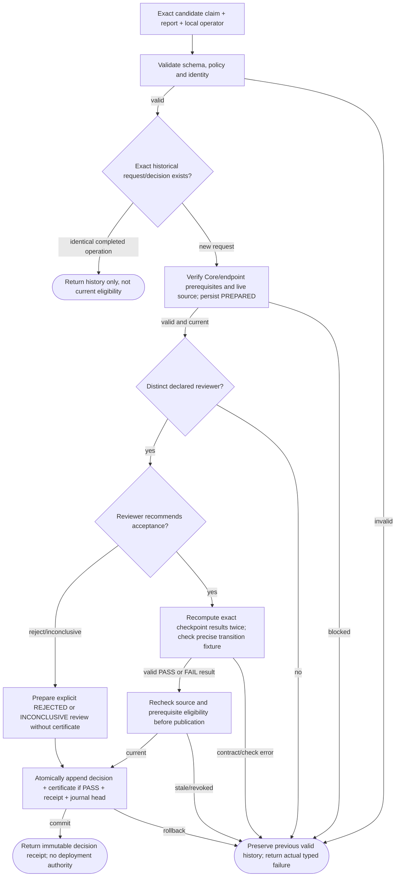
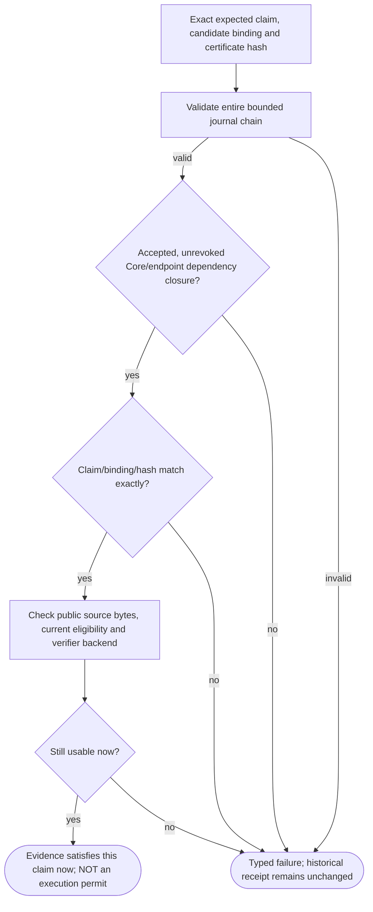
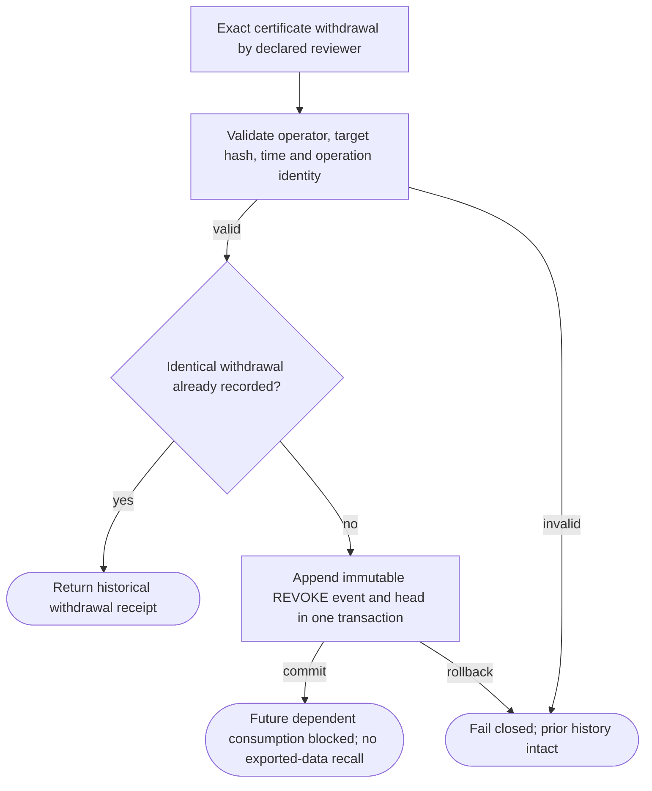

# QualificationEvidence002 — executable workflow logic

Trusted-local workflow, not authenticated authority. SUCCESS may return a rejected or inconclusive review record: only a QUALIFIED certificate can satisfy its exact claim. No result authorizes deployment.

## Qualification request, review and immutable issuance

**ID:** `qualification_review`  
**Owner:** QualificationEvidence002 local journal + built-in numerical evidence adapter  
**Status:** implemented trusted-local development workflow; authentication and independent scientific validation absent; implementation: `partial-simulator`  
**Purpose:** Exact claim review, current eligibility and durable history; no execution or deployment permit.

**Inputs:** PinnedQualificationRequest; LocalReviewerDecision; PublicProbeEvidence; ExactPrerequisiteRefs
**Outputs:** HistoricalReceipt; ClaimScopedCertificate or no certificate; CurrentUseObservation or typed failure
**Structural metrics:** 13 nodes; 18 transitions; normalized complexity 9. Not runtime proof.

### Flowchart



### Pseudocode

```text
VALIDATE(request and reviewer decision)
REQUIRE(distinct declared reviewer, AUTHORIZATION_DENIED)
if exact terminal retry: return historical receipt only
persist immutable request if absent
if accept: check exact artifacts with built-in numerical verifier; recheck prerequisites/source
else: record rejected or inconclusive decision; do not execute numerical checks
ATOMIC_PUBLISH(event, receipt, journal_head); return RESULT(SUCCESS, scoped decision)
```

### Invariants

- Exact Core-only and endpoint prerequisites required.
- Roles are local attestations, not authenticated identities.
- Candidate check and human decision are distinct.
- History does not restore source permission or claim eligibility.
- All mutations append an event and head in one transaction.
- No evaluation PASS self-promotes.

### Typed failures

- AUTHORIZATION_DENIED
- BUDGET_EXHAUSTED
- CONSTRAINT_CONFLICT
- INCOMPATIBLE_CONFIGURATION
- INSUFFICIENT_EVIDENCE
- RECOVERY_REQUIRED
- TRAINING_RESTRICTED
- VALIDATION_FAILED
- CAPABILITY_UNAVAILABLE

### Forbidden edges

- Producer -> own review
- Certificate -> implicit deployment
- AB approval -> inferred subset/reverse transition
- Qualification -> source SQL or report mutation
- Revoked evidence -> new use via historical retry

### Optimization notes

- Store exact source identities plus compact verification, not duplicate training tensors.
- One bounded event log owns decisions and revocation; no competing current/permission pointer.
- Check pinned bytes and fresh permissions at consumption; hashes do not authenticate hostile edits.

## Consume exact qualification with live revocation checks

**ID:** `qualification_consume`  
**Owner:** QualificationEvidence002 local journal + built-in numerical evidence adapter  
**Status:** implemented trusted-local development workflow; authentication and independent scientific validation absent; implementation: `partial-simulator`  
**Purpose:** Exact claim review, current eligibility and durable history; no execution or deployment permit.

**Inputs:** PinnedQualificationRequest; LocalReviewerDecision; PublicProbeEvidence; ExactPrerequisiteRefs
**Outputs:** HistoricalReceipt; ClaimScopedCertificate or no certificate; CurrentUseObservation or typed failure
**Structural metrics:** 8 nodes; 10 transitions; normalized complexity 5. Not runtime proof.

### Flowchart



### Pseudocode

```text
VALIDATE(journal chain)
REQUIRE(exact accepted dependency closure, INSUFFICIENT_EVIDENCE)
REQUIRE(not revoked, AUTHORIZATION_DENIED)
REQUIRE(exact scope and bindings, INCOMPATIBLE_CONFIGURATION)
recheck public source eligibility and verifier backend
return RESULT(SUCCESS, evidence_observation_without_permit)
```

### Invariants

- Exact Core-only and endpoint prerequisites required.
- Roles are local attestations, not authenticated identities.
- Candidate check and human decision are distinct.
- History does not restore source permission or claim eligibility.
- All mutations append an event and head in one transaction.
- No evaluation PASS self-promotes.

### Typed failures

- AUTHORIZATION_DENIED
- BUDGET_EXHAUSTED
- CONSTRAINT_CONFLICT
- INCOMPATIBLE_CONFIGURATION
- INSUFFICIENT_EVIDENCE
- RECOVERY_REQUIRED
- TRAINING_RESTRICTED
- VALIDATION_FAILED
- CAPABILITY_UNAVAILABLE

### Forbidden edges

- Producer -> own review
- Certificate -> implicit deployment
- AB approval -> inferred subset/reverse transition
- Qualification -> source SQL or report mutation
- Revoked evidence -> new use via historical retry

### Optimization notes

- Store exact source identities plus compact verification, not duplicate training tensors.
- One bounded event log owns decisions and revocation; no competing current/permission pointer.
- Check pinned bytes and fresh permissions at consumption; hashes do not authenticate hostile edits.

## Withdraw claim without deleting accepted history

**ID:** `qualification_revoke`  
**Owner:** QualificationEvidence002 local journal + built-in numerical evidence adapter  
**Status:** implemented trusted-local development workflow; authentication and independent scientific validation absent; implementation: `partial-simulator`  
**Purpose:** Exact claim review, current eligibility and durable history; no execution or deployment permit.

**Inputs:** PinnedQualificationRequest; LocalReviewerDecision; PublicProbeEvidence; ExactPrerequisiteRefs
**Outputs:** HistoricalReceipt; ClaimScopedCertificate or no certificate; CurrentUseObservation or typed failure
**Structural metrics:** 7 nodes; 7 transitions; normalized complexity 4. Not runtime proof.

### Flowchart



### Pseudocode

```text
VALIDATE(revocation)
REQUIRE(declared reviewer, AUTHORIZATION_DENIED)
if exact retry: return history
REQUIRE(exact accepted certificate hash, CONSTRAINT_CONFLICT)
ATOMIC_PUBLISH(revoke_event, receipt, journal_head)
all future uses re-evaluate dependency revocation; return RESULT(SUCCESS, withdrawal_receipt)
```

### Invariants

- Exact Core-only and endpoint prerequisites required.
- Roles are local attestations, not authenticated identities.
- Candidate check and human decision are distinct.
- History does not restore source permission or claim eligibility.
- All mutations append an event and head in one transaction.
- No evaluation PASS self-promotes.

### Typed failures

- AUTHORIZATION_DENIED
- BUDGET_EXHAUSTED
- CONSTRAINT_CONFLICT
- INCOMPATIBLE_CONFIGURATION
- INSUFFICIENT_EVIDENCE
- RECOVERY_REQUIRED
- TRAINING_RESTRICTED
- VALIDATION_FAILED
- CAPABILITY_UNAVAILABLE

### Forbidden edges

- Producer -> own review
- Certificate -> implicit deployment
- AB approval -> inferred subset/reverse transition
- Qualification -> source SQL or report mutation
- Revoked evidence -> new use via historical retry

### Optimization notes

- Store exact source identities plus compact verification, not duplicate training tensors.
- One bounded event log owns decisions and revocation; no competing current/permission pointer.
- Check pinned bytes and fresh permissions at consumption; hashes do not authenticate hostile edits.
